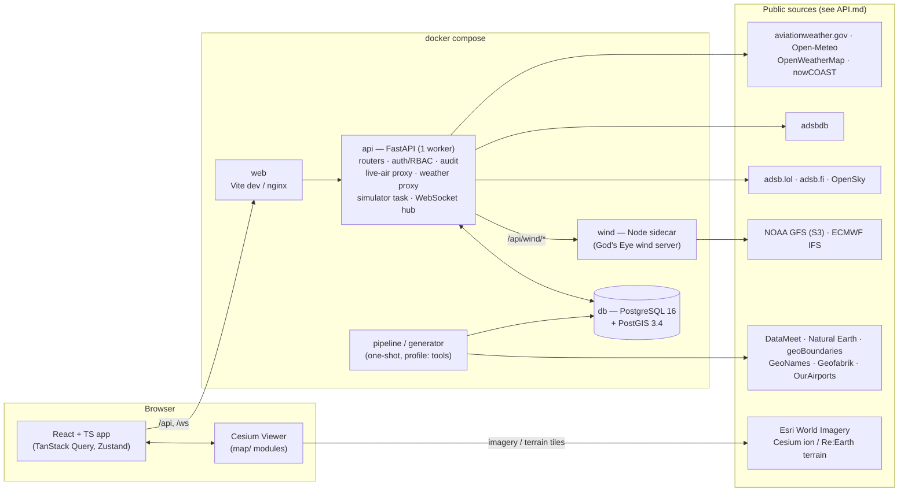

# ARCHITECTURE: iaf-airops Phase 1

> **Update 2026-10-16:** the map engine is now **MapLibre GL** (flat map), the theme is navy + neon blue with the official IAF crest, and the tick simulator is switched off for Phase 1. See ARCHITECTURE §18 D19–D21. Where this document still describes CesiumJS, Cesium ion, the olive/amber theme or live simulation on the map, D19–D21 take precedence.


| | |
|---|---|
| Status | Draft v0.1, 2026-10-16 |
| Implements | [PRD](PRD.md) |
| Related | [DATA_MODEL](DATA_MODEL.md), [API](API.md), [DESIGN_SYSTEM](DESIGN_SYSTEM.md) |

---

## 1. Context and constraints
- **Deployment target:** a single-machine hackathon demo (one laptop), run via `docker compose`. Internet is assumed; offline mode is a "could".
- **Phase 1 only:** inventory system, synthetic data, map dashboard, tick simulator. No decision-support logic.
- **One FastAPI backend process** hosts REST, WebSocket, simulator and feed proxies. **Ceiling:** one uvicorn worker, because the simulator and WebSocket hub live in-process. **Upgrade path:** move the simulator to its own process and use Postgres `LISTEN/NOTIFY` or Redis pub/sub.
- **Map code is reused from God's Eye View** (`../gods-eye-view`, MIT) wherever that is cheaper than writing new code. See the extraction table in §11.

---

## 2. System diagram



The browser never calls a keyed provider directly. The only browser-side credential is the Cesium ion token, which is public by design and URL-restricted.

---

## 3. Process model

| Process | Runs | Notes |
|---|---|---|
| `db` | `postgis/postgis:16-3.4` | volume `pgdata`; init script creates the app role with least privilege (no UPDATE/DELETE on `audit_log`) |
| `api` | `uvicorn app.main:app --workers 1` | lifespan starts: simulator task, METAR refresher task, ADS-B poller task, WebSocket hub |
| `wind` | `node server.mjs` (port 8787) | wraps God's Eye `server/providers/wind.js` handler in `node:http`; `api` proxies `/api/wind/*` to it |
| `web` | dev: `vite` · demo: `nginx` serving `frontend/dist` | proxies `/api` and `/ws` to `api` |
| `pipeline` | one-shot (`make pipeline`) | GDAL + osmium + Python; writes `gis_*` tables |
| `generator` | one-shot (`make seed`) | Python; writes all synthetic tables; runs post-generation checks |

---

## 4. Frontend

### 4.1 Stack
| Area | Choice |
|---|---|
| Core | React 18 + TypeScript (strict) + Vite 6 |
| Map | CesiumJS **1.138.0** (pinned; same version God's Eye runs), via `vite-plugin-cesium` |
| Server state | TanStack Query (REST cache). WebSocket events invalidate or patch query keys |
| UI state | Zustand: one small store for map UI (mode, layer toggles, selection, panel tab) |
| Routing | React Router |
| Tables and forms | TanStack Table; React Hook Form + Zod (schemas generated from OpenAPI where possible) |
| Symbology and icons | canvas-drawn airfield badges and map icons (`map/symbols.ts`, D23); Lucide for UI icons |
| Fonts | `@fontsource/b612`, `@fontsource/b612-mono` (self-hosted, no CDN) |
| API types | `openapi-typescript` generates `src/api/types.ts` from FastAPI's OpenAPI |

### 4.2 Routes
| Path | Screen | Roles |
|---|---|---|
| `/login` | Login + disclaimer | public |
| `/map` | Map + layer panel + side panel (default after login) | all |
| `/overview` | Command overview | all |
| `/inventory/:entity` | Tables + CRUD forms. `aircraft` opens on one card per aircraft type (`GET /inv/aircraft/by-type`) | all (edit per RBAC) |
| `/inventory/aircraft/:typeId` | The aircraft table filtered to one type, with breadcrumb and back to the type cards | all (edit per RBAC) |
| `/pilots`, `/pilots/:id` | Aircrew list and profile | all |
| `/alerts` | Alert list | all |
| `/audit` | Audit log + diff viewer | ADMIN, COMMAND_HQ, BASE_COMMANDER (own base, proposed) |
| `/admin` | Users, simulator controls | ADMIN |

### 4.3 Cesium integration rules
- **One Viewer, one owner.** `MapProvider` creates the viewer once. It is idempotent under React StrictMode: it checks a module-level ref, and `destroy()` runs only on real unmount. React components get the viewer through context and **never keep Cesium objects in React state**.
- **Layer module contract** (plain TS, under `frontend/src/map/layers/`):
  ```ts
  interface MapLayer<TData> {
    id: string;
    attach(viewer: Cesium.Viewer): void;   // create collections / data sources
    setData(data: TData): void;            // diff-update in place (no flicker)
    setVisible(visible: boolean): void;
    setOpacity?(alpha: number): void;
    pick?(picked: unknown): Selection | null; // map a Cesium pick to {kind, id}
    detach(): void;
  }
  ```
- **Large point sets** use `BillboardCollection` / `PointPrimitiveCollection` / `LabelCollection` (primitives), not `Entity`. Polygons and lines use `GroundPrimitive` / `GroundPolylinePrimitive` with pre-built geometry instances.
- **Render on demand.** `scene.requestRenderMode = true` plus the ported `renderGovernor` (`requestRender(reason)`, `holdContinuousRender(owner)` while animating tracks or wind).
- **Picking.** A single `ScreenSpaceEventHandler` in `map/selection.ts` asks each visible layer's `pick()`, then writes `{kind, id}` to the Zustand selection. The side panel reacts to that.
- **Region lock** (`map/regionLock.ts`):
  - `globe.cartographicLimitRectangle = Rectangle.fromDegrees(60, 0, 105, 42)`.
  - `screenSpaceCameraController.maximumZoomDistance ≈ 9,000 km`.
  - A `camera.changed` / `moveEnd` clamp pulls the camera centre back inside the box.
  - The imagery provider `rectangle` is limited to the box.
  - The bbox values come only from `shared/region.json`.
- **Colours.** `map/colors.ts` reads the CSS tokens once via `getComputedStyle` and converts them to `Cesium.Color`.

### 4.4 Frontend module map
```
frontend/src/
  app/            # shell, routes, providers, auth guard, ClassificationBanner, TopBar
  api/            # generated types, fetch client, query keys, ws client
  map/
    viewer.ts  renderGovernor.ts  regionLock.ts  basemaps.ts  terrain.ts  colors.ts
    selection.ts  lod.ts
    camera/      tilt.ts  groundGuard.ts  flyTo.ts
    symbology/   sidc.ts  symbolCache.ts          # milsymbol → canvas → billboard
    layers/      boundaries.ts places.ts bases.ts algs.ts civilAirports.ts
                 radars.ts airDefence.ts comms.ts telecomTowers.ts roads.ts rail.ts
                 liveAir.ts simTracks.ts metar.ts owmTiles.ts irClouds.ts
                 wind/ (ported God's Eye JS + .d.ts shim)
    hud/         Hud.tsx  FeedChips.tsx
  features/
    layer-panel/  mode-switcher/  base-panel/  info-card/  search/
    overview/  inventory/  pilots/  alerts/  audit/  admin/  weather-popover/  terrain/
  components/     # KpiTile, StatusPill, FuelGauge, DataTable, EntityForm, SimBadge…
  styles/         # tokens.css, base.css
  vendor/godseye/ # verbatim ports that keep their MIT header (only reached via map/ adapters)
```

---

## 5. Backend

### 5.1 Stack
- Python 3.12, FastAPI, Pydantic v2, SQLAlchemy 2 (async) + GeoAlchemy2, asyncpg, Alembic.
- httpx (async) for upstream calls; argon2-cffi; PyJWT; structlog.
- pytest + pytest-asyncio for tests.

### 5.2 Module map
```
backend/app/
  main.py          # app factory, lifespan (sim, pollers, ws hub), routers
  config.py        # pydantic-settings from env
  db.py            # engine, session, app-role
  models.py        # SINGLE schema source (DATA_MODEL §3)
  schemas/         # Pydantic in/out per entity
  auth/            # login, JWT cookie, password hashing, lockout
  rbac.py          # Depends(require(role, scope)) — base/command scoping
  audit.py         # audit(session, actor, action, entity, before, after)
  crud.py          # crud_router(Model, In, Out, scope_fn) factory: list/get/create/update/retire
  routers/         # bases, summary, overview, inventory/*, pilots, sorties, alerts, audit, users, sim, gis, search
  live/            # providers.py readsb.py opensky.py normalise.py classify.py military.py enrich.py poller.py
  weather/         # metar.py openmeteo.py owm_proxy.py ir_proxy.py wind_proxy.py
  sim/             # engine.py clock.py programme.py sorties.py aircraft.py fuel.py crew.py qra.py unknowns.py faults.py alerts.py kpi.py invariants.py
  ws.py            # hub: topics, seq numbers, auth on handshake
backend/generator/ # config.yaml, load_curated.py, fleet.py, crew.py, history.py, sites.py, checks.py, __main__.py
backend/alembic/
backend/tests/
```

### 5.3 Route summary (`/api/v1`)
| Group | Routes |
|---|---|
| Auth | `POST /auth/login`, `POST /auth/logout`, `GET /auth/me` |
| Map data | `GET /bases?side=&command=` (GeoJSON-ish list), `GET /bases/{id}/summary` (side panel, from `v_base_summary`), `GET /bases/{id}/public` (foreign/other-mil card), `GET /sites/{radars,ad,comms}?bbox=` |
| GIS | `GET /gis/{admin0,admin1,admin2,places,roads,rail,towers,civil_airports}?bbox=&bucket=lo\|mid\|hi`. Returns GeoJSON with a feature cap, an ETag and long cache headers |
| Inventory CRUD (generic factory) | `/aircraft`, `/aircrew`, `/ground-crew`, `/ground-assets`, `/fuel-storage`, `/fuel-transactions`, `/warehouses`, `/stock-levels`, `/ad-batteries`, `/radars`, `/comms-nodes`, `/runways`, `/parking`, `/squadrons`, `/missions`, `/sorties`. Each supports `GET` list (filters, sort, page), `GET /{id}`, `POST`, `PATCH /{id}` (requires `version`), `POST /{id}/retire`, `DELETE /{id}` (only if unreferenced) |
| Pilots | `GET /aircrew/{id}/profile` (hours by type, quals, currency, fatigue, postings), `GET /aircrew/{id}/sorties` |
| Overview | `GET /overview` (theatre), `GET /commands/{code}/kpis`, `GET /kpi-snapshots?scope=&id=&metric=` |
| Alerts and audit | `GET /alerts`, `POST /alerts/{id}/ack`, `GET /audit?actor=&entity=&base=&from=&to=` |
| Live air | `GET /live/aircraft?bbox=` (normalised tracks), `GET /live/aircraft/{hex}/enrich`, `GET /live/status` (per-provider health) |
| Weather | `GET /wx/metar?bbox=` / `?base=`, `GET /wx/taf?ids=`, `GET /wx/point?lat=&lon=`, `GET /wx/owm/{layer}/{z}/{x}/{y}.png`, `GET /wx/ir/wms?...`, `GET /wind/*` (proxy to sidecar) |
| Simulator | `GET /sim/state`, `POST /sim/{pause,resume,step,speed,reseed}` (ADMIN) |
| Search | `GET /search?q=` (bases, ICAO, tail numbers, aircrew) |
| WebSocket | `GET /ws` (cookie-authenticated) |

### 5.4 Cross-cutting rules
- **RBAC.** Every mutating route depends on `require(...)` plus a scope function. For example, `aircraft` is scoped by `home_base_id`, `aircrew` by `base_id`, and `sortie` by `departure_base_id`.
- **Audit.** `audit()` is called inside the same DB transaction as the change. `crud_router` does this automatically. The simulator calls it per changed entity with `actor_type = SIMULATOR`.
- **Optimistic locking.** `PATCH` requires `version` and returns 409 on mismatch.
- **Errors.** Every error uses `{error: {code, message, details}}`. Validation errors map field paths for the forms.
- **Logging.** Structured logs with a request id. Secrets are never logged.

---

## 6. Live-air subsystem

### 6.1 Provider chain (verified 2026-10-16; see [API §1](API.md#1-live-aircraft))
| Role | Provider | Used for | Notes |
|---|---|---|---|
| Primary (merged) | adsb.lol | viewport point queries `/v2/point/{lat}/{lon}/{nm}` + `/v2/mil` | keyless; ODbL; dynamic rate limits |
| Primary (merged) | adsb.fi | point query `/api/v2/lat/{lat}/lon/{lon}/dist/{nm}` + `/api/v2/mil` | keyless; ~1 req/s; **point responses use the key `aircraft`, `/mil` uses `ac`** |
| Snapshot + fallback | OpenSky | theatre bbox snapshot `/api/states/all?lamin=0&lomin=60&lamax=42&lomax=105` every 60–90 s | anonymous works (returned 372 states for the bbox); OAuth2 client credentials recommended for credits |
| Optional | airplanes.live | same readsb shape | **returns 403 without prior approval**; enable only if access is granted |

**Why merge rather than fail over.** On 2026-10-16 at 00:28 IST, a 250 NM query over Delhi returned 29 aircraft from adsb.lol and 71 from adsb.fi, from different feeder networks. Merging both, de-duplicated by hex with the freshest position winning, gives the best picture. If one provider is down, the other continues.

### 6.2 Poller (`live/poller.py`)
- **Viewport-driven.** The frontend reports its view bbox (throttled to 1 per 2 s). The poller covers it with at most `ADSB_MAX_CIRCLES` (default 4) circles of 250 NM. With no active viewers, it polls a default set of circles over India every 30 s.
- **Military feed.** `/v2/mil` is polled every 30 s and filtered to the region bbox. The hex codes go into the military registry. This ports God's Eye's `createMilitaryRegistry`: sticky, add-only per session, and `dbFlags & 1` also counts as military.
- **Caching and resilience:**
  - Per-provider cache of 10–12 s.
  - Identical in-flight requests are coalesced (port of God's Eye `coalesceProxyRequest`).
  - `Retry-After`-aware backoff.
  - Serve stale data on error.
  - A provider is marked OFF after 2 consecutive failures and retried with backoff. The other providers keep feeding the merge.
- **Output.** A merged, de-duplicated (by hex, freshest position wins) track list, kept in memory and served by `GET /live/aircraft?bbox=`. The frontend polls this every 10 s (Live mode only).

### 6.3 Normalised track schema
```json
{ "hex": "800c4d", "callsign": "AIC101", "reg": "VT-ALJ", "icao_type": "B77W",
  "category": "CIVIL|CARGO|MILITARY|HELICOPTER|UAV|DRONE",
  "lat": 28.6, "lon": 77.2, "alt_m": 10668, "on_ground": false,
  "gs_kt": 470, "track_deg": 312, "vr_mps": 0.0, "squawk": "1234",
  "emitter_cat": "A5", "is_military": false, "emergency": null,
  "source": "adsb.lol", "ts": "2026-10-16T05:12:03Z", "age_s": 3, "simulated": false }
```
- **Normalisers:**
  - `readsb.py` handles adsb.lol, adsb.fi and airplanes.live. It accepts `ac` or `aircraft` arrays; `alt_baro` may be the string `"ground"`.
  - `opensky.py` handles positional state-vector arrays. Port of God's Eye `normalizeOpenSkyAircraft`: index 0 hex, 5/6 lon/lat, 7 baro alt, 13 geo alt, 14 squawk, 17 category.

### 6.4 Classification (`live/classify.py`)
Port of God's Eye `src/data/aircraftClass.js` (itself derived from *skylight*, MIT) and `src/data/aircraftEmergency.js`, extended:

1. **MILITARY:** hex in the military registry, or `dbFlags & 1`.
2. **UAV:**
   - ICAO type in the UAV list (`HERN`, `MQ9`, `RQ4`, `TB2`, `SRCH`…), or
   - emitter category `B6` with a fixed-wing type.
3. **DRONE:** emitter category `B6` with no type or a small rotary type, or a type in the small-UAS list.
4. **HELICOPTER:** ICAO type in the helicopter list, or emitter category `A7`.
5. **CARGO:**
   - operator ICAO code in `cargo_operators.csv` (e.g. `BDA` Blue Dart, `FDX`, `UPS`, `QTR` cargo flights by callsign pattern, `CKS`, `GTI`, `ABW`), or
   - a freighter type variant (`B77L` + cargo operator, `B744F`…).
6. **CIVIL:** everything else.

**Extend the type lists** with Indian types missing upstream: Jaguar, Tejas, C-130J (`C30J`), Il-76/78, C-295, ERJ-145 Netra, A-50, Mi-17 (`MI8`), ALH Dhruv, LCH, PC-7, Kiran, Do-228. Verify designators against ICAO Doc 8643.

**Emergency squawks:** 7500 / 7600 / 7700 set `emergency`.

### 6.5 Enrichment
`GET /live/aircraft/{hex}/enrich` calls adsbdb `/v0/aircraft/{hex}`, plus `/v0/callsign/{cs}` for the route. It is called only on click, and cached in an LRU (24 h, also caches misses).

### 6.6 Simulated tracks
- Computed by the simulator (DATA_MODEL §9) and pushed on WebSocket `tracks.sim` every tick.
- The frontend `simTracks.ts` interpolates between ticks: `SampledPositionProperty` with linear interpolation, extrapolating ≤ 1 tick.
- They are **never mixed into** `/live/aircraft`. The two layers are separate so real and simulated data cannot be confused.

---

## 7. Weather subsystem

| Feature | Backend | Cache | Frontend |
|---|---|---|---|
| METAR/TAF (FR-WX-01) | `weather/metar.py`: `GET aviationweather.gov/api/data/metar?bbox=0,60,42,105&format=json` every 5 min (+ `taf?bbox=` every 30 min) | in-memory, last good kept | `metar.ts` flight-category rings on base symbols; Weather tab decoded via `metar-taf-parser` (JS) or server-side decode |
| Nearest-METAR fallback | `metar.py` precomputes base → nearest reporting station (≤ 50 km) at startup from `stationinfo?bbox=` | static | label "nearest: VIAR, 38 km" |
| Point forecast (FR-WX-02) | `weather/openmeteo.py` proxies `api.open-meteo.com/v1/forecast` (current + hourly incl. pressure-level winds) | 10 min, key = lat/lon rounded to 0.1° | `weather-popover` |
| OWM overlays (FR-WX-03) | `weather/owm_proxy.py`: `tile.openweathermap.org/map/{layer}/{z}/{x}/{y}.png?appid=$OWM_API_KEY` | 10 min disk/LRU | `owmTiles.ts` (`UrlTemplateImageryProvider` → `/api/v1/wx/owm/...`) |
| Wind (FR-WX-04) | `wind` sidecar (Node), the God's Eye wind server, proxied at `/api/v1/wind/*` | sidecar: 1 h | ported `src/layers/wind/*` |
| IR clouds (FR-WX-05) | `weather/ir_proxy.py`: nowCOAST WMS `global_longwave_imagery_mosaic` | 10 min | `irClouds.ts` (`WebMapServiceImageryProvider` → proxy) |

### 7.1 Wind sidecar (`wind/`)
- **Code:** copy `server/providers/wind.js`, `server/providers/wind/{catalog,decode,gfs,grid,ifs}.js` and `src/sources/windBody.js` from God's Eye into `wind/src/`, keeping the MIT headers. It depends on `@meri-imperiumi/eccodes-wasm`.
- **Server:** `wind/server.mjs` wraps the exported Connect handler in `http.createServer`. It needs Node 24.
- **Routes** (unchanged contract, so the ported frontend layer works as-is):
  - `GET /api/wind/manifest?model=gfs|ifs&overlay=none|...`
  - `GET /api/wind/grid/{id}.bin?...`
  - `GET /api/wind/status`
- FastAPI proxies `/api/v1/wind/*` → `http://wind:8787/api/wind/*`.

---

## 8. Simulator and WebSocket
- **Engine.** The spec is in [DATA_MODEL §9](DATA_MODEL.md#9-tick-simulator-spec). `sim/engine.py` runs an asyncio loop:
  1. Open a session.
  2. Run the step modules in order.
  3. Commit.
  4. Publish deltas to `ws.py`.

  Ticks never overlap. If one runs long, the next is skipped and logged.
- **Hub.** `ws.py` keeps a set of authenticated connections and a monotonically increasing `seq`. On subscribe, it sends a `sim.clock` snapshot. Clients that detect a seq gap invalidate all queries and resubscribe.
- **Client.** `api/ws.ts` maps topics to actions:
  - `entity.changed` → `queryClient.invalidateQueries([type])`
  - `tracks.sim` → `simTracks.setData`
  - `alert` → toast + badge
  - `kpi` → overview patch

---

## 9. Static GIS pipeline
`pipeline/` is idempotent and driven by `make pipeline`. Downloads go to `data/raw/` (gitignored), recorded in a manifest with URL, date, licence and sha256.

1. **India outline (official depiction).** DataMeet `Country/india-soi.geojson` (Survey of India-derived), with fallback `india-composite.geojson` (CC-0). Cross-check against Natural Earth `ne_10m_admin_0_countries_ind` (India point of view). Result: `gis_admin_area(level=ADM0, country_iso3=IND)`.
2. **Neighbour ADM0.** Natural Earth India-POV admin-0, filtered to the bbox, with `ST_Difference(neighbour, india)` applied.
3. **India ADM1/ADM2.** DataMeet `States/Admin2.shp` and `Districts/Census_2011/2011_Dist.shp` (CC BY 2.5 IN). Use `ogr2ogr` to load into PostGIS, then `ST_Intersection` with the India outline.
4. **Neighbour ADM1/ADM2.** geoBoundaries API `https://www.geoboundaries.org/api/current/gbOpen/{ISO3}/{ADM1|ADM2}/` → `gjDownloadURL`, for PAK, CHN, NPL, BTN, BGD, MMR, LKA, AFG.
   - Then `ST_Difference(unit, india_outline)`. This removes Indian-claimed territory (PoK, Gilgit-Baltistan, Aksai Chin, Shaksgam).
   - Then `ST_Intersection(unit, region_bbox)`, and drop empties.
5. **Countries in the bbox outside the named neighbours** (Iran, Central Asia, Thailand…): ADM0 only.
6. **Places.** GeoNames `cities1000.zip`, filtered to the bbox, into `gis_place`, with population tiers driving label LOD.
7. **OSM infrastructure.** Geofabrik `.osm.pbf` for India + Pakistan + Nepal + Bhutan + Bangladesh + Sri Lanka + Myanmar (+ China, clipped):
   - `osmium extract --bbox 60,0,105,42`
   - `osmium tags-filter` keeping:
     - `w/highway=motorway,trunk,primary`
     - `w/railway=rail`
     - `n/man_made=mast,tower` with `tower:type=communication` (and `communication:*=yes`)
   - `ogr2ogr` into `gis_line` / `gis_point`.
8. **Airports.** OurAirports `airports.csv` + `runways.csv` → `civil_airport`. Runway geometry/dimensions feed `runway` for curated bases. Rows whose ident is a curated base are excluded from `civil_airport`.
9. **Simplification.** Three simplification buckets per layer: `geom_lo` (~2 km tolerance), `geom_mid` (~250 m) and `geom_hi` (~25 m), built with `ST_SimplifyPreserveTopology` (topology-aware via `ST_CoverageSimplify` if PostGIS ≥ 3.4 supports it). The API serves the bucket matching the camera height.
10. **Boundary tests** (`pipeline/tests`):
    - no neighbour polygon intersects India (area > 1 km²)
    - test points inside India: Gilgit, Muzaffarabad, the Aksai Chin centroid, Tawang
    - Lhasa is not in India

**Serving.** `/api/v1/gis/*` returns GeoJSON with an ETag and `Cache-Control: max-age=86400`. If payloads exceed ~5 MB per view, the could-item is to pre-tile to MVT with `tippecanoe` and render through a Cesium vector-tile path.

---

## 10. Map layer specification
"Below" means visible when the camera height is below this value. Labels follow FR-MAP-07.

| Layer | Group | Source | Real/Syn | Below | Style (see DESIGN_SYSTEM §8) | Click |
|---|---|---|---|---|---|---|
| India boundary (official) | Boundaries | DataMeet SoI / NE India-POV | R | always | amber 2 px | — |
| Neighbour country outlines | Boundaries | NE India-POV (clipped) | R | always | khaki 1.5 px | — |
| India states/UTs | Boundaries | DataMeet | R | 4,000 km | khaki 1 px, 70% | label |
| India districts | Boundaries | DataMeet (Census 2011) | R | 800 km | olive 0.75 px dashed | label |
| Neighbour ADM1 / ADM2 | Boundaries | geoBoundaries (clipped) | R | 3,000 / 600 km | olive 0.75 px | label |
| Place names | Boundaries | GeoNames | R | tiered by population | khaki text, dark halo | — |
| IAF air bases | Air bases | curated + OurAirports | R location / S status | always | APP-6 friend air base + condition bar + QRA badge + alert halo + METAR ring (WX mode) | **side panel** |
| ALGs / airstrips | Air bases | curated | R | 2,500 km | runway glyph | info card |
| Other Indian military air stations | Air bases | curated | R | 4,000 km | APP-6 friend, muted | public card |
| Neighbour air bases | Air bases | curated + OurAirports | R | 6,000 km | APP-6 **hostile** (PAK, CHN) / **neutral** (others) | public card |
| Civil airports | Air bases | OurAirports | R | large/medium 3,000 km; small 500 km | grey glyph | card + METAR |
| Radars + coverage rings | Defence | generator | S | 3,000 km (rings toggle) | APP-6 radar, dotted ring | card |
| AD / SAM batteries + rings | Defence | generator | S | 2,000 km | APP-6 AD unit, dashed ring, 6% fill | card |
| QRA status | Defence | derived | S | with bases | badge on base symbol | → panel Defence tab |
| Telecom towers | Comms | Geofabrik OSM | R | 300 km | grey tower glyph | card |
| Military comms nodes | Comms | generator | S | 3,000 km | APP-6 signal installation | card |
| Roads (motorway/trunk/primary) | Transport | Geofabrik OSM | R | 1,500 / 400 km | grey-khaki lines | — |
| Railways | Transport | Geofabrik OSM | R | 1,500 km | dashed grey | — |
| Live ADS-B (8 categories) | Live | `/live/aircraft` | Live | Live mode | rotated glyph per category; label < 500 km | track card |
| Simulated IAF tracks | Live | WebSocket | S | Live mode | APP-6 exercise-friend, violet trail | sortie card |
| Simulated unknown tracks | Live | WebSocket | S | Live mode | APP-6 exercise-unknown | track card |
| METAR rings | Weather | aviationweather.gov | R | WX mode | flight-category ring | WX card |
| OWM / IR / wind | Weather | as named | R | WX mode | opacity 0.6 | point readout |
| Terrain | Terrain | ion / Re:Earth | R | Terrain mode | — | close-up |

---

## 11. God's Eye View extraction table
Source repo: `/Users/sambhavjain/Desktop/IAF/gods-eye-view` (Cesium 1.138, vanilla JS, MIT). Effort: S = < ½ day, M = 1–2 days, L = more.

| God's Eye path | Our module | Effort | Notes |
|---|---|---|---|
| `src/app/viewer.js` (`createApplicationViewer`), `src/app/atmosphereCompat.js` | `map/viewer.ts` | S | Set `globe.show = true` (no Google 3D); keep the Apple Metal workaround |
| `src/renderGovernor.js` | `map/renderGovernor.ts` | S | no deps |
| `src/maps/imagery.js`, `defaultSources.js`, `catalog.js`, `credits.js` | `map/basemaps.ts` | M | Keep Esri + NaturalEarthII; **remove OSM tiles (non-GoI borders), Google 3D, Bing, keySetup**; Esri attribution |
| `src/maps/terrain.js`, `terrainRetry.js` | `map/terrain.ts` | S | ion World Terrain first, then Re:Earth (CC BY 4.0 credit), then ellipsoid |
| `src/data/localGeojsonLod.js` | `map/lod.ts` | S | LOD budget by camera height |
| `src/data/contextStore.js`, `src/data/pickRegistry.js` | `map/selection.ts` | S | replace `window` globals with the Zustand store |
| `src/layers/installations/*` (19 files) | pattern for `map/layers/{bases,radars,airDefence,comms}.ts` | M | **Re-implement following the pattern** (viewport debounce, in-place updates, ground clamping, pick ownership); do not copy wholesale |
| `src/ui/cameraOrientationControls.js` (+ `src/data/scenePick.js`) | `map/camera/tilt.ts` | S | `toggleCameraTilt` (−35° ↔ −89°), `resetCameraNorth` |
| `src/cameraGroundGuard.js` (+ `src/data/cameraArrival.js`) | `map/camera/groundGuard.ts` | S | |
| `src/ui/flyToDataSource.js` (+ `src/data/cameraFraming.js`) | `map/camera/flyTo.ts` | S | |
| `server/providers/aircraft/opensky.js` | `backend/app/live/opensky.py` | M | logic port: credit governor, Retry-After handling; OpenSky non-commercial terms |
| `server/providers/aircraft/adsb-lol.js`, `src/data/adsbLolFallback.js` | `backend/app/live/readsb.py` | S | one normaliser for adsb.lol / adsb.fi / airplanes.live |
| `server/providers/aircraft/enrichment.js` | `backend/app/live/enrich.py` | S | adsbdb |
| `src/sources/live/aircraft.js` | `backend/app/live/normalise.py` | S | |
| `src/layers/aircraft/classification.js` | `backend/app/live/military.py` | S | sticky military registry |
| `src/data/aircraftClass.js` | `backend/app/live/classify.py` | S | **also credit skylight (MIT)**; add Indian types |
| `src/data/aircraftEmergency.js` | `backend/app/live/classify.py` | S | |
| `server/providers/common/http.js` (`coalesceProxyRequest`), `common/rate-limit.js` | `backend/app/live/http.py` | S | coalescing + per-IP limits |
| `server/providers/regional/weather.js` | `backend/app/weather/openmeteo.py` | S | Open-Meteo CC BY 4.0 credit |
| `server/providers/wind.js`, `server/providers/wind/*`, `src/sources/windBody.js` | `wind/` sidecar | S | verbatim + MIT header; GFS public domain, IFS CC BY 4.0 |
| `src/layers/wind/*` | `frontend/src/map/layers/wind/` | M | keep JS, add `.d.ts` shim; wire to our renderGovernor |
| `server/providers/weather.js` (nowCOAST part) | `backend/app/weather/ir_proxy.py` | S | only `global_longwave_imagery_mosaic` covers India |
| `src/ui/styles/foundation.css`, `panel-surfaces.css` | reference only | — | our tokens are new (DESIGN_SYSTEM); borrow the focus-ring and panel-surface patterns |
| `public/models/{jet,mq9,bell206}.glb` | optional 3D track models | — | CC BY 4.0, credits from `public/models/README.md` |
| **Not ported** | | | |
| `src/hud.js` | — | — | contains a hard-coded US classification banner. **Never copy its strings** |
| `src/data/lifecycle.js`, `src/ui/layerPanel.js`, `src/overlays/worldOverlay.js` | — | — | too coupled; rewritten in React / Cesium `LabelCollection` |
| `src/data/adminBoundaries.js` + bundled Natural Earth JSON | — | — | de facto borders; replaced by the pipeline |
| `src/sources/openFreeMap.js` | — | — | its tiles carry non-GoI boundaries; never render them |
| `src/data/local_data/osm_military_names/names.json` | validation only | — | ODbL; never used for placement |

**Header for every ported file:**
```
// Portions derived from God's Eye View (<original path>),
// Copyright (c) 2026 Bilawal Sidhu, MIT License. See THIRD_PARTY_NOTICES.md.
```

---

## 12. Repository layout
```
iaf-airops/
  AGENTS.md  README.md  LICENSE  THIRD_PARTY_NOTICES.md
  docker-compose.yml  .env.example  Makefile
  docs/               # PRD, DATA_MODEL, ARCHITECTURE, API, DESIGN_SYSTEM, IMPLEMENTATION_PLAN
  shared/region.json  # {"west":60,"south":0,"east":105,"north":42,"border_buffer_km":25}
  frontend/           # §4.4
  backend/            # §5.2 (+ generator/, alembic/, tests/)
  wind/               # Node sidecar (§7.1)
  pipeline/           # GIS pipeline (§9) + tests
  data/
    curated/          # committed CSVs (DATA_MODEL §8.1)
    raw/              # downloads (gitignored)
    fixtures/         # recorded upstream responses for tests
```

---

## 13. Environment variables (`.env.example`)
| Var | Default | Notes |
|---|---|---|
| `DATABASE_URL` | `postgresql+asyncpg://airops:airops@db:5432/airops` | |
| `JWT_SECRET` | (required) | |
| `JWT_TTL_HOURS` | `8` | |
| `DEMO_PASSWORD` | (required) | seeded users |
| `SEED` | `2026` | generator + simulator |
| `SIM_ENABLED` / `SIM_TICK_SECONDS` / `SIM_SPEED` / `SIM_ASSERT` | `true` / `5` / `1` / `0` | |
| `ADSB_PROVIDERS` | `adsb.lol,adsb.fi,opensky` | all listed providers are polled and merged; add `airplanes.live` only if approved |
| `ADSB_MAX_CIRCLES` | `4` | |
| `OPENSKY_CLIENT_ID` / `OPENSKY_CLIENT_SECRET` | empty | optional OAuth2 client credentials |
| `OWM_API_KEY` | empty | OWM overlays disabled if empty |
| `AWC_USER_AGENT` | `iaf-airops/0.1 (team contact)` | aviationweather.gov asks for an identifying UA |
| `VITE_CESIUM_ION_TOKEN` | empty | public by design; restrict allowed URLs in the ion dashboard |
| `WIND_URL` | `http://wind:8787` | |
| `CORS_ORIGINS` | `http://localhost:5173` | |
| `HTTPS_CA_BUNDLE` | empty | path to an extra CA (e.g. a campus TLS-inspection CA), passed to httpx (`verify=`) and Node (`NODE_EXTRA_CA_CERTS`) |
| `OFFLINE_MODE` | `false` | could item: disables outbound calls and uses fallbacks |
| `LOG_LEVEL` | `info` | |

---

## 14. docker-compose services
| Service | Image / build | Ports | Depends on |
|---|---|---|---|
| `db` | `postgis/postgis:16-3.4` | 5432 (localhost only) | — |
| `api` | `backend/Dockerfile` (python:3.12-slim) | 8000 | db, wind |
| `wind` | `wind/Dockerfile` (node:24-slim) | 8787 (internal) | — |
| `web` | `frontend/Dockerfile` (dev: node:24 + vite; demo: nginx) | 5173 / 80 | api |
| `pipeline` | `pipeline/Dockerfile` (ghcr.io/osgeo/gdal + osmium-tool + python) | — | db (profile `tools`) |
| `generator` | same image as `api` | — | db (profile `tools`) |

---

## 15. Security architecture
- **Auth:** Argon2id hashes; JWT in an httpOnly SameSite=Strict cookie; CSRF covered by SameSite plus an `Origin` check on mutating routes.
- **RBAC:** enforced server-side on every route; scope checks query by `base_id` / `command_id`.
- **Database:** the app role cannot UPDATE/DELETE `audit_log`. Migrations run as the owner role.
- **Secrets:** env only; never sent to the browser except `VITE_CESIUM_ION_TOKEN`.
- **Upstream proxies:** fixed host allow-list, no user-supplied URLs; response size caps; timeouts.
- **Headers:** CSP (`default-src 'self'`; img/connect to the tile hosts in API.md; `worker-src blob:` for Cesium), `X-Content-Type-Options`, `Referrer-Policy`.
- **Data sensitivity rules:** see [AGENTS.md](../AGENTS.md#8-data-sensitivity-rules).

---

## 16. Network and offline matrix
| Component | Online source | Fallback |
|---|---|---|
| Basemap | Esri World Imagery | Cesium bundled NaturalEarthII |
| Terrain | Cesium ion World Terrain | Re:Earth → ellipsoid (notice) |
| Live ADS-B | adsb.lol + adsb.fi (merged) + OpenSky | remaining providers → stale cache → (could) recorded replay |
| METAR/TAF | aviationweather.gov | last good, marked stale |
| Point forecast | Open-Meteo | disabled with notice |
| OWM / IR / wind | as named | layer disabled with notice |
| GIS / fonts / symbols | local (PostGIS, self-hosted) | always available |

**Campus networks.** The team's campus firewall (FortiGate, TLS inspection) **blocks `terrain.reearth.land`**, as observed on 2026-10-16. Run `make netcheck` before any demo: it curls every upstream in [API.md](API.md) and prints a pass/fail table. If TLS inspection is in place, set `HTTPS_CA_BUNDLE`.

---

## 17. Testing strategy
| Layer | Tests |
|---|---|
| Generator | determinism checksum; counts ±10%; invariants; denylist; geometry rules |
| Pipeline | boundary tests (§9.10) |
| API | RBAC matrix (role × action × entity); audit-per-mutation; 409 locking; validation rules; route smoke |
| Live air | normaliser + classifier fixture tests from recorded responses in `data/fixtures/` (no live network in tests) |
| Simulator | 60 sim-minutes at 60× with `SIM_ASSERT=1` → 0 violations; unknown-track → QRA scramble scenario; human-sortie lifecycle |
| Frontend | vitest for pure modules (`sidc.ts`, `lod.ts`, label maps); one Playwright smoke: login → map → click base → panel renders |

---

## 18. Decision records (short)
| # | Decision | Why |
|---|---|---|
| D1 | No Resium; Cesium wrapped in plain TS layer modules | full control of primitives and render mode; matches God's Eye patterns |
| D2 | Single FastAPI process (simulator + WebSocket in-process) | simplest for a one-laptop demo; upgrade path in §1 |
| D3 | Simulated tracks derived, not stored | less write load; deterministic recompute |
| D4 | Enums as VARCHAR + CHECK | easy migrations |
| D5 | GeoJSON with 3 simplification buckets, not vector tiles | less infrastructure; MVT kept as a could item |
| D6 | Node sidecar for wind | reuses God's Eye eccodes-wasm decoder unchanged |
| D7 | adsb.lol + adsb.fi merged, OpenSky snapshot/fallback | verified keyless 2026-10-16; coverage differs per feeder network; airplanes.live now gated |
| D8 | Official GoI boundaries via DataMeet + clipped geoBoundaries | legal and reviewer acceptability |
| D9 | Audit includes simulator transitions, pruned after N days | full traceability without unbounded growth |
| D10 | **Native Homebrew** Postgres 17 + PostGIS 3.6 instead of Docker on the dev laptop | Docker wasn't installed and disk was 91% full; same database, no VM |
| D11 | Sync SQLAlchemy + psycopg 3 (not async + asyncpg); simulator runs in a worker thread | simpler code; one worker is the ceiling anyway (D2) |
| D12 | `metadata.create_all` + `sql/schema.sql` instead of Alembic for now | the schema is still moving; add Alembic once real data must survive changes |
| D13 | API on port **8010** (`API_PORT`) | port 8000 is used by another app on this machine |
| D14 | `truststore` (OS trust store) for all outbound HTTPS | python.org Python has no CA bundle; the campus FortiGate inspects TLS |
| D15 | Wind: God's Eye wind **server** reused verbatim as a sidecar; browser renderer simplified to CPU particles on a 2D canvas | God's Eye's GPU streamline layer is ~2.4k lines tied to its layer services |
| D16 | `@cesium/widgets` 14.3.0 + `@cesium/engine` 22.3.0 pinned via npm `overrides` | widgets 14.5 pulls engine 24, giving two engines; WebGL ContextLimits read 0 and rendering fails |
| D17 | Generator policy is a Python module (`generator/config.py`), RNG is stdlib `random` | no YAML dependency; deterministic, verified by checksum |
| D18 | Live ADS-B merges adsb.lol + adsb.fi; a custom User-Agent is required (adsb.lol returns 403 to the default python-httpx UA) | observed 2026-10-16 |
| D19 | **MapLibre GL JS 5.24 replaces CesiumJS** (supersedes D1, D16; FR-MAP-01/03 and FR-TER-01 now refer to the flat map). Flat Web Mercator, OpenFreeMap vector basemap for terrain features only, our own PostGIS MVT endpoint (`GET /gis/tiles/{z}/{x}/{y}.pbf`: `admin`, `admin_label`, `place`, `tower`, `airport`) for every boundary and name, AWS terrarium DEM for hillshade and 3D terrain mode | team asked for a flat, smoother, less cluttered map (2026-10-16); the 3D globe read as "circular". Vector tiles are crisp at every zoom and supersede D5 for the map |
| D20 | **Tick simulator disabled for Phase 1** (`SIM_ENABLED=false`). Simulated tracks, synthetic radar/AD/comms sites and sortie creation are removed from the UI; the alert rules still run every 30 s over the current data (`sim/alerts.loop`). The generated inventory and 90-day history stay as the dataset | team decision 2026-10-16: the map shows only real/public data; simulation and optimisation come together in Phase 2. Code is kept, switched off |
| D23 | **Four map views** (Live / Weather / Terrain / Infra) with mode-exclusive layers; airfield badges replace APP-6 symbols (milsymbol removed); railway stations from the OSM Overpass API (`make stations`, `gis_point` kind `RAIL_STATION` with a `rank`); far-zoom highways and rail drawn from our `gis_line_lo` tiles (the basemap carries them only from ~z7); base "Connections" (nearest railheads, airports, highways, IAF bases) computed by KNN + geodesic distance, **no routing** (route calculation is Phase 2); satellite IR clouds re-coloured to white in the browser via a MapLibre `clouds://` protocol (no image library on the server) | team requests and answers, 2026-10-16 |
| D24 | **Equipment pictures** in the base panel (Aircraft, Support, Defence tabs: type cards → one card per airframe / vehicle / unit) and as Inventory thumbnails. Aircraft: original top-view outlines (`frontend/src/equipment/aircraft.tsx`, 34 types). Ground equipment, AD, radars: original 3D-style illustrations from a small SVG engine (`equipment/iso.tsx`, `equipment/models.tsx`, 41 kinds). `/bases/{id}/summary` adds `ground_items` | team requests 2026-10-16 (chose drawings over AI renders or stock photos: free, consistent, offline); the reference image supplied was a watermarked stock image, so nothing was traced from it |
| D25 | **3D terrain by default; Terrain view removed.** Views are Live, Weather, Infra. Live and Infra render the DEM in 3D (pitch 42°, rotate allowed); Weather is flat (no terrain, pitch 0). Terrain controls moved to Map settings | team request 2026-10-16 |
| D26 | **Inventory → Aircraft opens on aircraft-type cards** (FR-INV-11): one card per type that has aircraft, grouped Aircraft / Helicopters / UAVs & drones, with total, serviceable, QRA, maintenance, U/S and a status bar; a card opens the existing table filtered by `aircraft_type_id`. Counts come from `GET /inv/aircraft/by-type` (same column / command filters as the list). Buckets: serviceable = the `v_aircraft_serviceability` set (QRA ⊂ serviceable), maintenance = `MAINT_SCHEDULED`, U/S = `MAINT_UNSCHEDULED` + `AOG` (as the U/S pill), depot and retired separate; `total` excludes retired. New token `--qra` (teal). Pictures are the D24 top-view drawings, not photos | team request 2026-10-17 |
| D27 | **Inventory performance.** (1) The map stays mounted under other pages but is paused while hidden: no live-air polling, no 1 s dead-reckoning redraw, no wind animation, and MapLibre repaint requests are swallowed (with 3D terrain it re-rendered every frame) until the user returns to `/map`. (2) Equipment pictures are rasterised once per type to PNG (drop shadow baked in) instead of inline SVG, and the picture/card backgrounds are flat: inline SVG and gradients were re-rasterised on every scroll frame | measured 2026-10-17 in Chrome: table scroll ≈ 35 → 7 ms/frame, type cards ≈ 90 → 21 ms/frame |
| D28 | **Decision engine** in `backend/app/decide/` (Phase 2): immutable snapshot → feasibility with recorded reject reasons → OR-Tools CP-SAT, lexicographic by priority (P1 first, then P2…, then the preset's cost) → deterministic tail/crew assignment with retry cuts → independent validator → explanations → stored plan. One solve at a time (`monitor.LOCK`) | solver-agnostic model, explainable by construction, < 3 s for the theatre on a laptop |
| D29 | **Simulator back on, in the Ops view only.** `SIM_ENABLED=true`; simulated tracks, AD/radar coverage, plan routes, mission areas, threat zones and weather impact appear only in the new Ops map view (dock key 4). The Live view stays real data only (D20 still holds there) | the problem statement is about dynamic operations; the team's "map shows only real data" rule is kept for Live |
| D30 | **Generic loadouts** (`loadout_config`): category counts only (AAM-BVR ×4 …), compatibility by role family; reserved on commit, released on landing, expended only on exercise ranges | the problem statement lists weapon loads; no real store names or station layouts |
| D31 | **Generic threat model**: two risk bands along the de facto LoC / LAC (40 km, 100 km) plus directing-staff exercise injects. Never tied to real systems or foreign locations; no mission targets or routes in foreign territory | contested environment without collating sensitive information |
| D32 | **Cross-platform tooling**: PostGIS in Docker (`docker-compose.yml`), PowerShell scripts (`scripts/*.ps1`), `127.0.0.1` in `DATABASE_URL` (Windows resolves localhost to IPv6 first: +5 s per connection), pure-Python shapefile staging when `ogr2ogr` is absent, OurAirports CSVs downloaded by the pipeline | the team works on Windows |
| D33 | **De facto control for planning only**: Natural Earth default admin-0 → `gis_defacto_admin0`, never rendered. `India.ok` / `route_ok` / `route_clear` keep every synthetic site, route and mission on the Indian-administered side of the LoC / LAC; the map keeps the official GoI depiction | the official polygon includes PoK, Gilgit-Baltistan and Aksai Chin: synthetic CAP stations and radars were landing there |
| D34 | **Standoff by neighbour**: plan routes keep the full border buffer (25 km) from Pakistan and China and ~5 km from neutral neighbours; legs that cut it go through a visibility-graph router (`decide/routing.py`, fine mesh over the Siliguri corridor) | a 25 km standoff from Nepal and Bangladesh closes the ~22 km Siliguri corridor and cuts the north-east off |
| D36 | **Support legs and launch rate**: a package whose type and mission allow air-to-air refuelling, and that can't reach or hold without it, gets a tanker leg (`feasibility.SupportLeg`: tanker base, rendezvous on the outbound leg, its own route, crew and fuel). The tanker draws on aircraft, crew, fuel and launch rows like any package, is validated as its own spec (`<item>#AAR`), becomes an `AAR_SUPPORT` sortie at commit, and a cancelled tanker sends its package back to re-planning. Every open runway takes at most 8 launches per 15-minute slot (optimiser rows + validator `LAUNCH_RATE`) | the problem statement names tanker and launch dependencies; tankers turned 4 uncovered ISR missions into covered ones on the seeded day |
| D37 | **In-flight re-role**: when an urgent new P1/P2 mission can't be covered from the ground in time, re-tasking looks at airborne packages on lower-priority missions with the right role and load (loads can't change in flight), reachable inside the window, with fuel to hold and recover at a workable base (the planned recovery base first). Commit moves the sortie to the new mission in place (`sortie.reroute_ts`: the simulator flies the new route from where the aircraft is), releases the old mission with the time on station it got, and gives kept packages that reuse the same tails or crew other ones in the same proposal (diverts get the same knock-on check) | dynamic re-tasking of airborne assets is what the problem statement means by "dynamic"; a second proposal right after committing the first would be poor practice |
| D38 | **Predictive maintenance (snag-risk model)**: defects in the simulated world follow a hidden law (`sim/reliability.py`: wear through the inspection interval, fresh-out-of-maintenance faults, airframe age, sortie length, type family, a per-tail "lemon" factor) and are written to `maintenance_event`; each flown tail records `sortie_aircraft.hsm_at_launch`. `decide/predict.py` learns the risk from that log only (logistic regression, Newton's method, time split, model card in `ml_model` and `docs/MODEL_CARD_SNAG_RISK.md`). P1/P2 packages take the free tails with the lowest predicted risk (2-point bands, then fleet-hours balancing); explanations show risk per tail and package; forecasts subtract expected defects | the problem statement asks for predictive analytics; a model that can't see the ground truth, with honest held-out metrics against that truth, is the defensible way to show it |
| D39 | **Civil-traffic deconfliction as a soft cost**: a 0.25° density grid from civil airports' terminal areas (always) plus live civil ADS-B tracks (counted fully for launches within 2 h, fading to nothing by 6 h); each candidate route pays for the density it crosses (preset weight), and busy routes get an explanation row naming the spot and "coordinate with ATC" | Indian airspace is shared under flexible use; traffic is a reason to prefer a quieter option, never a reason to drop a mission |
| D40 | **Validator and optimiser share semantics; the validator feeds the retry loop**: weapons and QRA are concurrency limits checked at each start inside a package's interval (as the optimiser's rows are), not the sum of everything overlapping; an option the validator rejects is forbidden and the model re-solved instead of dropping the mission; a final fill pass gives each still-uncovered mission one more try with any option that can be crewed around the plan and validates (the model's capacity rows are aggregates, so an option can pass them and still fail detailed crewing). The constraint rows are built once per plan and the base CP-SAT model cloned per retry. `python -m app.bench` measures all of it over several seeds, epochs and a surge day (`docs/BENCHMARK.md`) | a surge-day benchmark found false weapons violations that dropped coverable missions; a 2.5× surge day went from 36 s to 14–19 s (16 s at today's 154 missions, with each retry warm-started from the last and 3 retries), and CP-SAT matches or beats greedy in every benchmark run; the fill pass may displace up to two strictly lower-priority packages for an uncovered P1/P2 |
| D41 | **Support dependencies**: a mission can name a supporting mission (normally an AEW&C orbit) that must be on station for its whole time on station (`mission.depends_on_id`, one level). The optimiser allows a dependent option only together with a supporter option whose time on station covers it (or a committed supporter package outside the solve); the validator's `DEPENDENCY` rule checks the same, using only committed cover from supporters the planner isn't re-planning; re-tasking pulls a mission and its supporter / dependents into one scope; uncovered dependents say `NO_COVER` with a fix. The generator adds barrier CAPs under AEW&C cover | the problem statement's package dependencies; a CAP near the LoC without its AEW&C picture is not the mission that was asked for |
| D42 | **Split missions as parts**: one mission flown by several packages, either reliefs in time (a time on station no package can hold; consecutive shifts with 15 min handovers) or parts from different bases on station together (more aircraft than one base can field or launch in one slot). Parts are ordinary missions (`parent_mission_id`, `part_no`, `parts`, `split_kind`; the parent becomes `SPLIT`), so one-package-per-mission holds everywhere; the optimiser covers the parts of a parent all or nothing, the planner drops a part group left partial after crewing, re-tasking re-plans siblings together. Splits are offered as checked fixes on an uncovered mission (every part has a feasible option; base parts sized from free aircraft, crews and launch rate with 20 % headroom) and applied by a person (`POST /ops/missions/{id}/split`, audited). Feasibility now rejects a package larger than a base's launch rate (`LAUNCH_RATE`), and the 4-ship formation-lead rule applies to fighters only | keeps the model and the commit diff simple while covering long patrols and surges; the human approves the decomposition |
| D43 | **Manual planning baseline**: a timed session (`manual_session`) in which a planner picks base, type and time for each mission from the raw picture; the real rules judge the picks (feasibility for that base and type, assignment, validator), and finishing stores the result next to the optimiser's on the same snapshot (the re-plan snapshot: committed sorties not yet launched are free). `python -m app.bench` exports finished sessions to `docs/manual_sessions.csv` before reseeding and reports them | PS-8 asks for faster planning measured against a manual baseline; the team runs the sessions, the tool keeps the measurement honest |
| D44 | **Public airspace import (optional)**: `python -m app.decide.airspace_import` loads Indian airspace from OpenAIP (API key or a saved export, CC BY-NC 4.0): prohibited areas become `RESTRICTED` (never routed through), restricted / danger areas `DANGER` (shown, not usable as mission areas), CTR / TMA / ATZ the new `CIVIL_TERMINAL` kind that adds to the civil-traffic grid. Codes `OAIP-…`, source `PUBLIC`; a re-import replaces the last one; synthetic zones stay | real airspace where it is published, without making the demo depend on a key or the network |
| D45 | **Launch waves**: a package bigger than a base's launch rate (8 per runway per 15 min) takes off in up to 3 consecutive slots; the first wave holds while the others join (the hold counts against endurance and fuel). One rule, `optimiser.wave_slots`, feeds both the optimiser's launch rows and the validator (D40). Base parts of a split may now launch in waves too | big helicopter or transport packages from one base are normal; splitting across bases is for when one base hasn't the aircraft |
| D46 | **Air tasking order**: `GET /ops/plans/{id}/ato` (JSON for the print view `/planner/ato/:id`, `?format=csv`, `?base_id=`): one entry per package with callsigns, tails, crew, brief / launch / on-station / land times in Zulu and IST, route waypoints in degrees-minutes with the nearest named place, loadout, tanker meeting point and the planner's notes; uncovered missions at the end; DRAFT until committed; base commanders get their own base | the plan in the form the bases actually brief and fly from |
| D47 | **Containerised deployment**: `docker compose --profile full up -d --build` runs PostGIS, the API (first start: schema, GIS pipeline into a cached volume, seed; then uvicorn), the web app on nginx at http://localhost:8080 (proxying REST and the WebSocket) and the wind sidecar. `docker compose up -d db` stays the development path | a judge or a new team member runs the whole system with one command on any OS |
| D48 | **Persisted map view settings**: one `tilt` boolean and `exaggeration` in `airops.view.v1`, controlled by Map settings → View. The single map eases to 42° or 0° on load, leaving Weather, or changing tilt; manual pitch is temporary. Weather keeps terrain off and pitch 0. Relief and satellite retain their existing behavior | user request, 2026-10-18; supersedes D25's fixed default tilt while preserving its Weather exception |
| D49 | **Recorded live trails**: `feeds.TRAILS` keeps a bounded deque of 120 chronological observed positions per hex, updated by the existing merge and pruned with `TRACKS` after 120 s unseen. Authenticated `GET /live/aircraft/{hex}/trail` returns `lat, lon, alt_m, ts` (UTC epoch seconds). Only the selected live aircraft polls its trail every 10 s; the map joins the solid trail to its dead-reckoned icon and optionally draws a dashed great-circle scheduled leg when adsbdb supplies airport coordinates. Selection/view/page/track changes remove paths without camera movement | implements FR-LIVE-09 without a new upstream; history starts with this server's observations, and adsbdb is schedule data rather than a filed flight plan |
| D50 | **Ops AD site markers and Infra tower glyphs**: independent default-on Ops-only site markers reuse `/sites/ad`; violet shield/chevron symbols and cards carry SIM treatment. Coverage rings retain their separate toggle. Infra's default-off telecom towers remain on the existing MVT source from zoom 9, using backed mast glyphs, zoom sizing and symbol collision | uses only existing synthetic AD fields (no description) and public tower data; MVT sources cannot be clustered |
| D35 | **Re-tasking by re-validation**: a monitor re-checks the committed plan against live data every 12 s; any broken rule (simulator, human edit, weather, inject) becomes a deduplicated disruption and a re-task proposal (local swap → partial → full re-solve with a stability bonus). Commit repairs tails/crew that went unavailable in between and skips packages it can't repair, instead of failing | one mechanism for every source of change; the simulated world keeps moving between "generate" and "commit" |
| D21 | **Official IAF crest** on splash, login, top bar and favicon; navy + neon-blue theme replaces olive + amber | team decision 2026-10-16 (overrides the earlier "no emblems" assumption in PRD §decision log) |
| D22 | **Classification banner removed** (top and bottom `UNCLASSIFIED // SIMULATED DATA …` strips) | team decision 2026-10-16; simulated data stays identified by the login disclaimer and SIM badges (the side-panel "Simulated inventory" stripe was also removed at the team's request) |
| D51 | **Map settings option windows** replace the settings accordions: each heading opens a separate interactive window on hover or click, one at a time, positioned within the viewport. Click keeps controls open until dismissed; keyboard access, outside dismissal and focus return are supported. Existing toggles, values and the symbol guide are retained | user clarification with screenshot, 2026-10-18: settings should open beside the heading rather than expand below it |
| D52 | **Grouped Inventory navigation**: six categories contain the existing 22 entity views (Operations — missions, sorties, QRA posture — removed from the navigation on 2026-10-18 at the team's request; missions have their own page, the other two stay reachable by URL); the selected entity URL determines its category and the smaller section row. Aircraft cards and detail routes, API queries, permissions and records are retained. Entity navigation clears table-specific search, pagination, sorting and editing, while keeping base and command filters | user-approved consolidation, 2026-10-18: reduce navigation clutter without merging unlike records or changing their schema |
| D53 | **Infra connectivity focus and public-road estimates**: a transient store object holds source, destination, Direct/Road and a fit request. Dedicated public-only GeoJSON layers replace clutter temporarily; MapView alone handles visibility, flat terrain and fitting. `GET /bases/{id}/connections` is a lightweight public source + four nearest bases, ordered by exact geographic distance; `/bases/{id}/connections/{destination}` is authenticated and accepts only one of those public own-force destinations. Logic in `services/connectivity.py` proxies the fixed Valhalla/FOSSGIS route host with distance-only auto costing and hierarchy pruning disabled where supported, no redirects, a 30 s total timeout, 2 MiB/100,000-point caps, a 1.1 s global request gap, 429 backoff, coalescing and a 512-pair/24 h cache. The map and panel share queries; no bulk route prefetch, provider keys, new dependencies or database writes | user-approved feature, 2026-10-18; D23's straight-line-only display remains the normal view. Public road routes are estimates, not operational clearance; server distance/search limits, road completeness and unknown entrances are labelled. Failures leave direct distances available |
| D54 | **Satellite imagery during connectivity focus**: focus visibility preserves the existing satellite layer preference. Only Map settings controls the global `layers.satellite` preference; Infra follows it without a separate satellite control. Switching backgrounds keeps the source, destination, route and camera unchanged. Other focus visibility and flat-terrain rules remain in effect | user request, 2026-10-18; connectivity must remain usable on both normal and satellite backgrounds |
| D55 | **Scenarios and the scenario-centred Planner**: Exercise control becomes the Scenarios page; a scenario is one incident whose effects all apply on start (`decide/exercise.py`); eight seeded, one per category, each with an intensity preset and a short form; several runs live at once, one per scenario; Air HQ (COMMAND_HQ) and admin start and end them. Each run keeps a footprint and the monitor tags disruptions with `exercise_run_id` (cause first, then base). `decide/scenarios.py` builds the Planner's live view per run from the engine only: impacts (owned disruptions + effects), recommendations (re-task items, alternatives, checked fixes), requirements counted with `resources.py` against a 30 s cached snapshot. The re-task is still committed as one (D40). Commit slips a new / moved package whose preparation time passed while deciding, if its window holds. Generator adds Hawk / Kiran training waves at Bidar and Hakimpet so the crash scenario has packages to break | team request, 2026-10-18 (design: `docs/superpowers/specs/2026-10-18-scenarios-and-planner-design.md`): judges must see one incident at a time, what it broke, what to do and what that needs; at ×10 every urgent package was skipped at commit because a minute of thought is ten simulated minutes |
| D56 | **Situation-first flow and inventory optimisation**: the live scenarios are the starting point. A scenario's effects reduce supply and its `MISSION_POPUP`s create the missions it demands, tagged `mission.exercise_run_id` (routine = NULL); ending it cancels them (`store.cancel_mission`). Starting one with nothing committed or proposed generates a full plan (`store.generate_plan`, shared with `POST /ops/plans`); otherwise the monitor's re-task answers. `GET /ops/scenarios/situation` builds the Planner's one screen from the plan under review (`store.under_review`). `decide/logistics.py` recommends fuel / weapons / spares moves with an OR-Tools min-cost flow over road distance (policy in `decide/config.py`); `services/transfers.py` approves (donor debited, audited) and delivers at the ETA from the simulator tick; the snapshot counts stock on the road (D40 totals). Ops map adds Scenario effects and Inventory transfers layers; no other map view changes | team decision, 2026-10-18: a real air operations centre starts from the situation, and SIH26250 asks for resource optimisation, not only allocation of aircraft |
| D57 | **Planner → Plan & tools restructured, and two re-task bugs fixed** (2026-10-19). The old "Plan details & tools" view (plan picker, KPI strip, five tabs, a per-crew disruptions table) gave no context. It is now: one context line (which plan: the proposal waiting, else the plan in force; why it exists, from every disruption behind it, scenarios first; its changes and coverage; Commit / Reject), the live scenarios, and four tabs: **Packages** grouped by tag (not covered first, then each scenario, then routine) with a plain-language detail, **Test an option** (what-if and COA comparison in one `POST /ops/whatif`), **Plan by hand** (manual baseline, unchanged) and **History** (every plan, why, result, state; replaces the disruptions table). `plan.why` and the mission `tag` are added to the plan payload; `/ops/plans` rows carry `why` and the list `pending_id`. Bugs: (1) a package's own tanker sortie was never released when the package was re-checked or re-planned (`retask.detect`, rungs 2/3, `store._releasable`, re-plan with a committed plan), so the tanker's crew and tail were "already tasked" against themselves and the monitor proposed "no change needed" re-tasks every 12 s; one helper `store.own_sorties()` now frees both (an airborne tanker stays busy when re-planning). (2) a re-task's coverage counted only the missions it re-solved ("62 of 62" beside "P1 0 of 15"); it now counts the whole resulting plan against every mission in the horizon, and a re-task carries the plan in force's uncovered missions so its "not covered" list matches. The two `test_decide` re-task tests that failed before now pass. |
| D58 | **Map angle setting** (2026-10-19): the "3D tilt" switch, hidden inside Map settings → View, becomes one choice at the top of Map settings, **Tilted (3D) · Straight**, saved in `airops.view.v1` as before. Straight now also locks the map north-up and flat (rotate and tilt gestures off), so the choice means what it says; Tilted keeps right-drag. Weather stays straight (clouds and wind are drawn flat) and Connectivity focus stays flat, as before. FR-TER-02 and DESIGN_SYSTEM updated. |
| D59 | **Scenario → plan link in Plan & tools** (2026-10-19). The team couldn't see which packages a scenario caused. Plan & tools → Packages now opens with one box per live scenario: what happened (the scenario's sentence), then "because of this → our plan for it" rows (the same `ImpactTable` as Planner → Situation, from `GET /ops/scenarios/runs/{id}/response`); a row opens its package. A routine mission left uncovered is attributed to a scenario when one of the reasons a scenario's effects produce (runway closed, weather, fuel, aircraft, threat) names a base the scenario hit (`scenarios._cause`); the All view no longer lists it twice. A full plan made when a scenario starts says so (`plan.kpis.why`). Fix text names bases, not ICAO codes. A scenario's own mission keeps its tag after its window passes. **Several scenarios at once:** the Situation All view is one box per scenario (`ScenarioBox`, the same box as Plan & tools) followed by a Routine tasking section (unchanged count, uncovered missions folded away); requirements are grouped under their scenario's name. A scenario claims an uncovered routine mission only for reasons its own effects produce (`EFFECT_REASONS`: a runway closure claims "runway closed", not route risk). While nothing is committed, starting or ending a scenario (or approving transfers) re-plans in full, and a new full plan supersedes the one still waiting, so a proposal never misses a scenario. A scenario mission whose window passed before any plan was committed says so instead of "planning…". |
| D60 | **The Planner is one page** (2026-10-19). Two tabs answering the same question (Situation, Plan & tools) confused the team, and the plan's life cycle was never shown. Now: a four-step strip (Situation → Plan proposed → Your decision → Flying, from `situation.plan`, `decision`, `in_force.flying`); one sentence on what the planner did and why (`plan.why`, in plain words: scenario or routine tasking, the kind of problem and the mission's name, no codes) with Commit / Reject; one `ScenarioBox` per live scenario with its mini timeline; Routine tasking; a side panel "What this plan needs" (requirements by base grouped by scenario, then stock to move). "Details & tools" (`?tools=1`) holds every package and why, Test an option, Plan by hand and History. Plan numbers and "re-task" are gone from the main page ("a change to the plan"). Old links keep working: `?view=plan`, `?plan=`, `?item=` open the tools; `?run=` scrolls to that scenario's box. |
| D61 | **Situation cards, four steps per situation, and a person's own choice** (2026-10-19, supersedes D60's single page). The Planner opens on one card per situation (each live scenario, then routine tasking, and "+ Start a scenario"); no step bar there. Opening a card shows only that situation, in four clickable steps: **1 Situation** (what happened, what it means for the plan), **2 Plan** (per impact: the planner's recommendation and why, Keep / Accept, the planner's other options with "Use this instead", fixes, a pick of your own: base, aircraft type and time on station, "Check and use"; stock moves to approve; what the situation needs), **3 Decide** (only what was decided; undecided items send you back), **4 Mission** (Approve: commit the plan, then send the approved moves; Reject; then the missions with live status). Decisions are kept per plan and situation in the browser (sessionStorage); a choice of your own is written to the plan. `decide/choose.py` + `GET /ops/plans/options` and `POST /ops/plans/choose` (Air HQ and admin, audited `PLAN_OVERRIDE`, holds `monitor.LOCK`): the planner's own rules judge the pick (`feasibility.generate` for that base and type at the nearest workable time, tail and crew assignment around every other package, the validator over the whole plan, D40); it replaces the package in the plan waiting for a decision, or becomes a new proposal on top of the plan in force. `planner.item_model()` is the one way a package becomes a plan_item row. The plan is still approved as one (D40), so approving one situation also approves the planner's proposal for the others, and the Mission step says so. Details & tools stay on the landing page. |
| D62 | **Scenario impact assessment, explanations in words, scenarios that end** (2026-10-19). An audit found the Planner showed structure but little analysis: impacts were only a scenario's own pop-ups plus rule breaks the monitor caught in a committed plan, so a runway closure or a weather front showed one line; explanations were raw numbers; scenarios stayed "live" hours after their effects ended. Now: `decide/impact.py` plans the same moment twice, in the world captured just before the scenario (routers/scenarios.start keeps a snapshot) and in the world with it (with a stability bonus towards the "before" packages so only forced changes show), and lists each mission it moves, drops or adds with the "before" and "with" package and, for moved or dropped ones, why the "before" package can't stay (that option re-checked with `feasibility.generate`: runway closed, weather below minima, fuel short, threat; else it gave way to a higher priority), plus the aircraft at the bases it hits, quick-reaction alert before and after, coverage by priority, sorties, flying hours, fuel and transit before and after, and a few-sentence brief. It runs in the background after the planner's answer (about 2 s), is stored as `exercise_run.footprint.analysis`, and feeds step 1 (the brief, a without/with table, the changes) and step 2 (one card per change: what it was, why it can't stay, what the plan does now). Explanations record what the base had free (aircraft, rested qualified pilots) and each other option's time, fuel and risk against the choice; the Planner writes them as sentences. A scenario is "over" once its effects have ended and none of its own missions is still to fly. Scenarios started before this change have no assessment and say so. |
| D63 | **More scenarios, more options, collapsible plan items**: nine more scenarios (cyclone landfall, Himalayan earthquake, eastern-sector airspace violation, desert dust storm, winter fog, helicopter spares shortage, bird strike, rail accident, forest fire), all data built from the existing inject kinds, so 17 in all. "Other options" lists every workable option for a mission (`choose.alternatives`: up to 12, up to three launch times per base and type), each pre-checked for free tails and crew around the rest of the plan and compared with the current pick; "Use this instead" keeps the option's time and runs the full check. A stock move offers the nearest other donors with enough spare (`logistics`, up to 4); choosing one changes the move sent for approval. Plan items open and close (Open all / Close all), showing the planner's answer while closed. Also: `impact.py` names a closed runway as the reason a package was dropped, and no longer uses `%-d` (not portable to Windows) | the team asked for more situations to exercise, a real choice among alternatives, and a shorter page to scan |
| D64 | **Routine tasking shows what it needs**: the Planner's side panel was empty for routine tasking because requirements came only from scenario runs. `scenarios.routine_needs` now lists what changed routine packages need (the same rows as a scenario's) and, for each uncovered routine mission (up to 12), what flying it with the planner's best option would take (aircraft, qualified rested pilots, launch slots, tanker, fuel), counted against what the plan under review already uses there and then. A new status `short` marks the resource that blocks it; with no workable option, one row gives the main reason. Cached per plan version and snapshot. Also: the page declares `color-scheme: dark` and the time and date pickers' icon is drawn in the accent colour | the panel read "Nothing beyond the bases' own stock" next to missions that were not covered, and the picker icon was dark on the dark field |
