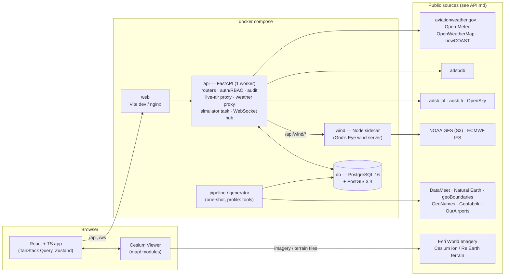

# ARCHITECTURE: iaf-airops Phase 1

> **Update 2026-10-16:** the map engine is now **MapLibre GL** (flat map), the theme is navy + neon blue with the official IAF crest, and the tick simulator is switched off for Phase 1. See ARCHITECTURE §18 D19–D21. Where this document still describes CesiumJS, Cesium ion, the olive/amber theme or live simulation on the map, D19–D21 take precedence.


| | |
|---|---|
| Status | Draft v0.1, 2026-10-16 |
| Implements | [PRD](PRD.md) |
| Related | [DATA_MODEL](DATA_MODEL.md), [API](API.md), [DESIGN_SYSTEM](DESIGN_SYSTEM.md) |

---

## 1. Context and constraints
- **Deployment target:** a single-machine hackathon demo (one laptop), run via `docker compose`. Internet is assumed; offline mode is a "could".
- **Phase 1 only:** inventory system, synthetic data, map dashboard, tick simulator. No decision-support logic.
- **One FastAPI backend process** hosts REST, WebSocket, simulator and feed proxies. **Ceiling:** one uvicorn worker, because the simulator and WebSocket hub live in-process. **Upgrade path:** move the simulator to its own process and use Postgres `LISTEN/NOTIFY` or Redis pub/sub.
- **Map code is reused from God's Eye View** (`../gods-eye-view`, MIT) wherever that is cheaper than writing new code. See the extraction table in §11.

---

## 2. System diagram



The browser never calls a keyed provider directly. The only browser-side credential is the Cesium ion token, which is public by design and URL-restricted.

---

## 3. Process model

| Process | Runs | Notes |
|---|---|---|
| `db` | `postgis/postgis:16-3.4` | volume `pgdata`; init script creates the app role with least privilege (no UPDATE/DELETE on `audit_log`) |
| `api` | `uvicorn app.main:app --workers 1` | lifespan starts: simulator task, METAR refresher task, ADS-B poller task, WebSocket hub |
| `wind` | `node server.mjs` (port 8787) | wraps God's Eye `server/providers/wind.js` handler in `node:http`; `api` proxies `/api/wind/*` to it |
| `web` | dev: `vite` · demo: `nginx` serving `frontend/dist` | proxies `/api` and `/ws` to `api` |
| `pipeline` | one-shot (`make pipeline`) | GDAL + osmium + Python; writes `gis_*` tables |
| `generator` | one-shot (`make seed`) | Python; writes all synthetic tables; runs post-generation checks |

---

## 4. Frontend

### 4.1 Stack
| Area | Choice |
|---|---|
| Core | React 18 + TypeScript (strict) + Vite 6 |
| Map | CesiumJS **1.138.0** (pinned; same version God's Eye runs), via `vite-plugin-cesium` |
| Server state | TanStack Query (REST cache). WebSocket events invalidate or patch query keys |
| UI state | Zustand: one small store for map UI (mode, layer toggles, selection, panel tab) |
| Routing | React Router |
| Tables and forms | TanStack Table; React Hook Form + Zod (schemas generated from OpenAPI where possible) |
| Symbology and icons | canvas-drawn airfield badges and map icons (`map/symbols.ts`, D23); Lucide for UI icons |
| Fonts | `@fontsource/b612`, `@fontsource/b612-mono` (self-hosted, no CDN) |
| API types | `openapi-typescript` generates `src/api/types.ts` from FastAPI's OpenAPI |

### 4.2 Routes
| Path | Screen | Roles |
|---|---|---|
| `/login` | Login + disclaimer | public |
| `/map` | Map + layer panel + side panel (default after login) | all |
| `/overview` | Command overview | all |
| `/inventory/:entity` | Tables + CRUD forms | all (edit per RBAC) |
| `/pilots`, `/pilots/:id` | Aircrew list and profile | all |
| `/alerts` | Alert list | all |
| `/audit` | Audit log + diff viewer | ADMIN, COMMAND_HQ, BASE_COMMANDER (own base, proposed) |
| `/admin` | Users, simulator controls | ADMIN |

### 4.3 Cesium integration rules
- **One Viewer, one owner.** `MapProvider` creates the viewer once. It is idempotent under React StrictMode: it checks a module-level ref, and `destroy()` runs only on real unmount. React components get the viewer through context and **never keep Cesium objects in React state**.
- **Layer module contract** (plain TS, under `frontend/src/map/layers/`):
  ```ts
  interface MapLayer<TData> {
    id: string;
    attach(viewer: Cesium.Viewer): void;   // create collections / data sources
    setData(data: TData): void;            // diff-update in place (no flicker)
    setVisible(visible: boolean): void;
    setOpacity?(alpha: number): void;
    pick?(picked: unknown): Selection | null; // map a Cesium pick to {kind, id}
    detach(): void;
  }
  ```
- **Large point sets** use `BillboardCollection` / `PointPrimitiveCollection` / `LabelCollection` (primitives), not `Entity`. Polygons and lines use `GroundPrimitive` / `GroundPolylinePrimitive` with pre-built geometry instances.
- **Render on demand.** `scene.requestRenderMode = true` plus the ported `renderGovernor` (`requestRender(reason)`, `holdContinuousRender(owner)` while animating tracks or wind).
- **Picking.** A single `ScreenSpaceEventHandler` in `map/selection.ts` asks each visible layer's `pick()`, then writes `{kind, id}` to the Zustand selection. The side panel reacts to that.
- **Region lock** (`map/regionLock.ts`):
  - `globe.cartographicLimitRectangle = Rectangle.fromDegrees(60, 0, 105, 42)`.
  - `screenSpaceCameraController.maximumZoomDistance ≈ 9,000 km`.
  - A `camera.changed` / `moveEnd` clamp pulls the camera centre back inside the box.
  - The imagery provider `rectangle` is limited to the box.
  - The bbox values come only from `shared/region.json`.
- **Colours.** `map/colors.ts` reads the CSS tokens once via `getComputedStyle` and converts them to `Cesium.Color`.

### 4.4 Frontend module map
```
frontend/src/
  app/            # shell, routes, providers, auth guard, ClassificationBanner, TopBar
  api/            # generated types, fetch client, query keys, ws client
  map/
    viewer.ts  renderGovernor.ts  regionLock.ts  basemaps.ts  terrain.ts  colors.ts
    selection.ts  lod.ts
    camera/      tilt.ts  groundGuard.ts  flyTo.ts
    symbology/   sidc.ts  symbolCache.ts          # milsymbol → canvas → billboard
    layers/      boundaries.ts places.ts bases.ts algs.ts civilAirports.ts
                 radars.ts airDefence.ts comms.ts telecomTowers.ts roads.ts rail.ts
                 liveAir.ts simTracks.ts metar.ts owmTiles.ts irClouds.ts
                 wind/ (ported God's Eye JS + .d.ts shim)
    hud/         Hud.tsx  FeedChips.tsx
  features/
    layer-panel/  mode-switcher/  base-panel/  info-card/  search/
    overview/  inventory/  pilots/  alerts/  audit/  admin/  weather-popover/  terrain/
  components/     # KpiTile, StatusPill, FuelGauge, DataTable, EntityForm, SimBadge…
  styles/         # tokens.css, base.css
  vendor/godseye/ # verbatim ports that keep their MIT header (only reached via map/ adapters)
```

---

## 5. Backend

### 5.1 Stack
- Python 3.12, FastAPI, Pydantic v2, SQLAlchemy 2 (async) + GeoAlchemy2, asyncpg, Alembic.
- httpx (async) for upstream calls; argon2-cffi; PyJWT; structlog.
- pytest + pytest-asyncio for tests.

### 5.2 Module map
```
backend/app/
  main.py          # app factory, lifespan (sim, pollers, ws hub), routers
  config.py        # pydantic-settings from env
  db.py            # engine, session, app-role
  models.py        # SINGLE schema source (DATA_MODEL §3)
  schemas/         # Pydantic in/out per entity
  auth/            # login, JWT cookie, password hashing, lockout
  rbac.py          # Depends(require(role, scope)) — base/command scoping
  audit.py         # audit(session, actor, action, entity, before, after)
  crud.py          # crud_router(Model, In, Out, scope_fn) factory: list/get/create/update/retire
  routers/         # bases, summary, overview, inventory/*, pilots, sorties, alerts, audit, users, sim, gis, search
  live/            # providers.py readsb.py opensky.py normalise.py classify.py military.py enrich.py poller.py
  weather/         # metar.py openmeteo.py owm_proxy.py ir_proxy.py wind_proxy.py
  sim/             # engine.py clock.py programme.py sorties.py aircraft.py fuel.py crew.py qra.py unknowns.py faults.py alerts.py kpi.py invariants.py
  ws.py            # hub: topics, seq numbers, auth on handshake
backend/generator/ # config.yaml, load_curated.py, fleet.py, crew.py, history.py, sites.py, checks.py, __main__.py
backend/alembic/
backend/tests/
```

### 5.3 Route summary (`/api/v1`)
| Group | Routes |
|---|---|
| Auth | `POST /auth/login`, `POST /auth/logout`, `GET /auth/me` |
| Map data | `GET /bases?side=&command=` (GeoJSON-ish list), `GET /bases/{id}/summary` (side panel, from `v_base_summary`), `GET /bases/{id}/public` (foreign/other-mil card), `GET /sites/{radars,ad,comms}?bbox=` |
| GIS | `GET /gis/{admin0,admin1,admin2,places,roads,rail,towers,civil_airports}?bbox=&bucket=lo\|mid\|hi`. Returns GeoJSON with a feature cap, an ETag and long cache headers |
| Inventory CRUD (generic factory) | `/aircraft`, `/aircrew`, `/ground-crew`, `/ground-assets`, `/fuel-storage`, `/fuel-transactions`, `/warehouses`, `/stock-levels`, `/ad-batteries`, `/radars`, `/comms-nodes`, `/runways`, `/parking`, `/squadrons`, `/missions`, `/sorties`. Each supports `GET` list (filters, sort, page), `GET /{id}`, `POST`, `PATCH /{id}` (requires `version`), `POST /{id}/retire`, `DELETE /{id}` (only if unreferenced) |
| Pilots | `GET /aircrew/{id}/profile` (hours by type, quals, currency, fatigue, postings), `GET /aircrew/{id}/sorties` |
| Overview | `GET /overview` (theatre), `GET /commands/{code}/kpis`, `GET /kpi-snapshots?scope=&id=&metric=` |
| Alerts and audit | `GET /alerts`, `POST /alerts/{id}/ack`, `GET /audit?actor=&entity=&base=&from=&to=` |
| Live air | `GET /live/aircraft?bbox=` (normalised tracks), `GET /live/aircraft/{hex}/enrich`, `GET /live/status` (per-provider health) |
| Weather | `GET /wx/metar?bbox=` / `?base=`, `GET /wx/taf?ids=`, `GET /wx/point?lat=&lon=`, `GET /wx/owm/{layer}/{z}/{x}/{y}.png`, `GET /wx/ir/wms?...`, `GET /wind/*` (proxy to sidecar) |
| Simulator | `GET /sim/state`, `POST /sim/{pause,resume,step,speed,reseed}` (ADMIN) |
| Search | `GET /search?q=` (bases, ICAO, tail numbers, aircrew) |
| WebSocket | `GET /ws` (cookie-authenticated) |

### 5.4 Cross-cutting rules
- **RBAC.** Every mutating route depends on `require(...)` plus a scope function. For example, `aircraft` is scoped by `home_base_id`, `aircrew` by `base_id`, and `sortie` by `departure_base_id`.
- **Audit.** `audit()` is called inside the same DB transaction as the change. `crud_router` does this automatically. The simulator calls it per changed entity with `actor_type = SIMULATOR`.
- **Optimistic locking.** `PATCH` requires `version` and returns 409 on mismatch.
- **Errors.** Every error uses `{error: {code, message, details}}`. Validation errors map field paths for the forms.
- **Logging.** Structured logs with a request id. Secrets are never logged.

---

## 6. Live-air subsystem

### 6.1 Provider chain (verified 2026-10-16; see [API §1](API.md#1-live-aircraft))
| Role | Provider | Used for | Notes |
|---|---|---|---|
| Primary (merged) | adsb.lol | viewport point queries `/v2/point/{lat}/{lon}/{nm}` + `/v2/mil` | keyless; ODbL; dynamic rate limits |
| Primary (merged) | adsb.fi | point query `/api/v2/lat/{lat}/lon/{lon}/dist/{nm}` + `/api/v2/mil` | keyless; ~1 req/s; **point responses use the key `aircraft`, `/mil` uses `ac`** |
| Snapshot + fallback | OpenSky | theatre bbox snapshot `/api/states/all?lamin=0&lomin=60&lamax=42&lomax=105` every 60–90 s | anonymous works (returned 372 states for the bbox); OAuth2 client credentials recommended for credits |
| Optional | airplanes.live | same readsb shape | **returns 403 without prior approval**; enable only if access is granted |

**Why merge rather than fail over.** On 2026-10-16 at 00:28 IST, a 250 NM query over Delhi returned 29 aircraft from adsb.lol and 71 from adsb.fi, from different feeder networks. Merging both, de-duplicated by hex with the freshest position winning, gives the best picture. If one provider is down, the other continues.

### 6.2 Poller (`live/poller.py`)
- **Viewport-driven.** The frontend reports its view bbox (throttled to 1 per 2 s). The poller covers it with at most `ADSB_MAX_CIRCLES` (default 4) circles of 250 NM. With no active viewers, it polls a default set of circles over India every 30 s.
- **Military feed.** `/v2/mil` is polled every 30 s and filtered to the region bbox. The hex codes go into the military registry. This ports God's Eye's `createMilitaryRegistry`: sticky, add-only per session, and `dbFlags & 1` also counts as military.
- **Caching and resilience:**
  - Per-provider cache of 10–12 s.
  - Identical in-flight requests are coalesced (port of God's Eye `coalesceProxyRequest`).
  - `Retry-After`-aware backoff.
  - Serve stale data on error.
  - A provider is marked OFF after 2 consecutive failures and retried with backoff. The other providers keep feeding the merge.
- **Output.** A merged, de-duplicated (by hex, freshest position wins) track list, kept in memory and served by `GET /live/aircraft?bbox=`. The frontend polls this every 10 s (Live mode only).

### 6.3 Normalised track schema
```json
{ "hex": "800c4d", "callsign": "AIC101", "reg": "VT-ALJ", "icao_type": "B77W",
  "category": "CIVIL|CARGO|MILITARY|HELICOPTER|UAV|DRONE",
  "lat": 28.6, "lon": 77.2, "alt_m": 10668, "on_ground": false,
  "gs_kt": 470, "track_deg": 312, "vr_mps": 0.0, "squawk": "1234",
  "emitter_cat": "A5", "is_military": false, "emergency": null,
  "source": "adsb.lol", "ts": "2026-10-16T05:12:03Z", "age_s": 3, "simulated": false }
```
- **Normalisers:**
  - `readsb.py` handles adsb.lol, adsb.fi and airplanes.live. It accepts `ac` or `aircraft` arrays; `alt_baro` may be the string `"ground"`.
  - `opensky.py` handles positional state-vector arrays. Port of God's Eye `normalizeOpenSkyAircraft`: index 0 hex, 5/6 lon/lat, 7 baro alt, 13 geo alt, 14 squawk, 17 category.

### 6.4 Classification (`live/classify.py`)
Port of God's Eye `src/data/aircraftClass.js` (itself derived from *skylight*, MIT) and `src/data/aircraftEmergency.js`, extended:

1. **MILITARY:** hex in the military registry, or `dbFlags & 1`.
2. **UAV:**
   - ICAO type in the UAV list (`HERN`, `MQ9`, `RQ4`, `TB2`, `SRCH`…), or
   - emitter category `B6` with a fixed-wing type.
3. **DRONE:** emitter category `B6` with no type or a small rotary type, or a type in the small-UAS list.
4. **HELICOPTER:** ICAO type in the helicopter list, or emitter category `A7`.
5. **CARGO:**
   - operator ICAO code in `cargo_operators.csv` (e.g. `BDA` Blue Dart, `FDX`, `UPS`, `QTR` cargo flights by callsign pattern, `CKS`, `GTI`, `ABW`), or
   - a freighter type variant (`B77L` + cargo operator, `B744F`…).
6. **CIVIL:** everything else.

**Extend the type lists** with Indian types missing upstream: Jaguar, Tejas, C-130J (`C30J`), Il-76/78, C-295, ERJ-145 Netra, A-50, Mi-17 (`MI8`), ALH Dhruv, LCH, PC-7, Kiran, Do-228. Verify designators against ICAO Doc 8643.

**Emergency squawks:** 7500 / 7600 / 7700 set `emergency`.

### 6.5 Enrichment
`GET /live/aircraft/{hex}/enrich` calls adsbdb `/v0/aircraft/{hex}`, plus `/v0/callsign/{cs}` for the route. It is called only on click, and cached in an LRU (24 h, also caches misses).

### 6.6 Simulated tracks
- Computed by the simulator (DATA_MODEL §9) and pushed on WebSocket `tracks.sim` every tick.
- The frontend `simTracks.ts` interpolates between ticks: `SampledPositionProperty` with linear interpolation, extrapolating ≤ 1 tick.
- They are **never mixed into** `/live/aircraft`. The two layers are separate so real and simulated data cannot be confused.

---

## 7. Weather subsystem

| Feature | Backend | Cache | Frontend |
|---|---|---|---|
| METAR/TAF (FR-WX-01) | `weather/metar.py`: `GET aviationweather.gov/api/data/metar?bbox=0,60,42,105&format=json` every 5 min (+ `taf?bbox=` every 30 min) | in-memory, last good kept | `metar.ts` flight-category rings on base symbols; Weather tab decoded via `metar-taf-parser` (JS) or server-side decode |
| Nearest-METAR fallback | `metar.py` precomputes base → nearest reporting station (≤ 50 km) at startup from `stationinfo?bbox=` | static | label "nearest: VIAR, 38 km" |
| Point forecast (FR-WX-02) | `weather/openmeteo.py` proxies `api.open-meteo.com/v1/forecast` (current + hourly incl. pressure-level winds) | 10 min, key = lat/lon rounded to 0.1° | `weather-popover` |
| OWM overlays (FR-WX-03) | `weather/owm_proxy.py`: `tile.openweathermap.org/map/{layer}/{z}/{x}/{y}.png?appid=$OWM_API_KEY` | 10 min disk/LRU | `owmTiles.ts` (`UrlTemplateImageryProvider` → `/api/v1/wx/owm/...`) |
| Wind (FR-WX-04) | `wind` sidecar (Node), the God's Eye wind server, proxied at `/api/v1/wind/*` | sidecar: 1 h | ported `src/layers/wind/*` |
| IR clouds (FR-WX-05) | `weather/ir_proxy.py`: nowCOAST WMS `global_longwave_imagery_mosaic` | 10 min | `irClouds.ts` (`WebMapServiceImageryProvider` → proxy) |

### 7.1 Wind sidecar (`wind/`)
- **Code:** copy `server/providers/wind.js`, `server/providers/wind/{catalog,decode,gfs,grid,ifs}.js` and `src/sources/windBody.js` from God's Eye into `wind/src/`, keeping the MIT headers. It depends on `@meri-imperiumi/eccodes-wasm`.
- **Server:** `wind/server.mjs` wraps the exported Connect handler in `http.createServer`. It needs Node 24.
- **Routes** (unchanged contract, so the ported frontend layer works as-is):
  - `GET /api/wind/manifest?model=gfs|ifs&overlay=none|...`
  - `GET /api/wind/grid/{id}.bin?...`
  - `GET /api/wind/status`
- FastAPI proxies `/api/v1/wind/*` → `http://wind:8787/api/wind/*`.

---

## 8. Simulator and WebSocket
- **Engine.** The spec is in [DATA_MODEL §9](DATA_MODEL.md#9-tick-simulator-spec). `sim/engine.py` runs an asyncio loop:
  1. Open a session.
  2. Run the step modules in order.
  3. Commit.
  4. Publish deltas to `ws.py`.

  Ticks never overlap. If one runs long, the next is skipped and logged.
- **Hub.** `ws.py` keeps a set of authenticated connections and a monotonically increasing `seq`. On subscribe, it sends a `sim.clock` snapshot. Clients that detect a seq gap invalidate all queries and resubscribe.
- **Client.** `api/ws.ts` maps topics to actions:
  - `entity.changed` → `queryClient.invalidateQueries([type])`
  - `tracks.sim` → `simTracks.setData`
  - `alert` → toast + badge
  - `kpi` → overview patch

---

## 9. Static GIS pipeline
`pipeline/` is idempotent and driven by `make pipeline`. Downloads go to `data/raw/` (gitignored), recorded in a manifest with URL, date, licence and sha256.

1. **India outline (official depiction).** DataMeet `Country/india-soi.geojson` (Survey of India-derived), with fallback `india-composite.geojson` (CC-0). Cross-check against Natural Earth `ne_10m_admin_0_countries_ind` (India point of view). Result: `gis_admin_area(level=ADM0, country_iso3=IND)`.
2. **Neighbour ADM0.** Natural Earth India-POV admin-0, filtered to the bbox, with `ST_Difference(neighbour, india)` applied.
3. **India ADM1/ADM2.** DataMeet `States/Admin2.shp` and `Districts/Census_2011/2011_Dist.shp` (CC BY 2.5 IN). Use `ogr2ogr` to load into PostGIS, then `ST_Intersection` with the India outline.
4. **Neighbour ADM1/ADM2.** geoBoundaries API `https://www.geoboundaries.org/api/current/gbOpen/{ISO3}/{ADM1|ADM2}/` → `gjDownloadURL`, for PAK, CHN, NPL, BTN, BGD, MMR, LKA, AFG.
   - Then `ST_Difference(unit, india_outline)`. This removes Indian-claimed territory (PoK, Gilgit-Baltistan, Aksai Chin, Shaksgam).
   - Then `ST_Intersection(unit, region_bbox)`, and drop empties.
5. **Countries in the bbox outside the named neighbours** (Iran, Central Asia, Thailand…): ADM0 only.
6. **Places.** GeoNames `cities1000.zip`, filtered to the bbox, into `gis_place`, with population tiers driving label LOD.
7. **OSM infrastructure.** Geofabrik `.osm.pbf` for India + Pakistan + Nepal + Bhutan + Bangladesh + Sri Lanka + Myanmar (+ China, clipped):
   - `osmium extract --bbox 60,0,105,42`
   - `osmium tags-filter` keeping:
     - `w/highway=motorway,trunk,primary`
     - `w/railway=rail`
     - `n/man_made=mast,tower` with `tower:type=communication` (and `communication:*=yes`)
   - `ogr2ogr` into `gis_line` / `gis_point`.
8. **Airports.** OurAirports `airports.csv` + `runways.csv` → `civil_airport`. Runway geometry/dimensions feed `runway` for curated bases. Rows whose ident is a curated base are excluded from `civil_airport`.
9. **Simplification.** Three simplification buckets per layer: `geom_lo` (~2 km tolerance), `geom_mid` (~250 m) and `geom_hi` (~25 m), built with `ST_SimplifyPreserveTopology` (topology-aware via `ST_CoverageSimplify` if PostGIS ≥ 3.4 supports it). The API serves the bucket matching the camera height.
10. **Boundary tests** (`pipeline/tests`):
    - no neighbour polygon intersects India (area > 1 km²)
    - test points inside India: Gilgit, Muzaffarabad, the Aksai Chin centroid, Tawang
    - Lhasa is not in India

**Serving.** `/api/v1/gis/*` returns GeoJSON with an ETag and `Cache-Control: max-age=86400`. If payloads exceed ~5 MB per view, the could-item is to pre-tile to MVT with `tippecanoe` and render through a Cesium vector-tile path.

---

## 10. Map layer specification
"Below" means visible when the camera height is below this value. Labels follow FR-MAP-07.

| Layer | Group | Source | Real/Syn | Below | Style (see DESIGN_SYSTEM §8) | Click |
|---|---|---|---|---|---|---|
| India boundary (official) | Boundaries | DataMeet SoI / NE India-POV | R | always | amber 2 px | — |
| Neighbour country outlines | Boundaries | NE India-POV (clipped) | R | always | khaki 1.5 px | — |
| India states/UTs | Boundaries | DataMeet | R | 4,000 km | khaki 1 px, 70% | label |
| India districts | Boundaries | DataMeet (Census 2011) | R | 800 km | olive 0.75 px dashed | label |
| Neighbour ADM1 / ADM2 | Boundaries | geoBoundaries (clipped) | R | 3,000 / 600 km | olive 0.75 px | label |
| Place names | Boundaries | GeoNames | R | tiered by population | khaki text, dark halo | — |
| IAF air bases | Air bases | curated + OurAirports | R location / S status | always | APP-6 friend air base + condition bar + QRA badge + alert halo + METAR ring (WX mode) | **side panel** |
| ALGs / airstrips | Air bases | curated | R | 2,500 km | runway glyph | info card |
| Other Indian military air stations | Air bases | curated | R | 4,000 km | APP-6 friend, muted | public card |
| Neighbour air bases | Air bases | curated + OurAirports | R | 6,000 km | APP-6 **hostile** (PAK, CHN) / **neutral** (others) | public card |
| Civil airports | Air bases | OurAirports | R | large/medium 3,000 km; small 500 km | grey glyph | card + METAR |
| Radars + coverage rings | Defence | generator | S | 3,000 km (rings toggle) | APP-6 radar, dotted ring | card |
| AD / SAM batteries + rings | Defence | generator | S | 2,000 km | APP-6 AD unit, dashed ring, 6% fill | card |
| QRA status | Defence | derived | S | with bases | badge on base symbol | → panel Defence tab |
| Telecom towers | Comms | Geofabrik OSM | R | 300 km | grey tower glyph | card |
| Military comms nodes | Comms | generator | S | 3,000 km | APP-6 signal installation | card |
| Roads (motorway/trunk/primary) | Transport | Geofabrik OSM | R | 1,500 / 400 km | grey-khaki lines | — |
| Railways | Transport | Geofabrik OSM | R | 1,500 km | dashed grey | — |
| Live ADS-B (8 categories) | Live | `/live/aircraft` | Live | Live mode | rotated glyph per category; label < 500 km | track card |
| Simulated IAF tracks | Live | WebSocket | S | Live mode | APP-6 exercise-friend, violet trail | sortie card |
| Simulated unknown tracks | Live | WebSocket | S | Live mode | APP-6 exercise-unknown | track card |
| METAR rings | Weather | aviationweather.gov | R | WX mode | flight-category ring | WX card |
| OWM / IR / wind | Weather | as named | R | WX mode | opacity 0.6 | point readout |
| Terrain | Terrain | ion / Re:Earth | R | Terrain mode | — | close-up |

---

## 11. God's Eye View extraction table
Source repo: `/Users/sambhavjain/Desktop/IAF/gods-eye-view` (Cesium 1.138, vanilla JS, MIT). Effort: S = < ½ day, M = 1–2 days, L = more.

| God's Eye path | Our module | Effort | Notes |
|---|---|---|---|
| `src/app/viewer.js` (`createApplicationViewer`), `src/app/atmosphereCompat.js` | `map/viewer.ts` | S | Set `globe.show = true` (no Google 3D); keep the Apple Metal workaround |
| `src/renderGovernor.js` | `map/renderGovernor.ts` | S | no deps |
| `src/maps/imagery.js`, `defaultSources.js`, `catalog.js`, `credits.js` | `map/basemaps.ts` | M | Keep Esri + NaturalEarthII; **remove OSM tiles (non-GoI borders), Google 3D, Bing, keySetup**; Esri attribution |
| `src/maps/terrain.js`, `terrainRetry.js` | `map/terrain.ts` | S | ion World Terrain first, then Re:Earth (CC BY 4.0 credit), then ellipsoid |
| `src/data/localGeojsonLod.js` | `map/lod.ts` | S | LOD budget by camera height |
| `src/data/contextStore.js`, `src/data/pickRegistry.js` | `map/selection.ts` | S | replace `window` globals with the Zustand store |
| `src/layers/installations/*` (19 files) | pattern for `map/layers/{bases,radars,airDefence,comms}.ts` | M | **Re-implement following the pattern** (viewport debounce, in-place updates, ground clamping, pick ownership); do not copy wholesale |
| `src/ui/cameraOrientationControls.js` (+ `src/data/scenePick.js`) | `map/camera/tilt.ts` | S | `toggleCameraTilt` (−35° ↔ −89°), `resetCameraNorth` |
| `src/cameraGroundGuard.js` (+ `src/data/cameraArrival.js`) | `map/camera/groundGuard.ts` | S | |
| `src/ui/flyToDataSource.js` (+ `src/data/cameraFraming.js`) | `map/camera/flyTo.ts` | S | |
| `server/providers/aircraft/opensky.js` | `backend/app/live/opensky.py` | M | logic port: credit governor, Retry-After handling; OpenSky non-commercial terms |
| `server/providers/aircraft/adsb-lol.js`, `src/data/adsbLolFallback.js` | `backend/app/live/readsb.py` | S | one normaliser for adsb.lol / adsb.fi / airplanes.live |
| `server/providers/aircraft/enrichment.js` | `backend/app/live/enrich.py` | S | adsbdb |
| `src/sources/live/aircraft.js` | `backend/app/live/normalise.py` | S | |
| `src/layers/aircraft/classification.js` | `backend/app/live/military.py` | S | sticky military registry |
| `src/data/aircraftClass.js` | `backend/app/live/classify.py` | S | **also credit skylight (MIT)**; add Indian types |
| `src/data/aircraftEmergency.js` | `backend/app/live/classify.py` | S | |
| `server/providers/common/http.js` (`coalesceProxyRequest`), `common/rate-limit.js` | `backend/app/live/http.py` | S | coalescing + per-IP limits |
| `server/providers/regional/weather.js` | `backend/app/weather/openmeteo.py` | S | Open-Meteo CC BY 4.0 credit |
| `server/providers/wind.js`, `server/providers/wind/*`, `src/sources/windBody.js` | `wind/` sidecar | S | verbatim + MIT header; GFS public domain, IFS CC BY 4.0 |
| `src/layers/wind/*` | `frontend/src/map/layers/wind/` | M | keep JS, add `.d.ts` shim; wire to our renderGovernor |
| `server/providers/weather.js` (nowCOAST part) | `backend/app/weather/ir_proxy.py` | S | only `global_longwave_imagery_mosaic` covers India |
| `src/ui/styles/foundation.css`, `panel-surfaces.css` | reference only | — | our tokens are new (DESIGN_SYSTEM); borrow the focus-ring and panel-surface patterns |
| `public/models/{jet,mq9,bell206}.glb` | optional 3D track models | — | CC BY 4.0, credits from `public/models/README.md` |
| **Not ported** | | | |
| `src/hud.js` | — | — | contains a hard-coded US classification banner. **Never copy its strings** |
| `src/data/lifecycle.js`, `src/ui/layerPanel.js`, `src/overlays/worldOverlay.js` | — | — | too coupled; rewritten in React / Cesium `LabelCollection` |
| `src/data/adminBoundaries.js` + bundled Natural Earth JSON | — | — | de facto borders; replaced by the pipeline |
| `src/sources/openFreeMap.js` | — | — | its tiles carry non-GoI boundaries; never render them |
| `src/data/local_data/osm_military_names/names.json` | validation only | — | ODbL; never used for placement |

**Header for every ported file:**
```
// Portions derived from God's Eye View (<original path>),
// Copyright (c) 2026 Bilawal Sidhu, MIT License. See THIRD_PARTY_NOTICES.md.
```

---

## 12. Repository layout
```
iaf-airops/
  AGENTS.md  README.md  LICENSE  THIRD_PARTY_NOTICES.md
  docker-compose.yml  .env.example  Makefile
  docs/               # PRD, DATA_MODEL, ARCHITECTURE, API, DESIGN_SYSTEM, IMPLEMENTATION_PLAN
  shared/region.json  # {"west":60,"south":0,"east":105,"north":42,"border_buffer_km":25}
  frontend/           # §4.4
  backend/            # §5.2 (+ generator/, alembic/, tests/)
  wind/               # Node sidecar (§7.1)
  pipeline/           # GIS pipeline (§9) + tests
  data/
    curated/          # committed CSVs (DATA_MODEL §8.1)
    raw/              # downloads (gitignored)
    fixtures/         # recorded upstream responses for tests
```

---

## 13. Environment variables (`.env.example`)
| Var | Default | Notes |
|---|---|---|
| `DATABASE_URL` | `postgresql+asyncpg://airops:airops@db:5432/airops` | |
| `JWT_SECRET` | (required) | |
| `JWT_TTL_HOURS` | `8` | |
| `DEMO_PASSWORD` | (required) | seeded users |
| `SEED` | `2026` | generator + simulator |
| `SIM_ENABLED` / `SIM_TICK_SECONDS` / `SIM_SPEED` / `SIM_ASSERT` | `true` / `5` / `1` / `0` | |
| `ADSB_PROVIDERS` | `adsb.lol,adsb.fi,opensky` | all listed providers are polled and merged; add `airplanes.live` only if approved |
| `ADSB_MAX_CIRCLES` | `4` | |
| `OPENSKY_CLIENT_ID` / `OPENSKY_CLIENT_SECRET` | empty | optional OAuth2 client credentials |
| `OWM_API_KEY` | empty | OWM overlays disabled if empty |
| `AWC_USER_AGENT` | `iaf-airops/0.1 (team contact)` | aviationweather.gov asks for an identifying UA |
| `VITE_CESIUM_ION_TOKEN` | empty | public by design; restrict allowed URLs in the ion dashboard |
| `WIND_URL` | `http://wind:8787` | |
| `CORS_ORIGINS` | `http://localhost:5173` | |
| `HTTPS_CA_BUNDLE` | empty | path to an extra CA (e.g. a campus TLS-inspection CA), passed to httpx (`verify=`) and Node (`NODE_EXTRA_CA_CERTS`) |
| `OFFLINE_MODE` | `false` | could item: disables outbound calls and uses fallbacks |
| `LOG_LEVEL` | `info` | |

---

## 14. docker-compose services
| Service | Image / build | Ports | Depends on |
|---|---|---|---|
| `db` | `postgis/postgis:16-3.4` | 5432 (localhost only) | — |
| `api` | `backend/Dockerfile` (python:3.12-slim) | 8000 | db, wind |
| `wind` | `wind/Dockerfile` (node:24-slim) | 8787 (internal) | — |
| `web` | `frontend/Dockerfile` (dev: node:24 + vite; demo: nginx) | 5173 / 80 | api |
| `pipeline` | `pipeline/Dockerfile` (ghcr.io/osgeo/gdal + osmium-tool + python) | — | db (profile `tools`) |
| `generator` | same image as `api` | — | db (profile `tools`) |

---

## 15. Security architecture
- **Auth:** Argon2id hashes; JWT in an httpOnly SameSite=Strict cookie; CSRF covered by SameSite plus an `Origin` check on mutating routes.
- **RBAC:** enforced server-side on every route; scope checks query by `base_id` / `command_id`.
- **Database:** the app role cannot UPDATE/DELETE `audit_log`. Migrations run as the owner role.
- **Secrets:** env only; never sent to the browser except `VITE_CESIUM_ION_TOKEN`.
- **Upstream proxies:** fixed host allow-list, no user-supplied URLs; response size caps; timeouts.
- **Headers:** CSP (`default-src 'self'`; img/connect to the tile hosts in API.md; `worker-src blob:` for Cesium), `X-Content-Type-Options`, `Referrer-Policy`.
- **Data sensitivity rules:** see [AGENTS.md](../AGENTS.md#8-data-sensitivity-rules).

---

## 16. Network and offline matrix
| Component | Online source | Fallback |
|---|---|---|
| Basemap | Esri World Imagery | Cesium bundled NaturalEarthII |
| Terrain | Cesium ion World Terrain | Re:Earth → ellipsoid (notice) |
| Live ADS-B | adsb.lol + adsb.fi (merged) + OpenSky | remaining providers → stale cache → (could) recorded replay |
| METAR/TAF | aviationweather.gov | last good, marked stale |
| Point forecast | Open-Meteo | disabled with notice |
| OWM / IR / wind | as named | layer disabled with notice |
| GIS / fonts / symbols | local (PostGIS, self-hosted) | always available |

**Campus networks.** The team's campus firewall (FortiGate, TLS inspection) **blocks `terrain.reearth.land`**, as observed on 2026-10-16. Run `make netcheck` before any demo: it curls every upstream in [API.md](API.md) and prints a pass/fail table. If TLS inspection is in place, set `HTTPS_CA_BUNDLE`.

---

## 17. Testing strategy
| Layer | Tests |
|---|---|
| Generator | determinism checksum; counts ±10%; invariants; denylist; geometry rules |
| Pipeline | boundary tests (§9.10) |
| API | RBAC matrix (role × action × entity); audit-per-mutation; 409 locking; validation rules; route smoke |
| Live air | normaliser + classifier fixture tests from recorded responses in `data/fixtures/` (no live network in tests) |
| Simulator | 60 sim-minutes at 60× with `SIM_ASSERT=1` → 0 violations; unknown-track → QRA scramble scenario; human-sortie lifecycle |
| Frontend | vitest for pure modules (`sidc.ts`, `lod.ts`, label maps); one Playwright smoke: login → map → click base → panel renders |

---

## 18. Decision records (short)
| # | Decision | Why |
|---|---|---|
| D1 | No Resium; Cesium wrapped in plain TS layer modules | full control of primitives and render mode; matches God's Eye patterns |
| D2 | Single FastAPI process (simulator + WebSocket in-process) | simplest for a one-laptop demo; upgrade path in §1 |
| D3 | Simulated tracks derived, not stored | less write load; deterministic recompute |
| D4 | Enums as VARCHAR + CHECK | easy migrations |
| D5 | GeoJSON with 3 simplification buckets, not vector tiles | less infrastructure; MVT kept as a could item |
| D6 | Node sidecar for wind | reuses God's Eye eccodes-wasm decoder unchanged |
| D7 | adsb.lol + adsb.fi merged, OpenSky snapshot/fallback | verified keyless 2026-10-16; coverage differs per feeder network; airplanes.live now gated |
| D8 | Official GoI boundaries via DataMeet + clipped geoBoundaries | legal and reviewer acceptability |
| D9 | Audit includes simulator transitions, pruned after N days | full traceability without unbounded growth |
| D10 | **Native Homebrew** Postgres 17 + PostGIS 3.6 instead of Docker on the dev laptop | Docker wasn't installed and disk was 91% full; same database, no VM |
| D11 | Sync SQLAlchemy + psycopg 3 (not async + asyncpg); simulator runs in a worker thread | simpler code; one worker is the ceiling anyway (D2) |
| D12 | `metadata.create_all` + `sql/schema.sql` instead of Alembic for now | the schema is still moving; add Alembic once real data must survive changes |
| D13 | API on port **8010** (`API_PORT`) | port 8000 is used by another app on this machine |
| D14 | `truststore` (OS trust store) for all outbound HTTPS | python.org Python has no CA bundle; the campus FortiGate inspects TLS |
| D15 | Wind: God's Eye wind **server** reused verbatim as a sidecar; browser renderer simplified to CPU particles on a 2D canvas | God's Eye's GPU streamline layer is ~2.4k lines tied to its layer services |
| D16 | `@cesium/widgets` 14.3.0 + `@cesium/engine` 22.3.0 pinned via npm `overrides` | widgets 14.5 pulls engine 24, giving two engines; WebGL ContextLimits read 0 and rendering fails |
| D17 | Generator policy is a Python module (`generator/config.py`), RNG is stdlib `random` | no YAML dependency; deterministic, verified by checksum |
| D18 | Live ADS-B merges adsb.lol + adsb.fi; a custom User-Agent is required (adsb.lol returns 403 to the default python-httpx UA) | observed 2026-10-16 |
| D19 | **MapLibre GL JS 5.24 replaces CesiumJS** (supersedes D1, D16; FR-MAP-01/03 and FR-TER-01 now refer to the flat map). Flat Web Mercator, OpenFreeMap vector basemap for terrain features only, our own PostGIS MVT endpoint (`GET /gis/tiles/{z}/{x}/{y}.pbf`: `admin`, `admin_label`, `place`, `tower`, `airport`) for every boundary and name, AWS terrarium DEM for hillshade and 3D terrain mode | team asked for a flat, smoother, less cluttered map (2026-10-16); the 3D globe read as "circular". Vector tiles are crisp at every zoom and supersede D5 for the map |
| D20 | **Tick simulator disabled for Phase 1** (`SIM_ENABLED=false`). Simulated tracks, synthetic radar/AD/comms sites and sortie creation are removed from the UI; the alert rules still run every 30 s over the current data (`sim/alerts.loop`). The generated inventory and 90-day history stay as the dataset | team decision 2026-10-16: the map shows only real/public data; simulation and optimisation come together in Phase 2. Code is kept, switched off |
| D23 | **Four map views** (Live / Weather / Terrain / Infra) with mode-exclusive layers; airfield badges replace APP-6 symbols (milsymbol removed); railway stations from the OSM Overpass API (`make stations`, `gis_point` kind `RAIL_STATION` with a `rank`); far-zoom highways and rail drawn from our `gis_line_lo` tiles (the basemap carries them only from ~z7); base "Connections" (nearest railheads, airports, highways, IAF bases) computed by KNN + geodesic distance, **no routing** (route calculation is Phase 2); satellite IR clouds re-coloured to white in the browser via a MapLibre `clouds://` protocol (no image library on the server) | team requests and answers, 2026-10-16 |
| D24 | **Equipment pictures** in the base panel (Aircraft, Support, Defence tabs: type cards → one card per airframe / vehicle / unit) and as Inventory thumbnails. Aircraft: original top-view outlines (`frontend/src/equipment/aircraft.tsx`, 34 types). Ground equipment, AD, radars: original 3D-style illustrations from a small SVG engine (`equipment/iso.tsx`, `equipment/models.tsx`, 41 kinds). `/bases/{id}/summary` adds `ground_items` | team requests 2026-10-16 (chose drawings over AI renders or stock photos: free, consistent, offline); the reference image supplied was a watermarked stock image, so nothing was traced from it |
| D25 | **3D terrain by default; Terrain view removed.** Views are Live, Weather, Infra. Live and Infra render the DEM in 3D (pitch 42°, rotate allowed); Weather is flat (no terrain, pitch 0). Terrain controls moved to Map settings | team request 2026-10-16 |
| D21 | **Official IAF crest** on splash, login, top bar and favicon; navy + neon-blue theme replaces olive + amber | team decision 2026-10-16 (overrides the earlier "no emblems" assumption in PRD §decision log) |
| D22 | **Classification banner removed** (top and bottom `UNCLASSIFIED // SIMULATED DATA …` strips) | team decision 2026-10-16; simulated data stays identified by the login disclaimer and SIM badges (the side-panel "Simulated inventory" stripe was also removed at the team's request) |
