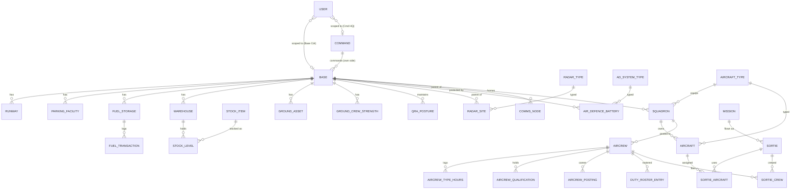

# DATA_MODEL: Schema, Synthetic Data Generation and Simulator

| | |
|---|---|
| Status | Draft v0.1, 2026-10-16 |
| Implements | [PRD](PRD.md) §7–§8 |
| Owners | `backend/app/models.py` is the single schema source. The generator lives in `backend/generator/`. The simulator lives in `backend/app/sim/`. |

---

## 1. Conventions

- **Database:** PostgreSQL 16 + PostGIS 3.4, accessed through SQLAlchemy 2.x + GeoAlchemy2. Alembic handles migrations.
- **Names:** `snake_case` tables and columns. Primary keys are `id bigint generated always as identity`. Human-readable natural keys are `UNIQUE` (ICAO code, tail number, service number, site code).
- **Time:** `timestamptz` stored in UTC. The UI shows IST first and Zulu second (DESIGN_SYSTEM §13).
- **Units:** stored in SI-like units: metres, km, kg, litres, seconds/hours, knots for speeds. The UI converts to ft / NM / kL. ATF density for kg↔L is 0.80 kg/L (config `fuel.atf_density`).
- **Enums:** stored as `VARCHAR` with `CHECK` constraints, using SQLAlchemy `Enum(..., native_enum=False)`, so adding values is migration-friendly.
- **Geometry:** `geometry(Point|LineString|Polygon|MultiPolygon, 4326)` with GiST indexes. Distances use a `::geography` cast.
- **Common columns** on every operational table:
  - `created_at`, `updated_at`
  - `version int NOT NULL DEFAULT 1`, used for optimistic locking
  - `is_simulated bool NOT NULL`
  - `source varchar CHECK (source IN ('PUBLIC','SYNTHETIC','LIVE'))`
  - `source_ref text`: a URL or dataset id for PUBLIC rows
- **Soft retire:** referenced entities are never hard-deleted. They get `status = RETIRED` / `is_active = false` (FR-INV-03).

---

## 2. ER diagram

`alert` and `audit_log` point at any entity polymorphically through `(entity_type, entity_id)`.

---

## 3. Entity reference

Each table lists its fields, notes, and who writes it:
- **G** = generator
- **A** = API (human CRUD)
- **S** = simulator
- **P** = GIS pipeline

R/S says whether the data is real public data or synthetic.

### A. Organisation and geography

#### `command` (G, R)
| Field | Type | Notes |
|---|---|---|
| code | enum `WAC, SWAC, CAC, EAC, SAC, TC, MC` | unique |
| name | text | "Western Air Command" |
| hq_name | text | e.g. "New Delhi (Subroto Park)", "Gandhinagar" (SWAC), "Prayagraj" (CAC), "Shillong" (EAC), "Thiruvananthapuram" (SAC), "Bengaluru" (TC), "Nagpur" (MC) |
| hq_geom | Point | |
| is_operational | bool | true for WAC/SWAC/CAC/EAC/SAC |

#### `base` (G/P; location R, status S)
| Field | Type | Notes |
|---|---|---|
| code | text unique | ICAO if any (e.g. `VIAX`), else OurAirports ident (`IN-0019`) |
| iata | text null | |
| name | text | "Air Force Station Adampur" |
| alt_names | text[] | |
| country_iso3 | char(3) | IND, PAK, CHN, NPL, BTN, BGD, MMR, LKA, AFG… |
| side | enum `OWN, OTHER_INDIAN_MIL, FOREIGN` | inventory only for OWN |
| operator | enum `IAF, IN, IA_AVN, ICG, PAF, PLAAF, PLANAF, BAF, SLAF, MAF, NA_AVN, AAF, CIVIL_JOINT, OTHER` | |
| base_type | enum `AIR_FORCE_STATION, FBSU, ALG, JOINT_USE, TRAINING_ESTABLISHMENT, BASE_REPAIR_DEPOT, HELIBASE, LOGISTICS, RADAR_STATION, FOREIGN_MILITARY, FOREIGN_JOINT_USE, OTHER_INDIAN_MIL` | |
| command_id | fk null | OWN only |
| wing | text null | e.g. "8 Wing" (public) |
| role_tags | text[] | FIGHTER, TRANSPORT, HELO, UAV, TRAINING, MAINT, AEW, TANKER |
| geom | Point | |
| elevation_m | numeric | |
| ops_status | enum `OPERATIONAL, LIMITED, CLOSED` | S, SIM |
| affiliation | enum `FRIEND, HOSTILE, NEUTRAL` | FRIEND for OWN/OTHER_INDIAN_MIL; HOSTILE for PAK/CHN; NEUTRAL otherwise |
| public_notes | text | foreign/other-mil cards (public facts only) |
| wikipedia_url, ourairports_id | text | provenance |

#### `runway` (P/G; dimensions R, status S)
Fields:
- `base_id`, `designator` (e.g. "05/23"), `length_m`, `width_m`
- `surface` enum `ASPHALT, CONCRETE, GRAVEL, GRASS, MATTING, UNKNOWN`
- `heading_true_deg`, `lighted`, `geom` LineString (from OurAirports runway ends)
- `status` enum `OPEN, RESTRICTED, CLOSED, UNDER_REPAIR` (S)

#### `parking_facility` (G, S)
Fields:
- `base_id`
- `kind` enum `HAS, BLAST_PEN, OPEN_APRON, MAINT_HANGAR, TRANSPORT_APRON, HELIPAD, UAV_HANGAR`
- `slot_size` enum `S` (UAV/light helicopter), `M` (fighter/medium helicopter), `L` (medium transport/heavy helicopter), `XL` (C-17/IL-76/IL-78/A-50)
- `slots_total`, `slots_unserviceable`

Occupancy is derived in `v_parking_occupancy` and never stored.

#### `qra_posture` (G, S)
Fields:
- `base_id`, `aircraft_type_id`
- `required_aircraft` (default 2), `readiness_min` (5 / 15 / 30)
- `active` bool

Actual QRA state is derived from aircraft and crew with status `QRA`.

### B. Fleet

#### `aircraft_type` (G, R approx.)
| Field | Type | Notes |
|---|---|---|
| icao_type | text | ICAO Doc 8643 designator (e.g. `SU30`, `RFAL`). **Verify codes for Indian types**, see §8.5 |
| name, variant, manufacturer | text | "Su-30MKI", "Rafale EH" |
| category | enum `FIXED_WING, ROTARY_WING, UAV_FIXED_WING, UAV_ROTARY_SMALL` | drives the Aircraft/Helicopters/UAVs/Drones UI sections |
| role | enum `FIGHTER_MULTIROLE, AIR_SUPERIORITY, STRIKE, TRAINER_BASIC, TRAINER_INTERMEDIATE, TRAINER_ADVANCED, TRANSPORT_STRATEGIC, TRANSPORT_TACTICAL, TRANSPORT_LIGHT, VIP_TRANSPORT, TANKER, AEW_C, ISR, UTILITY_HELO, ATTACK_HELO, HEAVY_LIFT_HELO, LIGHT_HELO, UAV_MALE, UAV_TACTICAL, SMALL_UAS` | "classification" in the panel |
| seats_pilot, seats_other | int | |
| max_fuel_kg, burn_kg_per_h, cruise_kt, endurance_h, combat_radius_km | numeric | approximate public figures |
| slot_size | enum S/M/L/XL | |
| maint_interval_h, turnaround_min | int | synthetic policy |
| serial_prefix | text | for tail-number generation (§8.7) |
| sidc_function | text | milsymbol function code (DESIGN_SYSTEM §6) |
| in_service | bool | false = history only (MiG-21, MiG-27, HPT-32) |

#### `squadron` (G, R ORBAT / S strength)
Fields:
- `number` (e.g. "47 Sqn", "125 HS", "114 HU"), `name` / nickname (public), `role`
- `aircraft_type_id`, `home_base_id`, `wing` (public)
- `unit_establishment` (synthetic, int), `source_ref` (URL)

#### `aircraft` (G, A, S, all SIM)
One table for jets, helicopters, UAVs and drones.

| Field | Type | Notes |
|---|---|---|
| tail_no | text unique | §8.7 |
| aircraft_type_id, squadron_id | fk | |
| home_base_id | fk | |
| current_base_id | fk null | **null iff AIRBORNE** |
| status | enum `AVAILABLE, STANDBY, QRA, AIRBORNE, TURNAROUND, MAINT_SCHEDULED, MAINT_UNSCHEDULED, AOG, DEPOT, RETIRED` | |
| status_reason | text | |
| readiness_min | int null | for STANDBY/QRA |
| airframe_hours, hours_since_maint, next_maint_due_hours | numeric | |
| next_maint_due_date, maint_eta | timestamptz null | |
| fuel_kg | numeric | on-board |
| induction_year | int | |
| last_sortie_at | timestamptz null | |

### C. People

#### `aircrew` (G, A, S, fictional, SIM)
| Field | Type | Notes |
|---|---|---|
| service_no | text unique | synthetic, e.g. `SIM-27xxx-F(P)` style |
| rank | enum `FG_OFFR, FLT_LT, SQN_LDR, WG_CDR, GP_CAPT, AIR_CMDE` | |
| first_name, last_name, callsign | text | **fictional** (§8.8) |
| date_of_birth, commission_date | date | |
| aircrew_role | enum `PILOT, WSO, NAVIGATOR, FLIGHT_ENGINEER, LOADMASTER, FLIGHT_GUNNER, RPA_PILOT, PAYLOAD_OPERATOR` | |
| stream | enum `FIGHTER, TRANSPORT, HELICOPTER, RPA` | |
| squadron_id, base_id | fk | |
| appointment | text | CO, Flight Commander, Flt Lt… |
| ops_category | enum `UNDER_CONVERSION, SEMI_OPERATIONAL, FULLY_OPERATIONAL, FLIGHT_LEAD, INSTRUCTOR` | |
| instrument_rating | enum `WHITE, GREEN, MASTER_GREEN` | |
| medical_status | enum `FIT_FULL, FIT_RESTRICTED, TEMP_UNFIT, GROUNDED` | |
| medical_valid_until | date | |
| duty_status | enum `ON_DUTY, STANDBY, QRA, BRIEFED, AIRBORNE, CREW_REST, OFF_DUTY, LEAVE, SICK, COURSE` | |
| rest_started_at | timestamptz null | |
| total_hours, night_hours, instrument_hours | numeric | career totals |

#### `aircrew_type_hours` (G, S)
Fields: `aircrew_id`, `aircraft_type_id`, `hours`, `captain_hours`, `night_hours`, `instrument_hours`, `last_flown_at`.

#### `aircrew_qualification` (G, A)
Fields:
- `aircrew_id`
- `code` enum `QFI, NIGHT, NVG, AAR_RECEIVER, FORMATION_LEAD_2, FORMATION_LEAD_4, LOW_LEVEL, MOUNTAIN_FLYING, SAR, PARA_DROP, TEST_PILOT, QRA_CLEARED`
- `aircraft_type_id` null
- `awarded_on`, `expires_on` null

#### `aircrew_posting` (G, A)
Fields: `aircrew_id`, `squadron_id`, `base_id`, `aircraft_type_id`, `appointment`, `from_date`, `to_date` null.

#### `ground_crew_strength` (G, A, S): aggregate counts
Fields:
- `base_id`
- `trade` enum `AIRFRAME, ENGINE, AVIONICS, ELECTRICAL, ARMAMENT, POL, ATC, MET, MT, FIRE_CRASH_RESCUE, STORES, MEDICAL, SECURITY, RADAR_TECH, COMMS_TECH`
- `shift` enum `A, B, C`
- `authorised`, `held`, `on_duty`, `standby`, `on_leave`

#### `duty_roster_entry` (G, A, S)
Fields:
- `aircrew_id`, `base_id`
- `duty_type` enum `FLYING, STANDBY, QRA, OPS_DUTY, REST, LEAVE, COURSE`
- `start_ts`, `end_ts`, `readiness_min` null

### D. Operations

#### `mission` (G, A, S)
Fields:
- `code`, `name`
- `mission_type` (same enum as sortie)
- `priority` enum `P1, P2, P3, P4`
- `window_start`, `window_end`
- `area_geom` Polygon null (inside India only)
- `status` enum `REQUESTED, APPROVED, ACTIVE, COMPLETED, CANCELLED`
- `requesting_command_id`

#### `sortie` (G, A, S)
| Field | Type | Notes |
|---|---|---|
| code | text unique | `SIM-<base>-<nnnn>` |
| mission_id | fk null | |
| origin | enum `SIM_PROGRAMME, HUMAN, QRA_SCRAMBLE` | |
| mission_type | enum `TRAINING, AIR_DEFENCE_PATROL, QRA_SCRAMBLE, INTERCEPT, STRIKE_EXERCISE, CAS_EXERCISE, RECCE_ISR, AIRLIFT, PARA_DROP, CASEVAC, HADR, AAR_SUPPORT, AEW_SUPPORT, FERRY, FUNCTIONAL_CHECK, SAR` | |
| priority | enum P1–P4 | |
| departure_base_id, recovery_base_id | fk | |
| status | enum `PLANNED, CREWED, READY, AIRBORNE, ON_STATION, RTB, LANDED, COMPLETED, CANCELLED, ABORTED` | |
| planned_launch_ts, actual_launch_ts, planned_recovery_ts, actual_recovery_ts | timestamptz | |
| cancel_reason | enum `WX, AIRCRAFT_US, CREW_UNAVAILABLE, FUEL, TASKING_CHANGE, USER_CANCELLED, OTHER` | |
| route_geom | LineString | waypoints; all ≥ `border_buffer_km` inside India |
| orbit_geom | Polygon null | CAP / ISR racetrack |
| cruise_alt_m | numeric | |
| fuel_planned_kg, fuel_used_kg | numeric | |
| target_track_id | text null | for INTERCEPT: the simulated unknown it responds to |

#### `sortie_aircraft` (A, S)
Fields: `sortie_id`, `aircraft_id`, `callsign`, `formation_pos`.

#### `sortie_crew` (A, S)
Fields:
- `sortie_id`, `aircrew_id`, `aircraft_id`
- `position` enum `CAPTAIN, CO_PILOT, WSO, NAVIGATOR, FLIGHT_ENGINEER, LOADMASTER, FLIGHT_GUNNER, RPA_PILOT, PAYLOAD_OPERATOR, INSTRUCTOR, STUDENT`
- `hours_logged`, `night_hours`

#### Simulated tracks: a DTO, not a table
- IAF fields: `track_id`, `sortie_id`, `aircraft_id`, `callsign`, `icao_type`, `lat`, `lon`, `alt_m`, `heading_deg`, `gs_kt`, `phase` (TAXI | TAKEOFF | CLIMB | CRUISE | ON_STATION | DESCENT | APPROACH | LANDED), `fuel_kg`, `kind: "SIM_IAF"`, `simulated: true`.
- Positions are computed as `f(route_geom, actual_launch_ts, now, type performance)` and never stored.
- Simulated unknowns have the same shape with `kind: "SIM_UNKNOWN"` and no sortie or aircraft. They live in simulator memory (`sim.unknowns`) and are recreated from the seed on restart.

### E. Logistics

#### `fuel_storage` (G, A, S)
Fields:
- `base_id`
- `grade` enum `ATF, AVGAS, DIESEL_HSD, MOGAS`
- `kind` enum `BULK_UNDERGROUND, ABOVE_GROUND, BLADDER`
- `capacity_l`, `current_l`, `reserve_l`, `reorder_l`, `tank_count`

Constraint: `CHECK (current_l BETWEEN 0 AND capacity_l)`. This table holds the base's **fuel capacity**.

#### `fuel_transaction` (A, S)
Fields:
- `fuel_storage_id`, `ts`
- `kind` enum `RECEIPT, ISSUE_AIRCRAFT, ISSUE_VEHICLE, DEFUEL, TRANSFER_IN, TRANSFER_OUT, ADJUSTMENT`
- `quantity_l` (> 0), `balance_after_l`
- `aircraft_id` null, `sortie_id` null
- `actor` (`user:<id>` or `SIMULATOR`)

#### `ground_asset` (G, A, S): vehicles and ground-support equipment
| Field | Notes |
|---|---|
| base_id, asset_class | `VEHICLE` or `GSE` |
| asset_type | VEHICLE: `FUEL_BOWSER, HYDRANT_DISPENSER, CRASH_FIRE_TENDER, AMBULANCE, TOW_TRACTOR, CARGO_LOADER, RUNWAY_SWEEPER, SNOW_CLEARER, TROOP_CARRIER, UTILITY_TRUCK, STAFF_CAR, MOBILE_ATC, MOBILE_RADAR_TRANSPORTER`. GSE: `GPU, AIR_START_UNIT, HYDRAULIC_RIG, NITROGEN_CART, OXYGEN_CART, WEAPON_LOADER, AIRCRAFT_JACK, ENGINE_STAND, AC_COOLING_CART, TOW_BAR, DEICER` |
| reg_or_serial | synthetic, `SIM-` prefixed |
| status | `SERVICEABLE, UNSERVICEABLE, UNDER_REPAIR` |
| capacity_l | bowsers only |
| last_service_date | |

#### `warehouse` (G, A, S)
Fields:
- `base_id`, `name`
- `kind` enum `GENERAL, AVIATION_SPARES, POL_PACKED, ARMAMENT_STORE, MEDICAL, RATIONS`
- `capacity_m3`, `utilisation_pct`
- `status` enum `OPERATIONAL, DEGRADED, CLOSED`

#### `stock_item` (G, catalogue)
Fields:
- `part_no` (synthetic), `nomenclature` (generic)
- `category` enum `ENGINE_SPARES, AIRFRAME_SPARES, AVIONICS_SPARES, TYRES_BRAKES, CONSUMABLES, POL_PACKED, GSE_SPARES, MEDICAL, RATIONS, ARMAMENT_AAM_BVR, ARMAMENT_AAM_WVR, ARMAMENT_PGM, ARMAMENT_BOMB_UNGUIDED, ARMAMENT_ROCKET, ARMAMENT_GUN_AMMO, ARMAMENT_CHAFF_FLARE`
- `unit` enum `EA, L, KG, ROUNDS`
- `aircraft_type_id` null

**Armament is generic only:** category plus a generic nomenclature such as "AAM – BVR (generic)". Never real designations, quantities tied to real units, or loadouts.

#### `stock_level` (G, A, S)
Fields: `warehouse_id`, `stock_item_id`, `qty_on_hand`, `qty_reserved`, `reorder_level`, `max_level`, `last_receipt_at`.

### F. Air defence, radar and comms (positions synthetic, system names real)

#### `ad_system_type` (G)
Fields:
- `name` (real public name, §8.12)
- `category` enum `LR_SAM, MR_SAM, SR_SAM, VSHORADS, AD_GUN, C_UAS`
- `max_range_km`, `max_alt_m` (approximate public figures, VERIFY)
- `sidc_function`

#### `air_defence_battery` (G, A, S, SIM)
Fields:
- `code` (`SIM-AD-nnn`), `ad_system_type_id`
- `protected_base_id` null, `command_id`
- `geom` Point
- `status` enum `OPERATIONAL, DEGRADED, MAINTENANCE, OFFLINE`
- `readiness_min`, `launchers_total`, `launchers_ready`

Engagement rings are computed at render time from `max_range_km`.

#### `radar_type` (G)
Fields:
- `name` (real public name, §8.12)
- `category` enum `LONG_RANGE, MEDIUM_POWER, LOW_LEVEL_TRANSPORTABLE, LOW_LEVEL_LIGHTWEIGHT, AEROSTAT, ATC_SURVEILLANCE`
- `max_range_km`

#### `radar_site` (G, A, S, SIM)
Fields:
- `code` (`SIM-RDR-nnn`), `radar_type_id`, `base_id` null
- `geom`, `antenna_height_m`
- `status` enum `OPERATIONAL, DEGRADED, MAINTENANCE, OFFLINE`

#### `comms_node` (G, A, S, SIM)
Fields:
- `code` (`SIM-COM-nnn`)
- `node_type` enum `DATALINK_GS, SATCOM_GS, HF_STATION, VUHF_RELAY, C2_NODE, NETWORK_HUB`
- `base_id` null, `geom`
- `status` enum `UP, DEGRADED, DOWN`

#### `comms_link` (G, S) [could]
Fields:
- `node_a_id`, `node_b_id`
- `medium` enum `FIBRE, MICROWAVE, SATCOM, HF, VUHF`
- `status`

### G. Governance

#### `app_user` (G, A)
Fields:
- `username`, `display_name`, `password_hash` (Argon2id)
- `role` enum `ADMIN, COMMAND_HQ, BASE_COMMANDER, VIEWER`
- `base_id` null: `CHECK (role <> 'BASE_COMMANDER' OR base_id IS NOT NULL)`
- `command_id` null: COMMAND_HQ scope; null means Air HQ
- `is_active`, `failed_logins`, `locked_until`, `last_login_at`

#### `audit_log` (A, S): append-only
| Field | Notes |
|---|---|
| ts, request_id | |
| actor_type | `USER` or `SIMULATOR` |
| actor_user_id, actor_role | null for SIMULATOR |
| action | `CREATE, UPDATE, DELETE, RETIRE, LOGIN, LOGIN_FAILED, LOGOUT, ALERT_ACK, SIM_CONTROL, USER_ADMIN, EXPORT, SIM_TRANSITION` |
| entity_type, entity_id, base_id | |
| before, after | jsonb (changed fields only for UPDATE) |
| ip | null for SIMULATOR |

- Append-only: the app DB role has `INSERT, SELECT` only. A trigger raises an error on UPDATE/DELETE.
- **The simulator writes one audit row per changed entity per tick**, with `action = SIM_TRANSITION`.
- Partition by month, or prune rows older than `audit.sim_retention_days` (default 7) where `actor_type = 'SIMULATOR'`. This keeps the table bounded. Human rows are kept indefinitely.

#### `alert` (S, A)
| Field | Notes |
|---|---|
| kind | `LOW_FUEL, FUEL_BELOW_RESERVE, LOW_SERVICEABILITY, QRA_SHORTFALL, CREW_FATIGUE, CREW_SHORTFALL, MEDICAL_EXPIRY, CURRENCY_LAPSE, MAINTENANCE_OVERDUE, STOCK_BELOW_REORDER, RADAR_DOWN, AD_DEGRADED, COMMS_DOWN, WX_BELOW_MINIMA, FEED_STALE, UNKNOWN_TRACK` |
| severity | `INFO, CAUTION, WARNING, CRITICAL` |
| status | `OPEN, ACKNOWLEDGED, CLEARED` |
| entity_type, entity_id, base_id, command_id | |
| message, value, threshold | |
| raised_at, ack_by, ack_at, cleared_at | |
| dedup_key | partial unique index `WHERE status <> 'CLEARED'` |

#### `kpi_snapshot` (S)
Fields:
- `ts`
- `scope` enum `THEATRE, COMMAND, BASE`, `scope_id`
- `metric`, `value`

Written every `sim.kpi_every_ticks` ticks. Feeds the sparklines.

#### `sim_state` (single row, S)
Fields: `seed`, `sim_epoch`, `sim_now`, `tick_no`, `speed`, `paused`, `last_programme_date`.

### H. Static GIS (pipeline-owned, read-only to the app)
| Table | Fields | Source |
|---|---|---|
| `gis_admin_area` | level (ADM0/ADM1/ADM2), country_iso3, name, parent_name, source, geom, geom_lo, geom_mid, geom_hi (pre-simplified) | DataMeet (India), Natural Earth India view (ADM0), geoBoundaries (neighbours, clipped) |
| `gis_place` | name, kind (city/town/village), population, admin1, geom | GeoNames cities1000 |
| `gis_line` | kind (MOTORWAY, TRUNK, PRIMARY, RAIL), name, ref, geom, geom_simplified | Geofabrik OSM extracts |
| `gis_point` | kind (TELECOM_TOWER), osm_id, operator, height_m, geom | Geofabrik OSM extracts |
| `civil_airport` | ident, icao, iata, name, type (large/medium/small/heliport), country_iso3, geom, elevation_m | OurAirports (excluding idents already in `base`) |

See [ARCHITECTURE §9](ARCHITECTURE.md#9-static-gis-pipeline) for the pipeline.

---

## 4. Enum catalogue
Every enum above is generated into `frontend/src/api/types.ts` via OpenAPI. The UI label map lives in `frontend/src/lib/labels.ts`. Labels use IAF/aviation abbreviations (S, U/S, AOG, QRA) with a tooltip giving the long form.

---

## 5. Derived values (SQL views; never stored)

| View | Definition |
|---|---|
| `v_aircraft_serviceability` | Serviceable = status ∈ {AVAILABLE, STANDBY, QRA, AIRBORNE, TURNAROUND}. Serviceability % = serviceable ÷ (total − RETIRED − DEPOT), by base / command / type. Small quadcopter drones (`UAV_ROTARY_SMALL`) are excluded, so every serviceability figure and alert uses the same count (2026-10-16) |
| `v_parking_occupancy` | aircraft with `current_base_id` = base, grouped by `aircraft_type.slot_size`, vs `parking_facility` slots |
| `v_aircrew_availability` | available = medical ∈ {FIT_FULL, FIT_RESTRICTED} ∧ duty ∈ {ON_DUTY, STANDBY} ∧ current on type ∧ not fatigued |
| `v_aircrew_currency` | current if flown the type within 30 days (fighter/RPA) or 45 days (transport/helicopter); night currency 30 days; *lapsing* ≤ 7 days before expiry. All SIMULATED policy, in config |
| `v_aircrew_fatigue` | fatigued if > 3 sorties in 24 h, or > 10 h duty in 24 h, or < 10 h rest since last duty, or > 30 h flown in 7 days (config) |
| `v_fuel_days` | days of supply = current_l ÷ mean daily issue over the last 3 sim-days |
| `v_qra_status` | met = count(aircraft QRA ∧ serviceable) ≥ required ∧ count(aircrew QRA ∧ available) ≥ required × seats |
| `v_base_summary` | single row per base aggregating all of the above; backs `GET /bases/{id}/summary` (side panel) |
| `v_command_kpis` | per command: FR-CMD-02 metrics |

---

## 6. Integrity rules and invariants
Each rule is enforced in the place shown, and the simulator invariant checker asserts it every tick in tests and when `SIM_ASSERT=1`.

| # | Invariant | Enforced in |
|---|---|---|
| I1 | Inventory rows (aircraft, crew, fuel, assets, AD, radar, comms, warehouses) only reference bases with `side = OWN` | API validation + generator assertion + DB trigger |
| I2 | An aircraft is in at most one sortie with status ∈ {CREWED…RTB} | API + simulator |
| I3 | An aircrew member is in at most one overlapping active sortie | API + simulator |
| I4 | `aircraft.status = AIRBORNE` ⇔ in an active airborne sortie ⇔ `current_base_id IS NULL` ⇔ a track is emitted | simulator |
| I5 | `0 ≤ fuel_storage.current_l ≤ capacity_l`; each transaction's `balance_after_l` equals the running balance | DB CHECK + simulator |
| I6 | The aircraft count is conserved across ticks (no creation or loss by the simulator) | simulator |
| I7 | Every synthetic row has `is_simulated = true` and `source = 'SYNTHETIC'` | generator + API default |
| I8 | Synthetic geometry (sites, routes, unknown-track turn points) lies inside the India polygon and at least `border_buffer_km` (default 25 km) from the boundary, except unknown tracks, which stay **outside** the boundary by at least the buffer | generator + simulator + API validation |
| I9 | No status edit on an AIRBORNE aircraft (409) | API |
| I10 | `aircraft.squadron.aircraft_type_id = aircraft.aircraft_type_id` | API + generator |
| I11 | `BASE_COMMANDER` users have a `base_id` | DB CHECK |
| I12 | Audit rows are never updated or deleted | DB grants + trigger |

---

## 7. API resource shape (summary)
REST under `/api/v1`. The full route list is in [ARCHITECTURE §5](ARCHITECTURE.md#5-backend).

- Every object carries `id`, `version`, `simulated: bool`, `source`.
- Lists return `{items, total, page, page_size}`.
- Errors use `{error: {code, message, details}}`.

---

## 8. Synthetic data generation spec

### 8.1 Inputs: curated CSVs committed in `data/curated/`
| File | Columns | Built from |
|---|---|---|
| `iaf_bases.csv` | code, name, lat, lon, elevation_m, command, wing, base_type, role_tags, size_class (S/M/L), source_url | Wikipedia "List of Indian Air Force stations" + OurAirports (coordinates/ICAO). Seed list in **Appendix A** |
| `iaf_squadrons.csv` | number, name, aircraft_type, home_base_code, wing, source_url | Wikipedia station and squadron articles. Seed hints in Appendix A; every row VERIFY |
| `algs.csv` | code, name, lat, lon, elevation_m, surface, source_url | Public ALG lists (Ladakh/Arunachal ALGs, e.g. Daulat Beg Oldi, Nyoma, Fukche, Mechuka, Vijaynagar, Walong, Tuting, Ziro, Pasighat, Along) |
| `other_indian_mil.csv` | code, name, operator (IN/IA_AVN/ICG), lat, lon, source_url | Wikipedia (INS air stations, Army Aviation bases, CG air enclaves) + OurAirports |
| `neighbour_bases.csv` | code, name, country, operator, lat, lon, public_notes, source_url | OurAirports (military-named fields in PAK/CHN/NPL/BTN/BGD/MMR/LKA/AFG inside the bbox) + Wikipedia PAF/PLAAF base lists |
| `aircraft_types.csv` | the `aircraft_type` columns + target_fleet + serial_prefix | §8.5 |
| `ad_system_types.csv`, `radar_types.csv` | the type columns | §8.12 |
| `names_first.csv`, `names_last.csv`, `callsign_words.csv` | — | curated pan-Indian name lists (or Faker `en_IN`) |
| `names_denylist.csv` | full names | Chiefs of Air Staff, gallantry awardees, notable IAF personalities: **generated names must not match** |

The OSM-derived military names in God's Eye (`src/data/local_data/osm_military_names/names.json`, ODbL) may be used **only to cross-check** base coordinates. They are never a placement source.

### 8.2 Determinism
- `SEED` (default `2026`) feeds `numpy.random.Generator(PCG64)`.
- Each entity gets its own sub-seed: `hash(seed, entity_kind, natural_key)`. Adding a base therefore doesn't reshuffle the others.
- `sim_epoch` is fixed in tests, and defaults to today 00:00 IST in dev.
- Check: running `make seed` twice must produce identical per-table checksums.

### 8.3 SIMULATED labelling rule
- Every synthetic row has `is_simulated = true` and `source = 'SYNTHETIC'`.
- Every API object has `"simulated": true|false`.
- Human-visible codes for synthetic things carry a `SIM-` prefix: sorties, sites, vehicles, service numbers.
- CSV exports start with `# SIMULATED DATA — SIH 2026 DEMO — NOT REAL`.
- UI treatment is in [DESIGN_SYSTEM §9](DESIGN_SYSTEM.md#9-simulated-labelling-rule).

### 8.4 Real vs synthetic boundary
| Real (public) | Synthetic |
|---|---|
| Base names, ICAO, coordinates, elevation, runway dimensions, command, wing | Base ops status, runway status, parking slots |
| Squadron numbers, names, home bases, aircraft type (public ORBAT) | Squadron strength, every airframe, tail number, status, hours |
| AD and radar **system names and approximate public ranges** | AD/radar/comms **positions**, status, launchers |
| Neighbour and other-Indian-military base locations and public notes | (nothing: no foreign or other-service inventory) |
| Civil airports, roads, railways, telecom towers, admin boundaries, place names | Pilots and all people, fuel, stores, vehicles, sorties, missions |

### 8.5 Fleet targets
Seeded from Wikipedia "List of active Indian military aircraft" (Air Force section, citing FlightGlobal *World Air Forces 2026*). All values are configurable in `generator/config.yaml` and marked **VERIFY**.

| Type (ICAO designator, verify) | Category / role | Target |
|---|---|---|
| Su-30MKI (`SU30`) | FIXED_WING / FIGHTER_MULTIROLE | 258 |
| Rafale EH/DH (`RFAL`) | FIXED_WING / FIGHTER_MULTIROLE | 36 |
| Tejas Mk1 + trainer (`LCA`?) | FIXED_WING / FIGHTER_MULTIROLE | 38 |
| MiG-29UPG/B/UB (`MG29`) | FIXED_WING / AIR_SUPERIORITY | 59 |
| Mirage 2000H/I/TH/TI (`MIR2`) | FIXED_WING / FIGHTER_MULTIROLE | 46 |
| Jaguar IS/IM/IB (`JAGR`) | FIXED_WING / STRIKE | 112 |
| Il-78MKI (`IL78`) | FIXED_WING / TANKER | 6 |
| A-50EI (`A50`) | FIXED_WING / AEW_C | 3 |
| Netra EMB-145I (`E145`) | FIXED_WING / AEW_C | 3 |
| C-17A (`C17`) | FIXED_WING / TRANSPORT_STRATEGIC | 11 |
| Il-76MD (`IL76`) | FIXED_WING / TRANSPORT_STRATEGIC | 17 |
| C-130J-30 (`C30J`) | FIXED_WING / TRANSPORT_TACTICAL | 12 |
| C-295W (`C295`) | FIXED_WING / TRANSPORT_TACTICAL | 16 |
| An-32RE/An-32 (`AN32`) | FIXED_WING / TRANSPORT_TACTICAL | 102 |
| Do-228 (`D228`) | FIXED_WING / TRANSPORT_LIGHT | 62 |
| HS-748 (`A748`) | FIXED_WING / TRANSPORT_LIGHT | 0 (history only) |
| Mi-17V-5 (`MI8`) | ROTARY_WING / UTILITY_HELO | 222 |
| Dhruv Mk I/III (`ALH`) | ROTARY_WING / UTILITY_HELO | 95 |
| Rudra (`ALH`) | ROTARY_WING / ATTACK_HELO | 16 |
| Prachand LCH (`LCH`?) | ROTARY_WING / ATTACK_HELO | 10 |
| AH-64E (`H64`) | ROTARY_WING / ATTACK_HELO | 22 |
| Mi-25/35P (`MI24`) | ROTARY_WING / ATTACK_HELO | 15 |
| CH-47F (`H47`) | ROTARY_WING / HEAVY_LIFT_HELO | 15 |
| Chetak / Cheetal / Cheetah (`ALO3`, `LAMA`) | ROTARY_WING / LIGHT_HELO | 115 |
| Hawk 132 (`HAWK`) | FIXED_WING / TRAINER_ADVANCED | 102 |
| Kiran HJT-16 (`HJT6`?) | FIXED_WING / TRAINER_INTERMEDIATE | 77 |
| PC-7 Mk II (`PC7`) | FIXED_WING / TRAINER_BASIC | 74 |
| HTT-40 | FIXED_WING / TRAINER_BASIC | 3 |
| Heron Mk II (`HERN`) | UAV_FIXED_WING / UAV_MALE | 9 |
| Searcher Mk II (`SRCH`?) | UAV_FIXED_WING / UAV_TACTICAL | 8 ("few") |
| Generic small drones (SIM) | UAV_ROTARY_SMALL / SMALL_UAS | 2–10 per fighter/helicopter base |

- **History-only types** (pilot careers, `in_service = false`): MiG-21 Bison (retired 2025), MiG-27, HPT-32, HS-748.
- **Excluded:** VIP, special-reconnaissance and leased types such as Boeing 777 VIP, BBJ, Gulfstream, Global 5000 and the KC-135 lease. They are too sensitive and not useful to the demo.

### 8.6 Squadron and airframe assignment
1. Load `iaf_squadrons.csv`, the real ORBAT. Each squadron gets its public home base and type.
2. `unit_establishment` by role:

   | Role | Aircraft per squadron |
   |---|---|
   | Fighter | 18 |
   | Heavy transport | 6–12 |
   | Medium transport | 12 |
   | Helicopter unit | 10–16 |
   | UAV | 6–8 |
   | Training | per establishment |

   Then scale proportionally so the per-type totals hit §8.5 within ±10%.
3. Fleet not covered by the ORBAT CSV (unknown units) goes into synthetic "SIM Flight nn" units at bases with a matching `role_tags`, weighted by command and capacity. At most 3 squadrons per base.
4. Rules:
   - Training Command bases get trainers only.
   - Base Repair Depots get 2–6% of each type as `DEPOT` status.
   - ALGs get no home squadrons.
5. 5–10% of airframes are detached (`current_base_id ≠ home_base_id`), including helicopter detachments at ALGs and border bases.
6. Parking slots = `ceil(home aircraft × 1.2)` per size class. Fighter bases get HAS ≥ 60% of fighter slots.

### 8.7 Airframes
- **Tail numbers:** the real IAF serial style, a per-type 1–2 letter prefix plus 3–4 digits (prefix in `aircraft_types.csv`, VERIFY). They are drawn from a **high reserved range** (e.g. 900–999 / 9000–9999 per prefix) so no generated serial copies a real airframe.
- `induction_year`: uniform within the type's service window.
- Airframe hours = years in service × annual utilisation × lognormal(σ = 0.25):

  | Category | Annual hours |
  |---|---|
  | Fighter | 150–200 |
  | Transport | 400–700 |
  | Helicopter | 250–400 |
  | MALE UAV | 800–1,200 |
  | Trainer | 300–450 |
- `hours_since_maint` ~ U(0, maint_interval).
- **Initial status** comes from per-type serviceability targets in config: fighters 55–75%, Rafale ~85%, transports 65–80%, helicopters 60–75%. The unserviceable remainder splits 60% MAINT_SCHEDULED / 30% MAINT_UNSCHEDULED / 10% AOG.
- QRA aircraft per `qra_posture`. STANDBY is 10–15% of serviceable aircraft.

### 8.8 Aircrew (fictional)
- **Count per squadron** = aircraft × seats × crew ratio. Ratios: single-seat 1.25; two-seat 2 × 1.2; transport and helicopter 2 × 1.5, plus flight engineers, loadmasters and gunners by type; RPA 2 crews per UAV.
- **Rank mix per squadron:** 1 Wg Cdr (CO); 2–3 Sqn Ldr (flight commanders); ~40% Flt Lt; ~35% Fg Offr. Station staff: 1 Gp Capt / Air Cmde per base.
- **Ages:** years since commission follow from rank. Date of birth = commission date − U(21, 23) years.
- **Career templates per stream** (posting timeline + per-type hours):
  - Fighter: PC-7 Mk II (~55 h) → Kiran (~80 h) → Hawk (~100 h) → first operational type → current type. Cohorts commissioned before 2022 may have MiG-21 as their first type.
  - Transport: PC-7 → Kiran/Do-228 → current.
  - Helicopter: PC-7 → Chetak/Cheetah → current.
  - RPA: PC-7 → RPA conversion → Heron/Searcher.
- **Total hours** = stream rate × years. Rates: fighter ~150 h/yr, transport ~350, helicopter ~250, RPA ~400. Multiplied by lognormal(σ = 0.2). Night is 10–20% and instrument 5–10% of the total.
- **Qualification probabilities** (config):
  - QFI ~15% of Flt Lt and above
  - Formation lead after 600 h on type
  - NVG ~50% of helicopter crews
  - Mountain flying for helicopter/transport crews at northern and eastern bases
  - QRA_CLEARED for fully operational fighter pilots
- **Medical:** 90% FIT_FULL, 5% FIT_RESTRICTED, 3% TEMP_UNFIT, 2% expiring within 30 days.
- **Names:** combine a curated first name with a curated last name, with gender-balanced first names. Reject any full name in `names_denylist.csv`. Callsigns come from `callsign_words.csv`.

### 8.9 History
- 90 days of completed sorties per airframe at type utilisation. Sortie durations:

  | Category | Duration |
  |---|---|
  | Fighter | 0.75–1.5 h |
  | Transport | 2–6 h |
  | Helicopter | 1–2 h |
  | UAV | 8–20 h |
- Crew are assigned round-robin within the squadron, respecting rest rules.
- This fills `sortie_crew`, recent `aircrew_type_hours.last_flown_at` and currency. Expect ~40k historic sorties.

### 8.10 Ground crew, vehicles and GSE
- **Ground crew:** `authorised` per trade = per-aircraft ratio × home aircraft + per-base fixed.
  - Example ratios: AIRFRAME 1.5/aircraft, ENGINE 1.2, AVIONICS 1.0, ARMAMENT 0.6 (fighter bases only).
  - Example fixed numbers: FIRE_CRASH_RESCUE 30, ATC 12, MET 6.
  - `held` = 85–100% of authorised. Split across shifts A/B/C.
- **Vehicles and GSE:** ratios per base type, e.g. bowsers = ceil(aircraft ÷ 8), crash fire tenders 2–4, GPUs = ceil(aircraft ÷ 4). Snow clearers only above 2,500 m or in J&K, Ladakh and the North-East.
- 85–95% serviceable.

### 8.11 Fuel and stores
- **ATF capacity by base class:**

  | Base class | ATF capacity |
  |---|---|
  | Fighter | 3–6 ML |
  | Transport hub | 5–10 ML |
  | Helibase | 0.5–1.5 ML |
  | ALG | 0.1–0.5 ML |
- Diesel is 5–10% of ATF capacity. AVGAS only where trainers are based.
- Initial level 50–90%. `reserve_l` = 15%, `reorder_l` = 40% of capacity.
- **Stock levels** sit around reorder levels, with 5% of items below.
- **Generic armament stock** only at fighter, attack-helicopter and UAV bases. Quantities are synthetic, scaled to the aircraft based there.

### 8.12 AD, radar and comms placement (synthetic positions; real system names)
Every catalogue entry is approximate and from public sources, marked VERIFY.

| `ad_system_types.csv` | Category | Max range km (approx.) |
|---|---|---|
| S-400 Triumf ("Sudarshan Chakra") | LR_SAM | 380 |
| MR-SAM (Barak-8) | MR_SAM | 70 |
| Akash / Akash-NG | SR_SAM / MR_SAM | 25 / 70 |
| SPYDER (SR / MR) | SR_SAM | 15 / 35 |
| S-125 Pechora (upgraded) | SR_SAM | 25 |
| Igla-S | VSHORADS | 6 |
| L/70 40 mm AD gun | AD_GUN | 4 |
| ZU-23-2 twin 23 mm | AD_GUN | 2.5 |
| Counter-drone system (generic) | C_UAS | 3 |

| `radar_types.csv` | Category | Max range km (approx.) |
|---|---|---|
| Arudhra (MPR) | LONG_RANGE | 300 |
| Rohini (3D CAR) | MEDIUM_POWER | 170 |
| Ashwini (LLTR) | LOW_LEVEL_TRANSPORTABLE | 200 |
| Aslesha (LLLR) | LOW_LEVEL_LIGHTWEIGHT | 50 |
| THD-1955 (legacy) | LONG_RANGE | 300 |
| EL/M-2084 | MEDIUM_POWER | 250 |
| Aerostat (EL/M-2083) | AEROSTAT | 500 |

**Placement rules:**
- **Point defence:** 1–3 batteries per fighter or forward base (VSHORADS / AD gun / SR-SAM), 2–8 km from the base centroid at random bearings. Forward bases get an extra C-UAS unit.
- **Area defence:** LR/MR-SAM batteries per border sector (sectors defined in `generator/config.yaml`: Western, Northern/Ladakh, Central, Eastern/Sikkim–Arunachal), offset 30–80 km inward from the border.
- **Radars:**
  - Medium-power and long-range radars at ~1 per 150 km of border, 20–60 km inward, preferring higher terrain (sample DEM elevation).
  - A low-level radar ring around each major base.
  - Aerostats are rare: 2–3 total.
- **Every site** must be on land, inside the India polygon, and ≥ `border_buffer_km` from the boundary. **Never use OSM `military=*`, God's Eye `names.json`, or any real deployment reporting to place sites.**
- **Comms:**
  - Every base gets a data-link ground station and a V/UHF relay.
  - Each Command HQ gets a SATCOM ground station and a C2 node.
  - Every 2–3 border radar sites get one HF station.
  - `comms_link` (could): base ↔ its Command HQ.

### 8.13 Today's flying programme (also run daily by the simulator)
- Per squadron per day: `sorties ≈ serviceable × type_daily_rate` (config; fighter 0.6–1.0 per aircraft-day).
- **Mission-type mix by role.** Fighters: TRAINING 60%, AIR_DEFENCE_PATROL 20%, STRIKE_EXERCISE 10%, other 10%.
- **Routes:**
  - Training sorties loop through synthetic training areas within 150 km of base.
  - Transports fly great-circle legs between bases.
  - Helicopters shuttle to ALGs.
  - UAVs fly ISR racetracks.
  - All routes stay ≥ `border_buffer_km` inside the boundary.
- **Priority mix:** P1 5%, P2 20%, P3 50%, P4 25%.
- **Launch times:** day-heavy distribution (07:00–17:00 IST), ~15% night.

### 8.14 Demo users
| Username | Role | Scope | Password |
|---|---|---|---|
| `admin` | ADMIN | all | `DEMO_PASSWORD` env |
| `airhq` | COMMAND_HQ | all (Air HQ) | `DEMO_PASSWORD` |
| `wac.hq` / `eac.hq` | COMMAND_HQ | WAC / EAC | `DEMO_PASSWORD` |
| `cdr.<icao>` (e.g. `cdr.viax`) | BASE_COMMANDER | that base | `DEMO_PASSWORD`; created for 3 demo bases |
| `viewer` | VIEWER | read-only | `DEMO_PASSWORD` |

### 8.15 Post-generation checks (fail the seed if any fail)
- Counts within ±10% of targets.
- All invariants in §6 hold.
- 0 inventory rows at non-OWN bases.
- 0 generated names in the denylist.
- All synthetic geometry passes the buffer and land tests.
- Every PUBLIC row has `source_ref`.
- The determinism checksum matches when re-run.

### 8.16 `generator/config.yaml` keys
`seed, sim_epoch, border_buffer_km, fleet.*, unit_establishment.*, serviceability.*, crew_ratio.*, rank_mix.*, hours.*, qualifications.*, medical_mix.*, ground_crew.*, vehicles.*, fuel.*, stock.*, ad.*, radar.*, comms.*, history_days, sortie_rate.*, priority_mix, demo_bases`

---

## 9. Tick simulator spec

### 9.1 Loop
The simulator runs in-process as an asyncio task, every `SIM_TICK_SECONDS` real seconds. Each tick advances `sim_now` by `SIM_TICK_SECONDS × speed`.

Each tick is **one transaction**. On a version conflict with a human edit, the conflicting entity is skipped and retried next tick.

### 9.2 Per-tick order
1. **Clock.** Advance `sim_now` and `tick_no`.
2. **Scheduled events:**
   - shift change at 06:00 / 14:00 / 22:00 IST
   - fuel replenishment arrivals
   - at sim midnight, generate the next day's flying programme (§8.13)
3. **Sorties**, both simulator-generated and human-created:
   - Status progression: PLANNED → CREWED (T−60 min) → READY (T−15) → AIRBORNE (launch) → ON_STATION → RTB → LANDED → COMPLETED (after debrief, 30 min).
   - **CANCELLED** before launch if the aircraft is unserviceable, no crew is available, fuel is short, or the METAR is below minima. A human cancel uses `USER_CANCELLED`.
   - **ABORTED** if an airborne snag occurs (probability per flight hour).
4. **Aircraft:**
   - AIRBORNE → TURNAROUND, lasting fighter 30–45 min, transport 60–90, helicopter 20–30.
   - From TURNAROUND the aircraft moves to AVAILABLE, or MAINT_SCHEDULED if due, or MAINT_UNSCHEDULED on a snag (probability per flight hour). It becomes AOG if the required spare's `stock_level` is 0.
   - Maintenance timers complete back to AVAILABLE.
   - Hours accumulate.
5. **Fuel:**
   - Burn while airborne (`burn_kg_per_h`).
   - Refuel at turnaround draws ATF and writes an `ISSUE_AIRCRAFT` transaction.
   - When a storage tank drops below `reorder_l`, a replenishment is scheduled after a 12–48 h lead time (ALGs 48–96 h).
   - Daily diesel issue to vehicles.
6. **Crew:**
   - Shift duty states.
   - CREW_REST after landing.
   - Fatigue counters.
   - Rare LEAVE/SICK events (config probabilities).
   - Medical expiry ticks over.
7. **Faults:** random radar/AD/comms DEGRADED/OFFLINE events with repair times.
8. **QRA and unknowns:**
   - Keep `qra_posture`: promote AVAILABLE aircraft and fit crew to QRA when short.
   - **Simulated unknown track.** Spawned with Poisson rate λ (config, default 0.5/sim-hour theatre-wide) at a random border sector, outside India.
     1. It flies toward the border and turns away at ≥ `border_buffer_km`.
     2. On detection (inside any radar ring), it raises an `UNKNOWN_TRACK` alert.
     3. A QRA scramble launches from the nearest base with QRA met: a sortie with `origin = QRA_SCRAMBLE`, `mission_type = INTERCEPT`, `target_track_id` set.
     4. The intercept closes, escorts while the unknown turns away, then the jet does RTB and recovers.
9. **Alerts:** evaluate the rules (§9.4), dedupe on `dedup_key`, auto-clear resolved ones.
10. **KPI snapshot** every `kpi_every_ticks`.
11. **Audit:** one `SIM_TRANSITION` row per changed entity.
12. **Commit, then broadcast** WebSocket deltas (§9.5).

### 9.3 Never mutated by the simulator
PUBLIC rows (base identity, runway dimensions, squadron identity, GIS), users, and existing audit rows.

### 9.4 Alert rules and default thresholds
These defaults are **SIMULATED policy**, set in config.

| Kind | CAUTION | WARNING | CRITICAL |
|---|---|---|---|
| LOW_FUEL (ATF % of capacity) | < 40% | < 25% | < reserve (15%) |
| LOW_SERVICEABILITY (base, per type) | < 70% | < 60% | < 45% |
| QRA_SHORTFALL | — | 1 short | none available |
| CREW_SHORTFALL (available pilots ÷ serviceable aircraft) | < 1.2 | < 1.0 | < 0.7 |
| CREW_FATIGUE (per aircrew) | — | fatigued and rostered | — |
| MEDICAL_EXPIRY / CURRENCY_LAPSE | ≤ 7 days | expired | — |
| MAINTENANCE_OVERDUE | due ≤ 5 h | overdue | AOG > 48 h |
| STOCK_BELOW_REORDER | below reorder | < 25% of reorder | 0 |
| RADAR_DOWN / AD_DEGRADED / COMMS_DOWN | DEGRADED | OFFLINE | multiple at one base |
| WX_BELOW_MINIMA | MVFR | IFR | LIFR |
| FEED_STALE | > 60 s | > 300 s | — |
| UNKNOWN_TRACK | — | detected | within 2 × buffer |

### 9.5 WebSocket topics
Every message uses the envelope `{seq, topic, sim_ts, ts, data}`.

| Topic | Payload |
|---|---|
| `sim.clock` | `{sim_now, speed, paused, tick_no}` every tick |
| `tracks.sim` | array of simulated track DTOs (IAF + unknown) every tick |
| `entity.changed` | `{type, ids[]}`: clients invalidate queries |
| `alert` | alert object on raise / ack / clear |
| `kpi` | changed KPI values |

If a client sees a gap in `seq`, it refetches over REST.

### 9.6 Determinism
- The RNG stream is keyed on `(seed, tick_no)`, so ticks without human edits are reproducible.
- Human edits are allowed and break determinism by design.
- The invariant checker (§6) runs every tick under `SIM_ASSERT=1`, and in all simulator tests.

---

## Appendix A: Seed list of IAF stations (public; VERIFY every row)
Source: Wikipedia "List of Indian Air Force stations", fetched 2026-10-16. The article itself notes that much of its unit data dates from 2009. ICAO codes and coordinates must be cross-checked with OurAirports, and squadron and type hints with current sources, before they go into `iaf_bases.csv` / `iaf_squadrons.csv`. Retired types (MiG-21, MiG-27) in the source are replaced with current equipment.

| Command | Stations (ICAO) |
|---|---|
| WAC | Adampur (VIAX), Ambala (VIAM), Amritsar (VIAR), Awantipur (VIAW), Bathinda (VIBT), Chandigarh (VICG), Halwara (VIHX), Hindon (VIDX), Jammu (VIJU), Leh (VILH), Nyoma (ALG/new base), Palam (VIDP), Pathankot (VIPK), Sarsawa (VISP), Sirsa (VISX), Srinagar (VISR), Udhampur (VIUX) |
| SWAC | Bhuj (VABJ), Deesa (VADS), Jaisalmer (VIJR), Jamnagar (VAJM), Jodhpur (VIJO), Lohegaon/Pune (VAPO), Nal-Bikaner (VIBK), Naliya (VANY), Phalodi (VIPL?), Suratgarh (VISG), Uttarlai (VIUT), Vadodara/Makarpura (VABO) |
| CAC | Agra (VIAG), Bakshi-ka-Talab (VIBL), Bamrauli/Prayagraj (VEAB), Bareilly (VIBY), Bihta (VEBT), Chakeri/Kanpur (VECX), Darbhanga (VEDH), Gorakhpur (VEGK), Gwalior (VIGR) |
| EAC | Bagdogra (VEBD), Barrackpore (VEBR), Chabua (VECA), Hasimara (VEHX), Jorhat (VEJT), Kalaikunda (VEDX), Kumbhigram (VEKU), Mohanbari (VEMN), Panagarh (VEPH), Purnea (VEPU), Shillong/Barapani (VEBI), Tawang (heliport), Tezpur (VETZ), Dinjan (heliport) |
| SAC | Car Nicobar (VOCX), Port Blair (VOPB, joint), Sulur (VOSX), Tambaram (VOTX), Thanjavur (VOTJ), Thiruvananthapuram (VOTV, joint) |
| TC | Begumpet (VOHY), Bidar (VOBR), Dundigal (VODG), Hakimpet (VOHK), Yelahanka (VOYK) |
| MC | Nagpur (VANP), Ojhar/Nashik (VAOZ, 11 BRD), Chandigarh (3 BRD), Kanpur (1/4 BRD) |

**Squadron hints from the same source, to be verified against current sources:**

| Base | Squadrons and types |
|---|---|
| Adampur | 47, 223 Sqn (MiG-29) |
| Ambala | 17 Sqn (Rafale), Jaguar sqns |
| Hasimara | 101 Sqn (Rafale) |
| Halwara | 220, 221 Sqn (Su-30MKI) |
| Pathankot | 125, 137 HS (AH-64E) |
| Hindon | 77, 81 Sqn (C-17, C-130J) |
| Agra | 12, 50, 78 Sqn (An-32, A-50, Il-78) |
| Gwalior | 1, 7, 9 Sqn + TACDE (Mirage 2000) |
| Gorakhpur | 16, 27 Sqn (Jaguar) |
| Tezpur | 2, 106 Sqn (Su-30MKI) |
| Chabua | 102 Sqn (Su-30MKI) |
| Jorhat | 43, 49 Sqn (An-32) |
| Thanjavur | 222 Sqn (Su-30MKI) |
| Sulur | 45, 18 Sqn (Tejas), 33 Sqn (An-32) |
| Leh | 114, 130 HU (helicopters) |
| Jodhpur | 31 Sqn (Su-30MKI), helicopter units, LCH |
| Bareilly | 8, 24 Sqn (Su-30MKI) |
| Panagarh | 87 Sqn (C-130J) |
| Chandigarh | 44 Sqn (Il-76), 48 Sqn (An-32), 126 HF (CH-47) |

---

## 10. Phase 2 tables (decision support)
Single source: `backend/app/models.py` section I. Policy values: `backend/app/decide/config.py`. Generated by
`backend/generator/phase2.py`. Rationale: [PHASE2_IMPLEMENTATION_PLAN §6](PHASE2_IMPLEMENTATION_PLAN.md#6-data-model-additions).

| Table | Purpose |
|---|---|
| `mission` (extended) | `target_geom` / `target_base_id`, `required_aircraft`, `eligible_roles`, `loadout_code`, `on_station_min`, `min_quals`, `max_risk`, `requested_by`, `approved_by` / `approved_at`, `outcome` (NONE / PARTIAL / MET / MISSED), `on_station_achieved_min`; status `REQUESTED → APPROVED → TASKED → ACTIVE → COMPLETED` (or `CANCELLED`) |
| `loadout_config`, `type_loadout` | Generic loadouts (D30): category counts per aircraft, fuel penalty, radius factor; compatibility by role family |
| `airspace_zone` | Training areas (capacity 2), exercise ranges (`DANGER`, capacity 1), restricted areas, temporary reservations (exercise runway closures use code `RWY-<base>`) |
| `threat_zone` | Generic border bands along the de facto LoC / LAC + exercise injects (D31), each with `risk_level` 0–1 and an active window |
| `wx_base_forecast` | Hourly base forecast; sources `SYNTHETIC` (seed), `OPEN_METEO` (poller), `EXERCISE` (inject); the planner prefers exercise > live > synthetic |
| `plan`, `plan_item`, `plan_unmet` | Plans (`PLAN` / `RETASK`), their packages (tails, crew positions, route, score breakdown incl. predicted snag risk and civil traffic, explanation, alternatives, change vs parent: KEPT / SWAP / MOVED / NEW / DIVERT / REROLE, or SKIPPED at commit) and uncovered missions (reasons incl. `REROLED`, fixes). `plan_item.support` (JSONB, NULL when none): the tanker leg (D36): base, type, launch / recovery, rendezvous point and window, route, fuel, tails, crew positions, `sortie_id` once committed |
| `disruption` | Broken rules found by the re-tasking monitor, deduplicated by key, with the proposal and its timing |
| `scenario`, `exercise_run` | Exercise scenarios (timed injects) and runs (injects applied, KPI samples) |
| `sortie` (extended) | `origin = PLAN`, `loadout_code`, `plan_item_id`; `mission_type = AAR_SUPPORT` for a package's tanker; `reroute_ts`: set when re-roled in flight, the simulator flies the new route from that moment (D37) |
| `sortie_aircraft` (extended) | `hsm_at_launch`: the tail's hours since maintenance when it flew, the snag-risk model's exposure row (D38) |
| `maintenance_event` | Maintenance log (D38): `PREFLIGHT` / `AIRBORNE` / `POSTFLIGHT` defects (with the sortie and its planned length) and `SCHEDULED` inspections, with hours since maintenance and airframe hours. Written by the generator (90-day history) and the simulator |
| `ml_model` | Trained models and their cards (D38): name (`snag_risk`), features, coefficients, scaling, held-out metrics, the sim time the data runs to; the newest row per name is used |
| `gis_defacto_admin0` | Natural Earth default admin-0, **planning only, never rendered** (D33) |

### Phase 2 invariants
| # | Invariant | Enforced in |
|---|---|---|
| I13 | Committed packages never share an aircraft or crew member in overlapping time (incl. turnaround and 10 h crew rest) | `decide/validate.py` before propose and commit; monitor |
| I14 | Weapons loaded ≤ stock held per base and category; planned fuel never takes ATF below reserve | validator; `services/sorties.adjust_stock` |
| I15 | Mission areas and plan routes stay inside India, clear of the border buffer (25 km from Pakistan / China, ~5 km from neutral neighbours, D34) and on the Indian-administered side of the LoC / LAC (D33) | API validation, `feasibility.build_route`, validator, generator checks |
| I16 | No QRA aircraft or QRA crew is tasked, and a QRA shortfall keeps enough aircraft back to backfill | optimiser capacity rows, assignment, validator, simulator QRA upkeep |
| I17 | Every plan sortie traces to a committed plan item and a `PLAN_COMMIT` audit row | commit service, tests |
| I18 | No runway launches more than 8 aircraft in a 15-minute slot | optimiser launch rows, validator `LAUNCH_RATE` |
| I19 | A tanker leg is crewed, fuelled and validated like a package; its sortie is linked to the same plan item | `planner.specs`, commit `_commit_support`, tests |
| I20 | The snag-risk model never reads the simulator's defect law; only `model_card.py` compares against it | code review, test `test_snag_model_learns_from_the_log_and_is_calibrated` |
