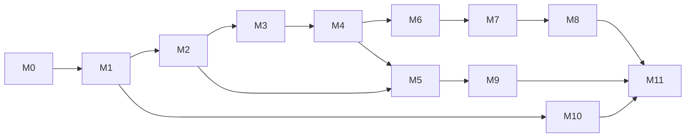

# IMPLEMENTATION_PLAN: Phase 1 build order

> **Update 2026-10-16:** the map engine is now **MapLibre GL** (flat map), the theme is navy + neon blue with the official IAF crest, and the tick simulator is switched off for Phase 1. See ARCHITECTURE §18 D19–D21. Where this document still describes CesiumJS, Cesium ion, the olive/amber theme or live simulation on the map, D19–D21 take precedence.

| | |
|---|---|
| Status | Draft v0.1, 2026-10-16 |
| For | The coding agent and the team. Read [AGENTS.md](../AGENTS.md) first |
| Traceability | Every task cites PRD requirement IDs. The coverage matrix at the end maps every FR to a milestone |

## How to use this plan
- **One branch per milestone** (`m3-map-shell`). Merge when its "Done when" checks pass.
- **Tasks are ≤ 1 day each.** Each leaves at least one runnable test behind ([AGENTS.md §7](../AGENTS.md#7-testing-rules)).
- **If reality diverges from a doc**, update the doc in the same PR and add a line to [ARCHITECTURE §18](ARCHITECTURE.md#18-decision-records-short).
- **Parallel tracks after M2:**

  | Track | Milestones |
  |---|---|
  | A: map | M3 → M4 → M6 → M7 → M8 |
  | B: screens | M5 → M9 |
  | C: simulator | M10 (can start right after M1; integrates with A/B at the end) |

---

## M0: Repository and environment setup
**Goal:** an empty but runnable stack.

| # | Task | Refs |
|---|---|---|
| 0.1 | Repo skeleton per [ARCHITECTURE §12](ARCHITECTURE.md#12-repository-layout); `Makefile` targets `up, down, dev, pipeline, seed, test, check, netcheck`; `.env.example` per ARCHITECTURE §13 | — |
| 0.2 | `docker-compose.yml`: `db` (postgis 16-3.4), `api`, `wind`, `web`; `pipeline` / `generator` under profile `tools` | — |
| 0.3 | FastAPI app factory, `/api/v1/healthz` with DB ping, structlog, error envelope | — |
| 0.4 | Vite + React + TS (strict) + Cesium **1.138.0** (pinned) + `vite-plugin-cesium`; blank globe; `tokens.css` + B612 fonts self-hosted | FR-MAP-01 (stub) |
| 0.5 | Lint/format: ruff + mypy (backend), eslint + prettier + stylelint (frontend); `make check` | — |
| 0.6 | `LICENSE`, `THIRD_PARTY_NOTICES.md` (God's Eye MIT text + skylight MIT + data licences from API §7/§10); `shared/region.json` | FR-MAP-16 (notices) |
| 0.7 | `make netcheck`: script that curls every ✔ endpoint in [API.md](API.md) and prints a pass/fail table | NFR network |

**Deliverables:** running stack, CI-equivalent `make check`.
**Done when:**
- `docker compose up` shows a globe at `localhost:5173`.
- `/api/v1/healthz` returns `{"db":"ok"}`.
- `make check` is green.
- `make netcheck` prints the table.

---

## M1: Data model, curated inputs and generator
**Goal:** a fully seeded, deterministic, synthetic-but-realistic database.

| # | Task | Refs |
|---|---|---|
| 1.1 | `models.py` for all entities in [DATA_MODEL §3](DATA_MODEL.md#3-entity-reference) incl. common columns; Alembic initial migration; DB role grants (audit append-only trigger) | DATA_MODEL §1, §6 I12 |
| 1.2 | SQL views: `v_aircraft_serviceability`, `v_parking_occupancy`, `v_aircrew_currency`, `v_aircrew_fatigue`, `v_aircrew_availability`, `v_fuel_days`, `v_qra_status`, `v_base_summary`, `v_command_kpis` | DATA_MODEL §5 |
| 1.3 | Curated CSVs in `data/curated/`: `iaf_bases.csv` from DATA_MODEL Appendix A + OurAirports coordinates; `iaf_squadrons.csv` (public ORBAT, `source_url` per row, VERIFY pass); `algs.csv`; `other_indian_mil.csv`; `neighbour_bases.csv`; `aircraft_types.csv` (§8.5); `ad_system_types.csv`, `radar_types.csv` (§8.12); name lists + denylist | DATA_MODEL §8.1 |
| 1.4 | Generator: fleet + squadron assignment + airframes (§8.6–8.7) | — |
| 1.5 | Generator: aircrew + careers + qualifications + medical (§8.8); ground crew, vehicles, GSE (§8.10) | — |
| 1.6 | Generator: fuel, warehouses, stock incl. generic armament (§8.11); AD/radar/comms placement with land + buffer tests (§8.12) | — |
| 1.7 | Generator: 90-day sortie history (§8.9); today's programme (§8.13); demo users (§8.14) | FR-AUTH-01 |
| 1.8 | Post-generation checks (§8.15) as pytest + `make seed` failure on violation | — |

**Done when:**
- `make seed` completes in < 2 min.
- Running it twice gives identical table checksums.
- Counts are within ±10% of targets.
- Invariant, denylist and buffer checks pass.
- Non-OWN bases have 0 inventory rows.

---

## M2: API, auth, RBAC and audit
**Goal:** a secure, typed REST API the UI can be built on.

| # | Task | Refs |
|---|---|---|
| 2.1 | Login / logout / me; Argon2id; JWT httpOnly cookie; lockout | FR-AUTH-01, 02, 05, 08 |
| 2.2 | `rbac.require()` + scope functions (base / command); permission matrix as data | FR-AUTH-03, 04, PRD §4.2 |
| 2.3 | `audit()` helper, same-transaction; `crud_router` factory with list (filter / sort / page / search), get, create, PATCH with `version` (409), retire, guarded delete | FR-INV-01, 03, 04, 05, 06 |
| 2.4 | Validation rules (DATA_MODEL §6 invariants exposed as 422s) | FR-INV-09 |
| 2.5 | Read endpoints: `/bases`, `/bases/{id}/summary`, `/bases/{id}/public`, `/overview`, `/commands/{code}/kpis`, `/aircrew/{id}/profile`, `/search` | FR-BASE-01..13 (data), FR-CMD-02, FR-PIL-03..08 (data), FR-MAP-10 (data) |
| 2.6 | Sortie CRUD with lifecycle-aware validation (serviceable aircraft, available crew, route buffer) | FR-INV-10 |
| 2.7 | Admin user management endpoints | FR-AUTH-06 |
| 2.8 | OpenAPI → `frontend/src/api/types.ts` (`make types`) | — |

**Done when:**
- The RBAC matrix test (role × action × entity) passes.
- Every create, update and delete writes exactly one audit row.
- The 409 test passes.
- Swagger lists all routes.
- `types.ts` compiles.

---

## M3: Map shell, region lock and official boundaries
**Goal:** the defence-grade map frame.

| # | Task | Refs |
|---|---|---|
| 3.1 | App shell: routes, auth guard, login page with disclaimer, ClassificationBanner, TopBar (IST + Zulu clocks) | FR-AUTH-08, DESIGN_SYSTEM §7, §10 |
| 3.2 | Port God's Eye viewer, atmosphere compat, render governor ([ARCHITECTURE §11](ARCHITECTURE.md#11-gods-eye-view-extraction-table)); single-owner `MapProvider` safe under StrictMode | FR-MAP-01 |
| 3.3 | `regionLock.ts` (limit rectangle, clamp, max zoom) from `shared/region.json` | FR-MAP-01, 02 |
| 3.4 | `basemaps.ts`: darkened Esri + NaturalEarthII; no OSM / Bing / Google | FR-MAP-03 |
| 3.5 | GIS pipeline steps 1–6, 9–10 ([ARCHITECTURE §9](ARCHITECTURE.md#9-static-gis-pipeline)): DataMeet India, NE India-POV, geoBoundaries clipped, GeoNames, simplification buckets, boundary tests | FR-MAP-04, 05, 06 |
| 3.6 | `/gis/*` endpoints + `boundaries.ts` + `places.ts` layers with LOD and label budget (port `localGeojsonLod.js`) | FR-MAP-04..07 |
| 3.7 | HUD strip (coords DMS/DD, altitude, clocks, feed chips placeholder) + mode soft-keys (bezel component) | FR-MAP-09, 11 |
| 3.8 | Selection plumbing (`selection.ts`, port of contextStore + pickRegistry) | FR-MAP-12 |

**Done when:**
- The boundary acceptance tests pass, both as SQL (no neighbour/India intersection; test points) and visually: J&K incl. PoK/G-B/Aksai Chin and Arunachal render inside India at all zooms.
- The camera can't leave the bbox.
- Idle frame rate is ≥ 30 fps.

---

## M4: Static layers, symbology and layer panel
**Goal:** every static layer on the map with correct symbols.

| # | Task | Refs |
|---|---|---|
| 4.1 | `sidc.ts` lookup + `symbolCache.ts` (milsymbol → billboards); verify each SIDC incl. exercise identities, hostile/neutral frames, condition bars, QRA modifier | FR-MAP-14, DESIGN_SYSTEM §6 |
| 4.2 | Layers: IAF bases, ALGs, other Indian military, neighbour bases (hostile PAK/CHN, neutral others), civil airports | FR-MAP-13, 14, 15 |
| 4.3 | Layers: radars + rings, AD batteries + rings, QRA badges, military comms nodes | FR-MAP-13 |
| 4.4 | OSM pipeline (step 7–8): roads, rail, telecom towers, OurAirports runways → layers | FR-MAP-13 |
| 4.5 | Layer rail: groups, toggles, counts, opacity, legend, persistence; disabled-reason text | FR-MAP-08 |
| 4.6 | Info cards for non-base features; neighbour / other-mil public card; search box | FR-MAP-10, 12, FR-BASE-17 |
| 4.7 | Credits panel | FR-MAP-16 |

**Done when:**
- Every layer toggles and shows its count.
- Picking works for every layer.
- Hostile/neutral/exercise frames render correctly.
- ≥ 30 fps with all static layers on.

---

## M5: Base side panel
**Goal:** the station drill-down that answers "what's the state of this base?".

| # | Task | Refs |
|---|---|---|
| 5.1 | SidePanel shell + bezel soft-key tabs + header | FR-BASE-01, 14 |
| 5.2 | Overview + Aircraft tabs (jets by class, type × status, capacity, helicopters, UAVs, drones) | FR-BASE-02, 03, 05, 11 |
| 5.3 | Crew tab (aircrew status, standby, availability, fatigue, pilot list → profile) | FR-BASE-04, 12 |
| 5.4 | Support + Defence tabs (vehicles, GSE, ground crew; AD guns, SAMs, radars, QRA) | FR-BASE-06, 07, 08 |
| 5.5 | Fuel & Stores + Infra tabs (fuel gauges, transactions, warehouses, generic armament, runways, ALGs) | FR-BASE-09, 10 |
| 5.6 | Sorties airborne / next launches; edit entry points by role | FR-BASE-13, 16 |
| 5.7 | Fly-to + panel-slide orchestration; < 500 ms open | FR-BASE-18, DESIGN_SYSTEM §11 |

**Done when:**
- Every row of [PRD §8](PRD.md#8-base-side-panel-field-checklist) is present for any IAF base.
- The panel opens in < 500 ms.
- Edit buttons appear only for the right roles.

---

## M6: Live air picture
**Goal:** real ADS-B traffic over the region, merged from all feeds and categorised.

| # | Task | Refs |
|---|---|---|
| 6.1 | `readsb.py` normaliser (adsb.lol / adsb.fi; `ac` or `aircraft` key) + `opensky.py` normaliser; recorded fixtures in `data/fixtures/` | FR-LIVE-02 |
| 6.2 | Poller: viewport circles, `/mil` registry, merge + dedupe, cache, coalescing, backoff, provider health | FR-LIVE-01, 10 |
| 6.3 | `classify.py`: port of God's Eye `aircraftClass.js` + emergency, extended with Indian types, cargo operator list, UAV/drone rules | FR-LIVE-03, 05 |
| 6.4 | `GET /live/aircraft`, `/live/status`, `/live/aircraft/{hex}/enrich` (adsbdb) | FR-LIVE-05 |
| 6.5 | Frontend `liveAir.ts`: rotated glyphs, category toggles with counts and the "not broadcast" text, staleness fade, track card, feed chips | FR-LIVE-04, 05, 06 |
| 6.6 | Simulated-track layer stub fed by a static fixture (real feed comes in M10) | FR-LIVE-07, 08 (stub) |

**Done when:**
- Live tracks render in the bbox with correct categories.
- The classifier fixture tests pass.
- Killing one provider keeps tracks flowing, and that provider's chip goes OFF.

---

## M7: Weather view
**Goal:** aviation and general weather for any location in the region.

| # | Task | Refs |
|---|---|---|
| 7.1 | METAR/TAF poller + nearest-station fallback precompute; flight-category rings; Weather tab with raw + decoded | FR-WX-01 |
| 7.2 | Open-Meteo proxy + click popover (current + 48 h incl. winds aloft) | FR-WX-02 |
| 7.3 | OWM tile proxy + overlay picker + opacity | FR-WX-03 |
| 7.4 | Wind sidecar (copy God's Eye wind server + `server.mjs`), FastAPI proxy, port `src/layers/wind/*` | FR-WX-04 |
| 7.5 | nowCOAST IR WMS proxy + layer | FR-WX-05 |
| 7.6 | Legends, valid-time chips, max-zoom notices | FR-WX-06, 08 |

**Done when:**
- Each overlay toggles in Weather mode.
- An Air Force-only base (e.g. VIAX) shows a labelled nearest-station METAR.
- A grep of the built bundle finds no provider keys.

---

## M8: Terrain view
**Goal:** 3D terrain inspection anywhere in the region.

| # | Task | Refs |
|---|---|---|
| 8.1 | `terrain.ts`: ion → Re:Earth → ellipsoid with notice (port `terrain.js` + `terrainRetry.js`) | FR-TER-01 |
| 8.2 | Tilt toggle (port `toggleCameraTilt`), free tilt gestures | FR-TER-02 |
| 8.3 | Click → oblique close-up of a ~30 km box; Back restores the view | FR-TER-03, 06 |
| 8.4 | Elevation readout (cursor + clicked point); ground guard port | FR-TER-04, 06 |
| 8.5 | Exaggeration slider | FR-TER-05 |

**Done when:**
- Clicking near Leh gives an oblique 3D close-up with elevation readouts.
- Back restores the previous view.
- The camera never clips below terrain.

---

## M9: Screens (overview, inventory, pilots, alerts, audit, admin)
**Goal:** every non-map screen in the PRD.

| # | Task | Refs |
|---|---|---|
| 9.1 | Command overview: theatre KPI row, command columns, TC/MC strip, per-base table, click → map + filter | FR-CMD-01..04 |
| 9.2 | Generic `DataTable` + `EntityForm` driven by per-entity config; tables for every entity; point picker; retire / delete flow; 409 dialog | FR-INV-01..06, 08 |
| 9.3 | Sortie create / edit / cancel UI (Base Commander + Admin) | FR-INV-10 |
| 9.4 | Pilot list + profile (identity, hours, quals, currency, sorties, medical / fatigue, career timeline, edit) | FR-PIL-01..09 |
| 9.5 | Alerts list, acknowledge, toasts, top-bar badge, map halo | FR-ALR-02..05 |
| 9.6 | Audit log view with diff viewer (incl. SIMULATOR actor filter) | FR-ALR-06, 07 |
| 9.7 | Admin: users; simulator controls UI | FR-AUTH-06, FR-SIM-01 (UI) |
| 9.8 | CSV export with SIM header | FR-INV-07 |

**Done when:**
- A create → edit → retire round-trip works per role for every entity.
- The audit diff renders.
- Pilot profiles show every FR-PIL field.

---

## M10: Tick simulator and WebSocket
**Goal:** the picture moves, consistently.

| # | Task | Refs |
|---|---|---|
| 10.1 | Engine loop, clock, speed / pause / step / reseed, single-transaction ticks, `sim_state` | FR-SIM-01, 11, 12 |
| 10.2 | Daily programme generation | FR-SIM-02 |
| 10.3 | Sortie lifecycle (programme + human-created), cancel / abort reasons; simulated track computation | FR-SIM-03, FR-LIVE-07 |
| 10.4 | Fuel burn / refuel / replenishment; crew shifts / rest / fatigue; maintenance / AOG; faults | FR-SIM-04, 05, 06, 08 |
| 10.5 | QRA upkeep + simulated unknown tracks + scramble / intercept / RTB | FR-SIM-07, FR-LIVE-08 |
| 10.6 | Alert rules + dedupe + auto-clear; KPI snapshots; simulator audit rows | FR-SIM-09, FR-ALR-01, FR-WX-07, FR-CMD-05 |
| 10.7 | WebSocket hub (auth, seq, topics) + client (invalidate / patch, resync on gap); live panel / table refresh; sim tracks layer + violet trails | FR-SIM-10, FR-AUTH-07, FR-BASE-15, FR-INV-08, FR-LIVE-09 |
| 10.8 | Invariant checker + soak test | FR-SIM-11 |

**Done when:**
- A 60 sim-minute run at 60× with `SIM_ASSERT=1` produces 0 violations.
- Tracks launch and recover at the correct bases.
- An unknown track triggers a scramble from the nearest QRA-met base.
- A human-created sortie is flown.
- The UI updates within 1 s of a tick.

---

## M11: Polish and demo readiness
**Goal:** the six-minute demo runs flawlessly.

| # | Task | Refs |
|---|---|---|
| 11.1 | Performance pass against NFR budgets (primitives, label budget, simplification buckets) | PRD §9 |
| 11.2 | Accessibility pass: contrast, focus, keyboard map, aria-live, reduced motion | PRD §9, DESIGN_SYSTEM §12 |
| 11.3 | Demo scenario seed (a base below fuel reserve, an IFR base, a QRA shortfall in EAC) + scripted demo checklist ([PRD §5](PRD.md#5-demo-narrative-the-6-minute-story)) | PRD §5, §11 |
| 11.4 | `netcheck` on the venue network; set `HTTPS_CA_BUNDLE` if TLS is inspected | API §11 |
| 11.5 | README with run steps and judge credentials; screenshots | — |
| 11.6 | (Could) Offline mode + ADS-B record/replay | FR-LIVE-11 |

**Done when:**
- The demo script runs end to end on the target machine.
- All five scripted questions are answered in < 30 s each.

---

## Cut list
If time runs short, drop in this order (top first). Must-haves are never cut.

1. FR-LIVE-11 offline replay
2. `comms_link` lines
3. FR-CMD-05 sparklines
4. ECMWF model toggle (keep GFS)
5. OWM layers beyond clouds + precipitation
6. FR-TER-05 exaggeration
7. FR-LIVE-09 trails
8. FR-INV-07 CSV export
9. FR-WX-07 below-minima alert

## Definition of done (every task)
- Tests added and passing; `make check` green.
- Docs updated if behaviour or schema changed.
- SIM labelling present on any new synthetic surface ([DESIGN_SYSTEM §9](DESIGN_SYSTEM.md#9-simulated-labelling-rule)).
- MIT header on any ported God's Eye file and a `THIRD_PARTY_NOTICES.md` entry.
- No provider key in the frontend bundle.

---

## FR coverage matrix
| Area | Milestones |
|---|---|
| FR-MAP-01..16 | M0 (01 stub, 16 notices), M3 (01–07, 09–12), M4 (08, 10, 12–16) |
| FR-LIVE-01..11 | M6 (01–06, 07/08 stub, 10), M10 (07–09), M11 (11) |
| FR-WX-01..08 | M7 (01–06, 08), M10 (07) |
| FR-TER-01..06 | M8 |
| FR-BASE-01..18 | M2 (data), M4 (17), M5 (01–16, 18), M10 (15) |
| FR-INV-01..10 | M2 (01, 03–06, 09, 10 API), M9 (01–08, 10 UI), M10 (08) |
| FR-PIL-01..09 | M2 (data), M9 |
| FR-CMD-01..05 | M2 (data), M9 (01–04), M10 (05) |
| FR-ALR-01..07 | M9 (02–07), M10 (01) |
| FR-AUTH-01..08 | M1 (01 users), M2 (01–06, 08), M3 (08 UI), M9 (06 UI), M10 (07) |
| FR-SIM-01..12 | M9 (01 UI), M10 |
