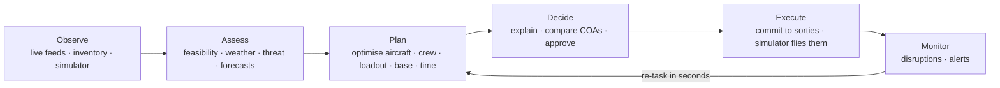
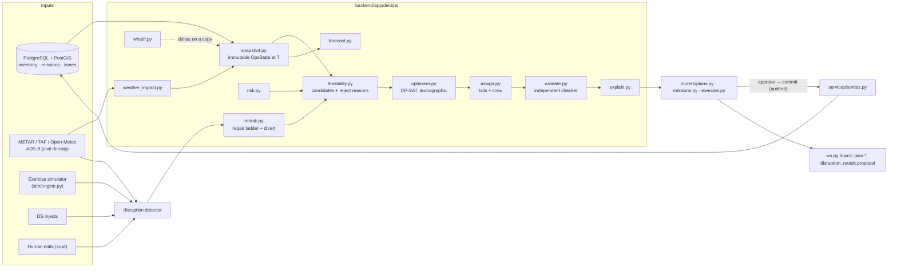
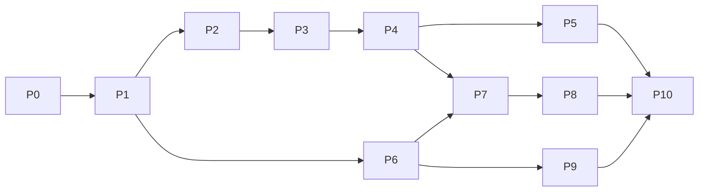

# PHASE2_IMPLEMENTATION_PLAN: decision support for SIH26250

| | |
|---|---|
| Status | Draft v0.1, 2026-10-17 |
| For | The team and the coding agent. Read [AGENTS.md](../AGENTS.md) first, then §4 here (it changes AGENTS.md §1) |
| Problem statement | **SIH26250**: Air Power: Dynamic Air Operations & Resource Optimisation (MoD / DSSC). Text taken from [PRD §1.1](PRD.md#11-problem-statement-summary-of-sih26250); cross-check against the official SIH page before finalising |
| Builds on | Phase 1 as it stands at commit `2e4e691` ([IMPLEMENTATION_PLAN](IMPLEMENTATION_PLAN.md) M0–M11) |
| Keeps | The navy + neon-blue theme, B612 fonts, tokens, components, layouts and copy rules in [DESIGN_SYSTEM](DESIGN_SYSTEM.md). No restyling. New screens are assembled from existing parts |

---

## 0. Implementation status (2026-10-17)
Built on branch `phase2-decision-support`. §17 decisions were taken as recommended (decision support allowed, Ops view
for the simulator, generic threats and loadouts, COMMAND_HQ approves, 24 h / 15 min, four soft-keys kept, Python 3.12).

| Milestone | Status | Where |
|---|---|---|
| P0 groundwork | Done: Docker PostGIS, `scripts/setup.ps1`, `dev.ps1`, `check.ps1`, `dbdump.ps1`; pipeline runs without GDAL; OurAirports CSVs downloaded; `127.0.0.1` DSN; docs updated (AGENTS, PRD §17, ARCHITECTURE D28–D35, DATA_MODEL §10, DESIGN_SYSTEM §15) | `docker-compose.yml`, `scripts/`, `pipeline/run_pipeline.py` |
| P1 data | Done: Phase 2 tables, generic loadouts, airspace and threat zones, two days of mission requests, synthetic 72 h base forecast, two scenarios; deterministic checksum | `models.py` §I, `generator/phase2.py` |
| P2 assessment | Done: snapshot, weather minima / night, route risk, feasibility with reject reasons, border-safe router | `decide/snapshot.py`, `weather_impact.py`, `risk.py`, `feasibility.py`, `routing.py` |
| P3 optimiser | Done: CP-SAT, lexicographic priorities, presets, assignment with retry cuts, independent validator | `decide/optimiser.py`, `assign.py`, `validate.py`, `planner.py` |
| P4 lifecycle | Done: plans API, commit diff (kept / swap / moved / new / divert / dropped), weapons reservation, overrides, audit; **commit-time repair** | `decide/store.py`, `routers/ops.py`, `services/sorties.py` |
| P5 UI | Done: Missions, Planner (Plan / Changes / What-if / COA), sim clock, nav | `frontend/src/pages/Planner.tsx`, `Missions.tsx`, `features/ops.tsx` |
| P6 simulator + Ops view | Done: simulator on, flies plan sorties, weapons release / expend, mission outcomes, QRA upkeep no longer steals tasked aircraft; Ops map view with nine layers | `sim/engine.py`, `map/MapView.tsx`, `map/style.ts` |
| P7 re-tasking | Done: monitor every 12 s, disruptions, swap → partial → full re-solve, divert advice, alerts, toasts | `decide/retask.py`, `monitor.py` |
| P8 explain / forecast / what-if | Done: explanations, unmet reasons + checked fixes, 72 h forecasts (base panel "Outlook"), what-if (7 deltas), COA | `decide/explain.py`, `forecast.py`, `whatif.py` |
| P9 exercise | Done: scenarios, live injects (8 kinds, `AUTO` base targeting), KPI samples, after-action report + CSV + print | `decide/exercise.py`, `routers/exercise.py`, `pages/Exercise.tsx` |
| P10 hardening | Done: 29 backend tests, 7 vitest units (`timeline.test.ts`), strict typecheck clean, `scripts/ui_smoke.py`, benchmark harness (`python -m app.bench` → [BENCHMARK](BENCHMARK.md)), accessibility pass (keyboard rows and timeline bars, focus ring, modal focus trap and return). **Not done:** the manual planning baseline (a team task) |
| Next phase (D36–D40) | Done: air-to-air refuelling legs and runway launch rate (D36); in-flight re-role with knock-on swaps (D37); predictive maintenance, a snag-risk model learned from the maintenance log, with a [model card](MODEL_CARD_SNAG_RISK.md) (D38); civil-traffic deconfliction (D39); validator and optimiser semantics aligned, validator-driven retries, fill pass, 2× faster model build (D40); human sorties through `services/sorties.py` | `decide/feasibility.py`, `retask.py`, `predict.py`, `model_card.py`, `traffic.py`, `optimiser.py`, `sim/reliability.py`, `bench.py` |

**Deviations from this plan (and why):**
- **Detection by re-validation (D35)** instead of wiring every source: the monitor re-checks the committed plan, so simulator, human, weather and inject changes are caught the same way.
- **De facto control for planning (D33)**: the official polygon includes PoK, Gilgit-Baltistan and Aksai Chin; synthetic CAP stations and radars were landing there. Planning now uses Natural Earth's de facto layer (never rendered); the map is unchanged.
- **Neutral-neighbour standoff of ~5 km and a router (D34)**: a 25 km standoff from Nepal and Bangladesh closes the Siliguri corridor.
- **Commit-time repair**: with the simulator running, tails go unserviceable between "generate" and "commit"; commit swaps them or skips the package with a reason instead of failing.
- **Crew rest of 10 h** after every sortie (the simulator's existing rule) rather than two sorties a day.

**Measured on the dev laptop (seeded day, simulated data):**
- **Seed:** ~15 s. 75 IAF stations, 1,826 aircraft, 3,821 aircrew, ~70–110 mission requests over two days.
- **Theatre plan:** 41–52 missions, typically 38/42 covered, every P1 covered, 0 validator violations. 0.6–2.4 s once warm; the first call in a process adds ~5 s of one-off geometry.
- **Re-task proposals:** 1–400 ms over a live ×60 exercise with 14 disruptions. Runway closure dropped only the package with no alternative; a weather forecast drop moved one package and swapped one crew for an instrument-rated one; a Su-30MKI grounding was fixed by five tail swaps; a pop-up P1 casualty evacuation was tasked from Leh.
- **Soak:** 4 simulated hours at ×60 with `SIM_ASSERT=1` gave 0 invariant violations. Plan sorties launched, flew and recovered; missions were marked MET.

| Phase after that (D41–D44) | Done: AEW&C support dependencies (optimiser link rows, validator `DEPENDENCY`, joint re-tasking); split missions as reliefs or parts from several bases, offered as checked fixes and applied by a person, covered all or nothing; manual planning baseline (timed sessions judged by the real rules, beside the optimiser, exported to the benchmark); optional OpenAIP airspace import; fill pass with displacement; launch-rate rejection in feasibility; helicopter packages of 4+ crewable | `decide/split.py`, `manual.py`, `airspace_import.py`, `optimiser.py`, `planner.py`, `features/manual.tsx` |

| Phase after that (D45–D47) | Done: launch waves (one rule shared by optimiser and validator); air tasking order (print view, CSV, per base, DRAFT until committed); containerised deployment (`docker compose --profile full up -d --build`, web on :8080, first-start pipeline and seed) | `optimiser.wave_slots`, `decide/ato.py`, `pages/Ato.tsx`, `deploy/` |

**Measured after D41–D44 ([BENCHMARK](BENCHMARK.md), same harness; each seeded day now also has a 6 h CAP and a flood-relief surge, split with the checked fixes first):**
- **Plans:** 90.3 % of missions covered on normal days (P1 91 %), 0 violations in 35 plans, deterministic 7 of 7; the seeded day plans in 4.3 s, normal days 2.4–9.3 s cold. CP-SAT matches or beats greedy in all 7 runs (better in 2, worse in 0); the surge day (154 missions) covers 131 vs 129 in 28 s.
- **Re-task proposals:** runway closure 0.7–3.9 s (mean 2.8 s), 80 % of the plan untouched; pop-up P1 0.3–0.7 s.
- **Split missions:** the seeded 6 h CAP is flown as two Su-30MKI reliefs from Halwara (08:00–11:15 and 11:00–14:00Z); the 16-helicopter flood surge as 8 Dhruv from Sarsawa plus 8 Mi-17V-5 from Hindan, on station together.
- **Manual baseline:** the tool is ready (Planner → Manual baseline); no human sessions recorded yet, so BENCHMARK.md says so.

**Measured in the next phase ([BENCHMARK](BENCHMARK.md): 3 seeds × 2 epochs + a 2.5× surge day, simulated data):**
- **Plans:** 93.1 % of missions covered on normal days, 0 validator violations in 35 plans, identical plan on a second run in 7 of 7. Total 1.6–5.4 s with a cold route cache (FR-PLN-07 target < 10 s); solve 0.3–1.1 s.
- **Optimiser vs greedy** on the same candidates: CP-SAT matches or beats greedy in every run (better in 3 of 7, +4 missions), including the surge day (123 vs 121 of 144, +2 P2). The surge day plans in 14–19 s.
- **Re-task proposals:** runway closure 0.5–2.7 s (mean 1.9 s), keeping 76 % of the plan untouched; pop-up P1 0.2–0.3 s, keeping 98 %. In-flight re-role tested end to end (proposal → commit → simulator flies the new route).
- **Snag-risk model:** held-out AUC 0.74 against a ceiling of 0.76 (the simulator's own law) and 0.68 for an hours-since-maintenance rule; calibrated by tenth; top 10 % riskiest tails see 3.4× the average defect rate. The simulator's defect rate is ~5–6 % per tail-sortie (20 % found pre-flight, 20 % in flight, 60 % post-flight).
- **Soak:** 30 simulated hours at ×90 with `SIM_ASSERT=1` and the new defect stages: 0 invariant violations; every pre-flight defect was covered by a spare tail.

**Still open:**
- run manual planning sessions with real planners (team task; the tool and the report section are ready)
- an OpenAIP key (or export) to load published airspace; synthetic zones are used until then
- organiser sign-off on the generic threat bands and loadouts (§17 rows 2–3)

---

## 1. Summary

**What the problem statement asks for.** Planning and re-tasking air operations in a contested, fast-changing environment. Today the inputs (aircraft availability, crew status, weapon loads, airspace, weather, threats, mission priorities) sit in separate systems. There is no common, real-time *decision-support* picture, so planning is slow and scarce air power is used poorly.

**What Phase 1 already delivers.** The *common picture*:
- a synthetic system of record (~75 IAF stations, ~1,400 aircraft, ~3,000 aircrew, 90 days of history) with CRUD, RBAC, audit and optimistic locking
- the map (GoI borders, live ADS-B, weather, infrastructure)
- base drill-down, command overview, pilot profiles and alerts

**What is missing is the other half of the title: *dynamic operations* and *resource optimisation*.**
- No missions exist in the data.
- No weapon loadouts.
- No airspace or threat model.
- No planner, re-tasking, forecasts or what-if.
- The simulator that would make the picture dynamic is switched off.
- [AGENTS.md §1](../AGENTS.md#1-scope) forbids decision-support code.

**What Phase 2 builds.** A human-in-the-loop decision-support loop on top of the Phase 1 data:



It covers:
1. **Mission tasking:** prioritised missions (P1–P4) with time windows, areas, requirements and an approval workflow.
2. **Optimised planning:** a CP-SAT model that assigns base, aircraft type and tails, crew and a generic loadout to each mission. It respects availability, crew currency, qualifications and fatigue, fuel, weapon stock, weather minima, airspace capacity, threat risk and QRA reserves.
3. **Dynamic re-tasking:** disruptions are detected, the plan is repaired with as few changes as possible, the change is shown as a diff, and a human approves it. Airborne packages get divert recommendations.
4. **Explanations:** why each choice was made, which alternatives lost and why, and for every unmet mission the reason and what would fix it.
5. **Forecasts:** aircraft, crew, fuel, weapons and base weather over 72 h.
6. **What-if and COA comparison:** hypothetical changes are evaluated without touching live data.
7. **Exercise mode** (fits DSSC's role as a staff college): the simulator returns in a separate Ops view, directing staff inject events, and runs end with an after-action report.

---

## 2. Problem statement → requirements → current coverage

| ID | Requirement derived from SIH26250 | Phase 1 status | Phase 2 delivers |
|---|---|---|---|
| PS-1 | Fuse all seven data categories into one model and picture | **6 of 7.** Missions are empty; weapon loads are generic stock only | Mission model + generic loadouts + airspace + threat zones (§6) |
| PS-2 | Real-time picture | Real feeds live; inventory static (simulator off, D20) | Exercise simulator + disruption stream (§8, P6) |
| PS-3 | Decision support for planning | **Missing** (banned by AGENTS §1) | Planner: feasibility → CP-SAT → assignment (§7.1–7.3) |
| PS-4 | Dynamic re-tasking | **Missing** | Disruption detection, repair ladder, diffs, divert advice (§7.4) |
| PS-5 | Optimal use of scarce air power | **Missing** | Priority-lexicographic objective; hours, fuel, weapons and crew balancing; QRA reserve kept (§7.2) |
| PS-6 | Contested environment: threats and airspace shape plans | Neighbour bases only; unknown tracks off | Risk-aware routing, threat zones, airspace capacity (§7.1) |
| PS-7 | Weather-aware planning | Weather shown, not used | Per-base hourly flight category and minima per crew rating (§7.1) |
| PS-8 | Faster planning (measurable) | — | Benchmark: time to plan / re-task vs manual baseline (§13) |
| PS-9 | Trustworthy, human-in-the-loop | Audit exists | Explanations, approve / override, plan validator, full audit (§7.5) |
| PS-10 | No official dataset: build a realistic one | Present | Extend the generator: missions, loadouts, airspace, scenarios (P1) |
| PS-11 | Training / wargaming use (DSSC) | — | Exercise control, injects, after-action report (§8, P9) |

---

## 3. Analysis of the current repository

### 3.1 Strengths to reuse (do not rewrite)
| Asset | Where | Reuse in Phase 2 |
|---|---|---|
| Schema with missions, sorties, sortie crew/aircraft, QRA posture, fuel, stock, AD, radar | `backend/app/models.py` | Extend; don't replace |
| Derived readiness views: serviceability, currency, fatigue, availability, fuel days, QRA | `backend/app/sql/schema.sql` | Direct inputs to the snapshot builder |
| Border-safe geometry: `India.ok`, `route_ok`, `place_near` | `backend/app/geo.py` | Route feasibility (invariant I8 stays) |
| Route planner + position along route | `backend/app/sim/routes.py` | Candidate routes and track positions |
| Full tick simulator: programme, lifecycle, fuel, crew, faults, QRA, unknowns, scramble | `backend/app/sim/engine.py` | Re-enable as Exercise mode; add injects and plan execution |
| Human sortie creation with validation + audit | `backend/app/routers/sim.py` `create_sortie` | Extract to a service; plan commit calls it |
| Alert engine with dedupe and auto-clear | `backend/app/sim/alerts.py` | New kinds; disruption source |
| Generic CRUD with RBAC, audit and 409s | `backend/app/crud.py` | Missions, loadouts, zones |
| WebSocket hub with seq numbers + client resync | `backend/app/ws.py`, `frontend/src/api/ws.ts` | New topics for plan, disruption and retask |
| Weather: METAR/TAF poller, Open-Meteo proxy | `backend/app/weather/` | Base forecast table for planning |
| UI kit: `Kpi`, `Row`, `Pill`, `Gauge`, `Modal`, `Sim`, toasts, dock + flyout, tables, `.tabs` | `frontend/src/components/ui.tsx`, `styles/base.css` | Every new screen |

### 3.2 Gaps and defects found
| # | Finding | Evidence | Fix in |
|---|---|---|---|
| G1 | Only 8 standing missions are generated, with no geometry, requirements or daily windows, so "mission priorities" can't drive planning | `backend/generator/__main__.py` "missions (Phase-2-ready, light)"; `engine.programme()` only links sorties to them at random | P1 |
| G2 | Missions are admin-only CRUD with no UI | `crud.py` `"missions": … admin_only=True`; no route in `App.tsx` | P1, P5 |
| G3 | Weapon loads are warehouse stock only: no loadout, no compatibility, sorties consume nothing | DATA_MODEL §E "No loadout model"; PRD §12 "Partial" | P1 |
| G4 | No airspace structures; training areas are implicit inside `sim/routes._loop` | `routes.py` | P1, P2 |
| G5 | No threat model beyond neighbour markers; own radar/AD rings removed from the map (D20) | ARCHITECTURE D20 | P1, P2, P6 |
| G6 | Weather is displayed but never used for feasibility (only `WX_BELOW_MINIMA` alerts) | `sim/alerts.py` | P2 |
| G7 | Simulator off; sortie creation UI and simulated tracks removed | `.env.example` `SIM_ENABLED=false`; D20 | P6 |
| G8 | Decision support forbidden by the agent rules | AGENTS.md §1 | P0 |
| G9 | Crew qualifications (NIGHT, NVG, MOUNTAIN_FLYING, QRA_CLEARED, FORMATION_LEAD) are stored but never checked for tasking | `create_sortie` checks medical/duty only | P2 |
| G10 | The top bar has no simulator clock, though DESIGN_SYSTEM §7.2 specifies one | `App.tsx` `TopBar` | P6 |
| G11 | Tooling is macOS-only (Homebrew paths, `lsof`, nvm); the team works on Windows; no docker-compose despite ARCHITECTURE §14 | `Makefile`, `scripts/dev.sh` | P0 |
| G12 | Thin test base: 10 backend tests, no frontend tests, no Playwright, no `data/fixtures/` | `backend/tests/test_api.py`; `data/` holds only `curated/` | P0, P10 |
| G13 | Doc debt: PRD and ARCHITECTURE still describe Cesium in places (banner-patched) | doc headers | P0 |
| G14 | Python version drift: AGENTS says 3.12, Makefile uses 3.13 | `AGENTS.md §3`, `Makefile` | P0 |

---

## 4. Guardrails: what stays, what changes

**Stays exactly as is:**
- Theme, tokens, fonts, layout rules, copy rules, bezel soft-keys only in the base panel ([DESIGN_SYSTEM](DESIGN_SYSTEM.md)).
- The four map conventions: GoI borders only, no third-party labels, region lock, IST primary.
- The **Live** view stays real-data-only (honours D20).
- All data-sensitivity rules ([AGENTS §8](../AGENTS.md#8-data-sensitivity-rules)): fictional people, SIM labels, no foreign inventory, no real classification markings.
- Every synthetic route and site stays ≥ `border_buffer_km` inside India (I8). **No mission targets or routes in foreign territory.** Strike-type missions use synthetic exercise ranges inside India.
- RBAC + audit on every mutation; `version` on every PATCH.

**Changes (land in P0, same PR as this plan's adoption):**

| Doc | Change |
|---|---|
| AGENTS.md §1 | Replace the ban with: "Phase 2 decision-support code lives in `backend/app/decide/`. Recommendations are advisory: nothing reaches the sortie tables without a human approval that is audited. Overview screens stay values-only; scores and rankings appear only in the Planner." |
| AGENTS.md §3 | Add `ortools` (CP-SAT, Apache-2.0) for the optimiser. Pin Python to the version the ortools wheel supports on Windows |
| PRD | New §17 "Phase 2" with FR-MSN, FR-PLN, FR-RTK, FR-XPL, FR-FCT, FR-WIF and FR-EXR (requirement IDs used below) |
| ARCHITECTURE §18 | D28 decision engine, D29 Ops view (simulator back, Live stays real), D30 generic loadouts, D31 threat model, D32 cross-platform tooling |
| DATA_MODEL | §3 new tables (§6 below); §6 invariants I13–I17; §9 simulator additions |
| DESIGN_SYSTEM | §5 Planner and Missions layouts (§10 below); §8 Ops view layer styles; §9 SIM treatment for plans, zones and routes |

---

## 5. Architecture



**Process model.** Same single FastAPI worker (ARCHITECTURE D2). Solves run in `asyncio.to_thread` with a hard time limit, as the simulator does. A module-level lock allows one solve at a time, so a second request returns 409 "A plan is being generated". **Ceiling:** one concurrent solve. **Upgrade path:** a job queue (RQ/Arq) with its own worker process. Mark it with a `ponytail:` comment.

**The snapshot is the contract.** `OpsState` is a frozen dataclass built from the DB and the views at time T:
- aircraft, crew and qualifications
- bases with runway status and parking
- fuel, stock and reservations
- per-base weather timeline
- missions, airspace and threat zones
- the committed plan

The planner, forecasts, what-if and re-tasking all read a snapshot, never the live session. What-if applies deltas to a copy, so it never writes.

---

## 6. Data model additions

All new rows follow DATA_MODEL §1: common columns, `is_simulated`, VARCHAR+CHECK enums, UTC, SI units. Schema changes go in `models.py`, and views in `sql/schema.sql` (D12 still holds: data is regenerated by `make seed`).

| Table | Key fields | Notes |
|---|---|---|
| `mission` (extend) | + `required_aircraft`, `eligible_roles text[]`, `loadout_code`, `on_station_min`, `target_geom Point`, `min_quals text[]`, `max_risk (LOW/MED/HIGH)`, `requested_by`, `approved_by`, `approved_at`, `outcome (NONE/PARTIAL/MET)`, `on_station_achieved_min` | `area_geom` / `target_geom` must sit inside India ≥ buffer (I8). Status adds `PLANNED` and `TASKED` between `APPROVED` and `ACTIVE` |
| `loadout_config` (new, catalogue) | `code`, `name` (generic: "Air defence, heavy"), `role_family`, `items jsonb` (`{"ARMAMENT_AAM_BVR": 4, "ARMAMENT_AAM_WVR": 2}`), `fuel_penalty_pct`, `radius_factor` | **Generic only**: no real store names or station layouts (decision D30) |
| `type_loadout` (new) | `aircraft_type_id`, `loadout_code` | Compatibility by role family |
| `airspace_zone` (new) | `code`, `kind (TRAINING_AREA, RESTRICTED, DANGER, CORRIDOR, TEMP_RESERVATION)`, `geom Polygon`, `lower_m`, `upper_m`, `capacity_packages`, `active_from/to` | Synthetic + exercise; optional public import later (cut list) |
| `threat_zone` (new) | `code`, `kind (BORDER_BAND, EXERCISE_SAM, EXERCISE_CAP, EXERCISE_EW, UNKNOWN_ACTIVITY)`, `geom`, `risk_level 0–1`, `active_from/to`, `scenario_id` | See D31: default = generic border-proximity bands; everything else is a directing-staff inject. Never tied to real foreign deployments |
| `wx_base_forecast` (new) | `base_id`, `valid_ts`, `ceiling_ft`, `vis_m`, `wind_kt`, `gust_kt`, `crosswind_kt`, `flight_cat`, `source (METAR/TAF/OPEN_METEO)`, `fetched_at` | Refreshed hourly; fixtures in tests |
| `plan` (new) | `version`, `parent_plan_id`, `scope (THEATRE/COMMAND)`, `command_id`, `horizon_start/end`, `status (DRAFT, PROPOSED, APPROVED, COMMITTED, SUPERSEDED, REJECTED)`, `preset`, `weights jsonb`, `seed`, `solver_status`, `solve_ms`, `kpis jsonb`, `created_by`, `approved_by`, `trigger_disruption_id` | Each re-plan is a child plan, so diffs come for free |
| `plan_item` (new) | `plan_id`, `mission_id`, `base_id`, `aircraft_type_id`, `loadout_code`, `launch_ts`, `recovery_ts`, `n_aircraft`, `aircraft_ids bigint[]`, `aircrew_ids bigint[]`, `route_geom`, `risk`, `fuel_l`, `score jsonb` (breakdown), `explanation jsonb`, `alternatives jsonb`, `status (PROPOSED, APPROVED, REJECTED, COMMITTED, SUPERSEDED)`, `sortie_id` | |
| `plan_unmet` (new) | `plan_id`, `mission_id`, `reasons jsonb` (codes + detail), `fixes jsonb` | Every unmet mission has at least one reason (test) |
| `disruption` (new) | `ts`, `kind (AIRCRAFT_US, CREW_UNAVAILABLE, RUNWAY_CLOSED, WX_BELOW_MINIMA, THREAT_ACTIVATED, AIRSPACE_RESERVED, FUEL_SHORT, STOCK_SHORT, MISSION_NEW, MISSION_CHANGED, INJECT)`, `base_id`, `entity_type/id`, `payload jsonb`, `status (OPEN, ASSESSED, RESOLVED, IGNORED)`, `impacted_item_ids bigint[]`, `proposal_plan_id` | |
| `scenario` / `scenario_inject` / `exercise_run` (new) | name, seed, start state; inject `offset_min`, `kind`, `params`; run `started_at`, `status`, `kpi_timeline jsonb` | Exercise mode and the after-action report |
| `sortie` (extend) | + `loadout_code`, `plan_item_id` | |
| `stock_level` (use) | `qty_reserved` is now written by plan commit and released on landing or cancel | |
| `alert.kind` (extend) | + `MISSION_UNCOVERED`, `PLAN_AT_RISK`, `RETASK_PROPOSED` | |
| `audit_log.action` (extend) | + `PLAN_GENERATE`, `PLAN_APPROVE`, `PLAN_REJECT`, `PLAN_COMMIT`, `PLAN_OVERRIDE`, `INJECT` | |

**New invariants:**

| # | Invariant | Enforced in |
|---|---|---|
| I13 | Committed plan items never share an aircraft or crew member in overlapping time (incl. turnaround and min rest) | `validate.py` + DB check on commit |
| I14 | Σ `qty_reserved` ≤ `qty_on_hand` per stock level; planned fuel issue never takes a tank below `reserve_l` | `validate.py`, commit transaction |
| I15 | Mission geometry and plan routes lie inside India ≥ buffer (extends I8) | API validation, `feasibility.py` |
| I16 | Committed items keep each QRA posture met (no QRA aircraft or crew tasked unless the posture is backfilled) | `optimiser.py` constraint + `validate.py` |
| I17 | Every committed sortie traces to an approved plan item or a human sortie with an audit row | commit service + test |

---

## 7. Decision engine

### 7.1 Feasibility, weather impact and risk (`feasibility.py`, `weather_impact.py`, `risk.py`)
For each approved mission *m* in the horizon, and each own base *b* with an open runway, an aircraft type *k* at *b* with an eligible role, and a compatible loadout *L*:

| Check | Rule (all thresholds are SIMULATED policy in `decide/config.py`) | Reject reason |
|---|---|---|
| Range / fuel | `2·transit + on_station` burn × (1 + L.fuel_penalty) + reserve ≤ `max_fuel_kg` | `OUT_OF_RANGE` |
| Route | `G.route_ok([b, target, b])`; else try one dogleg via `place_near` | `ROUTE_BORDER_BUFFER` |
| Threat | route risk = ∫ max(zone risk) ds + border-band term; ≤ `mission.max_risk` | `THREAT_TOO_HIGH` |
| Airspace | transit through `RESTRICTED` zones is not allowed; `TRAINING_AREA` use counts against `capacity_packages` | `AIRSPACE_CLOSED` |
| Weather | flight category at launch and recovery ≥ minima for the type and the crew's instrument rating (WHITE / GREEN / MASTER_GREEN); crosswind ≤ type limit | `WX_LAUNCH`, `WX_RECOVERY` |
| Night | window overlaps local night (sunrise/sunset from a few lines of NOAA solar equations; no new dependency) → needs `NIGHT` (fixed-wing) or `NVG` (helicopter) crew | `NO_NIGHT_CREW` |
| Terrain / role quals | high-altitude areas (DEM > 3,000 m, Ladakh, Arunachal) need `MOUNTAIN_FLYING`; 4-ships need `FORMATION_LEAD_4` | `NO_QUALIFIED_CREW` |
| Weapons | base stock − reserved ≥ `n × L.items` | `WEAPONS_SHORT` |
| Fuel at base | ATF − reserve − already planned ≥ `n × fuel` | `FUEL_SHORT` |
| Time window | launch slot gives on-station inside the mission window | `TIME_WINDOW` |

- Each surviving candidate gets a launch slot (15 min grid), its resource demand per slot, and a **score breakdown**: transit time, risk, fuel, weather margin, reserve impact, home-command preference.
- **Every rejection is recorded** with its reason. That record later produces the explanations, so no reason text is invented after the fact.
- Keep the top-K (default 30) candidates per mission.

### 7.2 Optimiser (`optimiser.py`, OR-Tools CP-SAT)
**Variables:**
- `y[c] ∈ {0,1}`: one per candidate *c*
- `u[m] ∈ {0,1}`: mission *m* unmet

**Constraints:**

| Constraint | Form |
|---|---|
| One package per mission | `Σ_{c∈C(m)} y[c] + u[m] = 1` |
| Aircraft capacity per (base, type, slot) | `Σ n_c·y[c] ≤ forecast_serviceable(b,k,slot) − QRA_required(b,k) − committed(b,k,slot)` (turnaround included in the active interval) |
| Crew capacity per (base, crew pool, slot) | pools = type-current pilots / WSOs / RPA crews; night and mountain subsets get their own rows; max sorties per crew per day; min rest |
| Fuel per base over horizon | `Σ fuel_c·y[c] ≤ current − reserve + replenishment arriving before use` |
| Weapons per (base, category) | `Σ n_c·L_c[cat]·y[c] ≤ on_hand − reserved` |
| Airspace capacity per (zone, slot) | `Σ y[c] ≤ capacity_packages` |
| Launch rate per (base, slot) (should) | `Σ n_c·y[c] ≤ runways × launches_per_slot` |
| Frozen items (re-plan) | items airborne or launching within `freeze_min` (default 30) are fixed |

**Objective: lexicographic, so a P4 sortie can never displace a P1:**
1. Maximise P1 missions covered. Fix that value.
2. Then P2, then P3, then P4, fixing each in turn.
3. With coverage fixed, maximise `Σ score_c·y[c]` under the chosen preset's weights:

| Preset | Emphasis |
|---|---|
| Balanced (default) | transit + risk + fuel equally |
| Max coverage | then minimise transit |
| Min risk | risk ×5 |
| Min fuel | fuel ×5 |
| Stability (re-plan only) | `−μ · changes vs parent plan` added; parent solution passed as hints (`AddHint`) |

- **Solver settings:** time limit 10 s per stage (config), 8 workers. Tests use `num_workers=1` and a fixed `random_seed` for determinism.
- **Scale check:** 24 h at 15 min gives 96 slots. With ~150 missions × 30 candidates that is ~4.5k booleans and ~15k linear rows, which fits comfortably on a laptop.
- **Fallback** if the ortools wheel is unavailable on the pinned Python: PuLP + CBC with the same model. Keep the model builder solver-agnostic.

### 7.3 Detailed assignment (`assign.py`)
For each selected package, choose specific tails and crew at the base with a small min-cost assignment (CP-SAT, per base):

**Tails:**
- most hours remaining before maintenance, so fleet hours stay balanced
- not one of the QRA aircraft
- `current_base_id = b`

**Crew:**
- available (`v_aircrew_availability`), current on type, holding the required qualifications
- lowest `hours_7d`
- prefer crew whose currency is *lapsing* (a sortie keeps them current, a free benefit)
- min rest between two packages on the same day

Output `aircraft_ids` and `aircrew_ids` per item. Base commanders can swap tails or crew inside their own package. `validate.py` re-checks every swap.

### 7.4 Dynamic re-tasking (`retask.py`)
**Disruption sources** write `disruption` rows:
- simulator transitions: aircraft U/S or AOG, crew sick, radar/AD/comms faults
- alert rules: `WX_BELOW_MINIMA`, `FUEL_BELOW_RESERVE`, `STOCK_BELOW_REORDER`
- human edits through the `crud` audit hook (aircraft status, runway status)
- weather refreshes that change the forecast flight category at a tasked base
- DS injects
- new or changed missions

**Impact assessment:** find committed or approved items whose aircraft, crew, base, runway, weather window, route (intersects a newly active zone) or stock are affected.

**Repair ladder** (fastest first, stop at the first that restores coverage):
1. **Local swap:** another tail or crew at the same base (`assign.py` only, < 1 s).
2. **Partial re-solve:** only impacted missions are free, the rest frozen.
3. **Full re-solve:** with the stability penalty.

Each produces a **proposal** (child plan) with a diff: moved / swapped / added / dropped, and *why* (for example "P4 TRG-12 dropped to free 2 × Su-30MKI at Halwara for P1 CAP-W-03").

**Airborne packages** (dynamic, M):
- **Divert recommendation** when the recovery base becomes unusable: nearest base with an open runway, weather above minima, a parking slot of the right size and enough fuel from the current position.
- **Re-role an airborne package** to a pop-up P1 when range, remaining fuel and loadout allow (S).

**Service levels:**
- proposal ready ≤ 15 s after the disruption (p95)
- WebSocket `retask.proposal` toast to COMMAND_HQ for that command
- one-click approve, all or per item

### 7.5 Explanations and validation (`explain.py`, `validate.py`)
**Assigned item:**
- the score breakdown versus the top 3 alternatives, as ruled rows: "Adampur ▲ IFR forecast from 21:00", "Pathankot ◆ no night-qualified crew"
- the binding constraints ("used 2 of 2 night-qualified pilots at Halwara")
- the resource impact: ATF 62% → 55%; AAM-BVR (generic) stock 48 → 40

**Unmet mission:**
- reason codes from the feasibility record plus `CAPACITY_CONFLICT`, which names the higher-priority missions that consumed the resource (read from the binding capacity rows in the solution)
- **fixes**: "shift window +40 min", "+2 Su-30MKI at Halwara", "accept risk MED", "borrow from SWAC"

**Validator:** an independent re-check of the whole plan against the snapshot (I13–I16). It runs in tests, before approval and before commit. A failed validation blocks commit and shows which rule failed.

### 7.6 Forecasts (`forecast.py`): explainable, rule-based
| Series (per base, 3 h slots, 72 h) | Method |
|---|---|
| Aircraft serviceable by type | current − maintenance entries (`hours_since_maint` + planned hours ≥ interval) + returns (`maint_eta`) − expected snags (rate per flight hour from the 90-day history × planned hours); show expected value with a ± band |
| Crew available by pool | rest windows, leave/course, medical expiry (`medical_valid_until`), currency expiry (`v_aircrew_currency.expires_at`) |
| Fuel | current − (baseline daily issue + planned issue) + replenishment ETA → time to reserve |
| Weapons | on hand − reserved − planned vs reorder |
| Base weather | TAF where it exists, else Open-Meteo hourly (low cloud → ceiling estimate, visibility). Labelled "derived" |

Optional (cut list): replace the constant snag rate with a logistic-regression model trained on the synthetic history. Label it "trained on simulated data".

### 7.7 What-if and COA comparison (`whatif.py`)
**Delta types:**
- ground N aircraft of type X (fleet grounding)
- close the runway at base B for T hours
- weather front polygon at IFR/LIFR for a window
- activate a threat or airspace zone
- mission surge ×1.5
- fuel convoy delayed by T hours
- base under air attack (runway + parking slots U/S)

**Method:** apply the deltas to a copy of the snapshot, then re-run forecast + planner. **No DB writes.** Results are compared side by side with the baseline: coverage by priority, P1 coverage, unmet with reasons, risk, fuel, weapons, QRA kept, crew utilisation.

**COA mode:** the same snapshot solved with two presets (for example Min risk vs Max coverage), shown side by side.

Scenarios can be saved and replayed in Exercise mode (§8).

---

## 8. Simulator back as Exercise mode (Ops view)
- **Live view stays real-only** (D20). A new fourth map view, **Ops** (dock key 4), shows the simulated operational picture. It carries the SIM treatment on every layer toggle.
- `SIM_ENABLED=true` by default again. Phase 1 behaviour is still available with `SIM_ENABLED=false`.

**Simulator additions** (`sim/engine.py`):
1. Fly committed plan sorties (human sorties are already flown). Reserve weapons at commit; on landing, expend a generic fraction by mission type and release the rest.
2. Record mission outcome: on-station minutes achieved vs required → `mission.outcome`.
3. Apply injects at their offsets: runway status, weather override per base (feeds `weather_impact`), zone activation, aircraft grounding, convoy delay, mission insert.
4. Emit `disruption` rows for the transitions listed in §7.4.
5. The unknown-track → QRA scramble path stays; after a scramble the planner backfills QRA (I16).

**Exercise control (ADMIN = directing staff):**
- pause, resume, step, speed 1×/10×/60× (API exists)
- load a scenario
- inject now or at a time
- inject timeline
- live KPI strip

**After-action report** per exercise run:
- timeline of injects → disruptions → proposals → approvals, with decision latency
- KPI curves
- unmet missions with reasons
- CSV with the `# SIMULATED DATA` header, and a print view

---

## 9. API additions (`/api/v1`)
| Group | Routes | Roles |
|---|---|---|
| Missions | `GET /missions?status=&priority=&command=&from=&to=`, `POST /missions`, `PATCH /missions/{id}` (version), `POST /missions/{id}/{approve\|cancel}` | §11 |
| Catalogues | `GET /loadouts`, `GET /type-loadouts`, CRUD `/airspace-zones`, `/threat-zones` (via `crud_router`) | read all; edit ADMIN |
| Plans | `POST /plans` {scope, command, horizon, preset, mission_ids?} → `{plan_id}` (async; WS `plan.progress`, `plan.ready`); `GET /plans`, `GET /plans/{id}` (items, unmet, kpis); `GET /plans/{id}/items/{iid}/explain`; `GET /plans/{id}/diff/{other}`; `PATCH /plans/{id}/items/{iid}` (override, re-validated); `POST /plans/{id}/{approve\|reject\|commit}` {item_ids?}; `GET /plans/{id}/routes` (GeoJSON) | §11 |
| Re-tasking | `GET /disruptions?status=`, `POST /disruptions/{id}/assess` → proposal plan; `POST /disruptions/{id}/ignore` | COMMAND_HQ, ADMIN |
| Forecast | `GET /forecast/bases/{id}?hours=72`, `GET /forecast/theatre`, `GET /wx/forecast/bases/{id}` | all |
| What-if | `POST /whatif` {deltas, preset\|presets[]} → comparison; `GET/POST /scenarios` | COMMAND_HQ, ADMIN |
| Exercise | `POST /exercise/start` {scenario_id}, `POST /exercise/inject`, `GET /exercise/state`, `GET /exercise/runs/{id}/aar` (+ `.csv`) | ADMIN (AAR read: all but VIEWER) |
| Ops map | `GET /ops/zones?kind=` (GeoJSON), existing `tracks.sim` WS topic, `GET /sites/{radars,ad,comms}` (exists) | all |
| WebSocket topics | `plan.progress`, `plan.ready`, `disruption`, `retask.proposal`, `exercise.inject`, existing `sim.clock`, `tracks.sim`, `entity.changed`, `alert` | — |

Refactor `create_sortie` from `routers/sim.py` into `services/sorties.py`. It is used by the existing route and by plan commit, so validation lives in one place.

---

## 10. Frontend: new screens built only from existing parts
**Rules:**
- Tokens from `tokens.css`; map colours through `map/colors.ts`.
- MapLibre code only under `frontend/src/map/`.
- Statuses as glyph + word.
- Sentence case.
- Violet / `Sim` badge for anything synthetic.
- `.tabs` (not bezel soft-keys) for tab sets outside the base panel.
- No new dependencies: the timeline is hand-drawn SVG.

**Map colours for new layers (no new hues):**

| Layer | Style |
|---|---|
| Planned routes | `--sim` (proposed dashed, approved solid) |
| Threat zones | `--base-hostile` outline + violet SIM hatch fill |
| Airspace zones | `--line` dashed |
| Mission areas | `--text-2`, `--accent` when selected |
| Weather-impact rings on bases | status colours + glyph |

### 10.1 Navigation
- Top bar: Map · Overview · **Missions** · **Planner** · Inventory · Aircrew · Alerts · Audit · Admin (· **Exercise** for ADMIN).
- Add the **simulator clock chip** (`SIM 14:32 ×60 ▶`) already specified in DESIGN_SYSTEM §7.2.
- Re-task proposals use the existing toast stack with a "View" action.

### 10.2 Planner (`/planner`)
```
┌ top bar ───────────────────────────────────────────────────────────────────────────────────────────────────────────┐
│ Planner  Theatre · 17 Oct 18:00 – 18 Oct 18:00 IST          Preset [Balanced ▾]  [Generate plan] [Approve] [Commit] │
│ Covered 42/45   P1 12/12   P2 18/18   Unmet 3   Risk 0.21   ATF 1,240 kL   QRA kept 19/19   Solved 3.4 s   SIM      │  KPI row (Kpi)
├───────────────────────┬────────────────────────────────────────────────────────────┬───────────────────────────────┤
│ Plan | Changes(2) |   │ Timeline   18:00 ── 00:00 ── 06:00 ── 12:00 ── 18:00        │ Package VIHX-03   ● Approved  │
│ What-if | COA         │ VIAX   ▕▓▓▓▏         ▕▓▓▏                                    │ CAP-W-01 · P1 · 2 × Su-30MKI  │
│ ─────────────────     │ VIHX       ▕▓▓▓▓▓▏      ▕▓▓▓▏                                │ Loadout: air defence, heavy   │
│ ■ P1 CAP-W-01    ✔    │ VIPK   ▕▓▓▏   ▕▓▓▓▏                                          │ Why Halwara                   │
│ ■ P1 CASEVAC-L1  ✔    │ VILH         ▕▓▏                                             │  Transit 22 min (best 18)     │
│ ◆ P2 ISR-N-04    ✔    │ …                                                            │  Night crew 4 of 4 used       │
│ Unmet (3)             │                                                              │  Weather ● VFR → ○ MVFR 21:00 │
│ — P4 TRG-12  ▲ crew   │                                                              │ Alternatives                  │
│   Fix: window +40 min │                                                              │  VIAX  ▲ IFR forecast 21:00   │
└───────────────────────┴────────────────────────────────────────────────────────────┴───────────────────────────────┘
```
- The left column switches with `.tabs`:
  - **Plan:** missions grouped by priority, then unmet with reason and fix.
  - **Changes:** the re-task diff, approve per row or all.
  - **What-if:** a delta builder of ruled rows, then a two-column KPI comparison.
  - **COA:** two presets side by side.
- Timeline bars use the existing pill/status vocabulary. "Show on map" opens the Ops view with the plan's routes.

### 10.3 Missions (`/missions`)
- The existing table pattern (sticky header, mono numbers, filters, CSV with SIM header).
- "New mission request" opens in `Modal` + `EntityForm` style fields. The **point/area picker opens the map in a modal**, as DESIGN_SYSTEM §7.2 EntityForm already specifies.
- Approve and cancel actions per RBAC. The status pill shows `Requested → Approved → Planned → Tasked → Active → Completed`.

### 10.4 Map: Ops view (dock key 4)
- Add `"OPS"` to `Mode` in `store.ts`, with layers flagged `mode: "OPS"`.
- Toggles:
  - simulated IAF tracks, simulated unknowns
  - radar coverage, AD coverage
  - mission areas, planned routes
  - threat zones, airspace zones
  - weather impact (bases with forecast below minima in the next 6 h)
- Hint text and the SIM badge follow the existing flyout pattern in `LayerRail.tsx`. Clicking a route opens an `InfoCard` with the package summary and "Open in planner".

### 10.5 Changes inside existing screens (no layout changes)
| Screen | Addition |
|---|---|
| Base panel → Overview | "Tasking today" rows (packages from this base, state pill) and "Outlook" rows (aircraft ready now / +6 h / +24 h; fuel time to reserve). **Keep the four soft-keys** |
| Base panel → Crew | "Tasked" pill on crew assigned in the committed plan |
| Overview | Theatre row and command columns gain Missions covered, P1 covered and Unmet (values only, PRD FR-CMD-04 holds); 24 h sparklines from `kpi_snapshot` (FR-CMD-05) |
| Alerts | New kinds render through the existing list |
| Admin → Exercise | Simulator controls, scenario picker, inject builder, inject timeline, live KPI strip |
| AAR (`/exercise/runs/:id`) | Timeline + KPI curves + CSV + print stylesheet |

---

## 11. RBAC additions (extends PRD §4.2)
| Capability | ADMIN (DS) | COMMAND_HQ | BASE_COMMANDER | VIEWER |
|---|---|---|---|---|
| Create / edit mission request | ✔ | ✔ own command (Air HQ: all) | ✘ | ✘ |
| Approve / cancel mission | ✔ | ✔ own command (Air HQ: all) | ✘ | ✘ |
| Generate plan, what-if, COA | ✔ | ✔ | ✘ | ✘ |
| View plans, explanations, forecasts | ✔ | ✔ | ✔ | ✔ |
| Approve / commit plan, approve re-task | ✔ | ✔ own command scope | ✘ | ✘ |
| Swap tail / crew inside own-base package | ✔ | ✘ | ✔ own base | ✘ |
| Edit airspace / threat zones, injects, exercise control | ✔ | ✘ | ✘ | ✘ |
| AAR read | ✔ | ✔ | ✔ | ✘ |

Every action above writes an audit row in the same transaction. The RBAC matrix test is extended to every cell.

---

## 12. Milestones
**Tracks:**

| Track | Milestones |
|---|---|
| A: decision engine | P2 → P3 → P7 → P8 |
| B: frontend | P5 → (P6 UI) → (P9 UI) |
| C: data and simulator | P1 → P6 → P9 |
| D: platform, tests, docs | P0 → P10 |



Sizing is in person-days. The total is ~40–48. With 4–6 people working the tracks in parallel, that is about 3–4 weeks.

### P0: Groundwork (2–3 d)
| # | Task |
|---|---|
| 0.1 | Cross-platform run: `docker-compose.yml` for PostGIS (ARCHITECTURE §14) **and** `scripts/dev.ps1` / `scripts/setup.ps1` mirroring `make dev` / `make setup` on Windows (G11) |
| 0.2 | `make dbdump` / `scripts/restore.ps1`: a `pg_dump` of a seeded DB with GIS tables, so teammates skip the 4.6 GB OSM pipeline |
| 0.3 | Pin Python (G14); add `ortools` and verify the wheel on Windows + macOS; PuLP+CBC fallback flag |
| 0.4 | Adopt the doc changes in §4 (AGENTS §1/§3, PRD §17, ARCHITECTURE D28–D32) |
| 0.5 | Create `data/fixtures/` (TAF, Open-Meteo, METAR samples) for offline tests (G12) |

**Done when:**
- `scripts/dev.ps1` starts all three services on a Windows laptop from a restored dump.
- `make check` (or `scripts/check.ps1`) is green.
- `python -c "import ortools"` works.

### P1: Data model and synthetic data extension (3–4 d)
| # | Task |
|---|---|
| 1.1 | Models and views from §6; invariants I13–I17 in `sim/invariants.py` |
| 1.2 | Generator: `loadout_config` + `type_loadout` (generic), armament stock aligned to loadouts at fighter, attack-helicopter and UAV bases |
| 1.3 | Generator: `airspace_zone` (training areas within 150 km of fighter bases, inside the buffer; corridors between hubs) and `threat_zone` default border bands (D31) |
| 1.4 | Generator: daily **mission requests** per command (FR-MSN): mix by command role (CAP, ISR, airlift, HADR, CASEVAC, AAR, AEW, training, exercise strike on synthetic ranges); priority mix P1 5%, P2 20%, P3 50%, P4 25%; windows; geometry inside the buffer; `requesting_command_id`. Fixes G1 |
| 1.5 | `wx_base_forecast` poller (hourly) + fixtures |
| 1.6 | Two demo scenarios in `scenario` (runway closure; weather front + pop-up CASEVAC) |

**Done when:**
- `make seed` is deterministic (checksum).
- The new invariants hold.
- Every mission and zone passes the buffer test.
- Missions exist for the next 48 h in every operational command.

### P2: Snapshot, feasibility, weather and risk (3–4 d)
| # | Task |
|---|---|
| 2.1 | `snapshot.py` (`OpsState` from DB + views, < 1 s for the theatre) |
| 2.2 | `weather_impact.py`: hourly flight category per base; minima by type and instrument rating; night from solar times |
| 2.3 | `risk.py`: route risk from zones + border band; airspace use |
| 2.4 | `feasibility.py`: candidates + reject reasons (§7.1); qualification checks (G9) |

**Done when:**
- Unit tests cover each reject reason on hand-built micro-snapshots.
- Theatre candidate generation takes < 3 s.

### P3: Optimiser and assignment (4–5 d)
| # | Task |
|---|---|
| 3.1 | `optimiser.py` model + lexicographic stages + presets (§7.2) |
| 3.2 | `assign.py` tails and crew (§7.3) |
| 3.3 | `validate.py` independent checker (I13–I16) |
| 3.4 | Golden scenarios (2 bases / 3 missions with a known optimum; priority dominance; QRA reserve) |

**Done when:**
- Every plan passes `validate.py`.
- P1 is never dropped while a lower priority is served with the same resource.
- Theatre 24 h solves in ≤ 10 s on the reference laptop.
- The same snapshot and seed give an identical plan hash.

### P4: Plan lifecycle, commit, RBAC and audit (2–3 d)
| # | Task |
|---|---|
| 4.1 | `routers/plans.py`, `routers/missions.py` (§9); async generate with WS progress |
| 4.2 | `services/sorties.py` extracted from `create_sortie`; commit creates sorties + `sortie_aircraft` / `sortie_crew` + stock `qty_reserved` + planned fuel, in one transaction |
| 4.3 | Item overrides re-validated and re-explained; audit actions from §6 |

**Done when:**
- Commit creates exactly one sortie per approved item with matching aircraft and crew.
- Every action writes exactly one audit row.
- The extended RBAC matrix passes.
- A stale `version` returns 409.

### P5: Missions and Planner UI (5–6 d)
| # | Task |
|---|---|
| 5.1 | `/missions` table, filters, request modal with map picker, approve / cancel |
| 5.2 | `/planner` KPI row, mission column, SVG timeline, item detail with explanation rows |
| 5.3 | Generate / approve / commit flow, preset picker, progress state, empty / error / skeleton states per DESIGN_SYSTEM §7.2 |
| 5.4 | Nav entries, sim clock chip, WS topics wired into `api/ws.ts` |

**Done when:**
- As `airhq`: generate → inspect a package → approve → commit, without leaving the page.
- Keyboard access works.
- Statuses carry glyph + word.
- Typecheck is clean.

### P6: Exercise simulator and Ops view (3–4 d)
| # | Task |
|---|---|
| 6.1 | Re-enable the simulator (`SIM_ENABLED=true`); fly committed plan sorties; weapons reserve / expend / release; mission outcome |
| 6.2 | Ops view (`Mode "OPS"`, layers in `map/`): simulated tracks, unknowns, radar/AD rings, mission areas, routes, zones, weather impact |
| 6.3 | Base panel "Tasking today" and "Outlook" rows; Crew "Tasked" pill |

**Done when:**
- The 60 sim-min soak at 60× with `SIM_ASSERT=1` has 0 violations.
- Committed packages launch, fly their routes and recover.
- The Live view shows no simulated object.

### P7: Dynamic re-tasking (4–5 d)
| # | Task |
|---|---|
| 7.1 | Disruption detectors (simulator, alerts, crud hook, weather refresh, missions) → `disruption` rows + WS |
| 7.2 | Impact assessment + repair ladder (§7.4) → proposal child plan + diff |
| 7.3 | Divert recommendation for airborne packages (M); airborne re-role for a pop-up P1 (S) |
| 7.4 | Planner "Changes" tab + toast "View"; approve per item / all |

**Done when:**
- Closing a runway at a tasked base produces a proposal in ≤ 15 s that moves only the affected items.
- One aircraft going U/S is repaired by a local swap with zero other changes.
- A pop-up P1 displaces only lower-priority items, and the diff names them.

### P8: Explanations, forecasts, what-if and COA (4–5 d)
| # | Task |
|---|---|
| 8.1 | `explain.py`: alternatives, binding constraints, resource impact, unmet reasons + fixes (`CAPACITY_CONFLICT` names the missions) |
| 8.2 | `forecast.py` series (§7.6) + base panel Outlook + overview sparklines |
| 8.3 | `whatif.py` deltas (§7.7) + What-if tab; COA tab (two presets) |

**Done when:**
- Every unmet mission has ≥ 1 reason and ≥ 1 fix.
- Every assigned item has alternatives (or "only feasible option").
- What-if leaves the DB unchanged (row-count test).

### P9: Exercise control and after-action report (3–4 d)
| # | Task |
|---|---|
| 9.1 | Inject engine in the simulator (§8) + `exercise.inject` WS |
| 9.2 | Admin → Exercise page (controls, scenario, inject builder, timeline, KPI strip) |
| 9.3 | AAR page + CSV (SIM header) + print stylesheet |

**Done when:**
- The two seeded scenarios run end to end at 60×.
- The AAR shows each inject → disruption → proposal → approval with timestamps.

### P10: Benchmark, hardening and demo readiness (3–4 d)
| # | Task |
|---|---|
| 10.1 | Benchmark harness: time to plan and time to re-task over 5 seeded days; mission fulfilment by priority; 0 violations; stability (changes per disruption) |
| 10.2 | Manual baseline: a team member plans a 10-mission scenario by hand with the Phase 1 screens; record the time (do not claim real-world figures) |
| 10.3 | Playwright smoke: login → planner → generate → approve → commit. Vitest for timeline layout and diff formatting |
| 10.4 | Performance pass (solve limits, candidate pruning, snapshot caching); accessibility pass on new screens |
| 10.5 | Demo script (§14) rehearsed on the venue laptop; `netcheck`; DB dump ready |

**Done when:** the demo runs end to end twice in a row and all scripted questions are answered in < 30 s.

---

## 13. Testing strategy (additions to ARCHITECTURE §17)
| Layer | Tests |
|---|---|
| Feasibility | one test per reject reason on micro-snapshots |
| Optimiser | golden optimum; priority dominance; QRA reserve (I16); determinism hash; time-limit respected; infeasible input degrades to "all unmet with reasons", never a crash |
| Validator | mutated plans (double-booked tail, fuel below reserve, weapons over stock) are rejected with the right rule |
| Re-tasking | U/S → local swap only; runway closed → only that base's items move; frozen items never change; proposal ≤ 15 s |
| Explanations | completeness (every unmet has reason + fix; every item has alternatives) |
| Commit | sorties match items; one audit row per action; reservations written and released |
| Simulator | soak with committed plans, `SIM_ASSERT=1`, 0 violations; injects apply at their offsets |
| What-if | no DB writes (row counts before = after) |
| API | RBAC matrix for every §11 cell; 409 on stale version |
| Frontend | vitest (pure modules); one Playwright smoke |
| Network | none: weather fixtures in `data/fixtures/` (AGENTS §7) |

---

## 14. Demo narrative (8 minutes) and judging metrics
1. **Login `airhq`.** The overview shows the theatre picture plus "45 mission requests, next 24 h".
2. **Planner → Generate (Balanced).** 3–4 s → 42/45 covered, every P1 covered. Open a package: *why Halwara* (night-qualified crew, Adampur IFR from 21:00, lower risk). Unmet: 3 P4 training sorties, *capacity used by P1 CAP-W-03*, fix "+40 min".
3. **Approve → Commit.** Sorties are created; the Ops view shows violet routes and the AD/radar picture.
4. **Exercise starts (DS, 60×). Inject: Adampur runway closed for 6 h.** A proposal arrives in seconds: 3 packages move, 1 P4 is dropped, airborne VAJRA21 gets a divert to Halwara. Approve.
5. **Inject: weather front over Tezpur–Jorhat.** EAC packages move to Hasimara; weather-impact rings appear.
6. **Pop-up P1 CASEVAC from an ALG in Ladakh.** A helicopter is tasked from the nearest base with mountain-flying-qualified crew; a P4 helicopter training sortie is bumped and named in the diff.
7. **Unknown track at the border → QRA scramble** (existing simulator). The planner backfills QRA.
8. **What-if: "20 Su-30MKI grounded tomorrow".** Side-by-side KPIs; COA Min risk vs Max coverage.
9. **Switch to `cdr.vijo`** (an existing demo user). Tasking for their base; swap a tail; the audit diff appears.
10. **AAR.** Disruption → decision timeline, decision latency, 0 fatigue or currency violations.

**Scripted questions** (each < 30 s), added to PRD §11:
- "Plan tomorrow for WAC: is every P1 covered?"
- "Adampur runway is closed: what changes?"
- "Why was Halwara chosen for CAP-W-01?"
- "Which missions are uncovered and what would fix them?"
- "How many serviceable Su-30MKI will EAC have in 24 h?"

**Metrics shown on screen** (all on simulated data):
- time to plan, time to re-task (s)
- fulfilment by priority (%)
- constraint violations (0)
- changes per disruption
- fleet-hours balance (spread of hours to maintenance)
- risk exposure
- fuel and weapons use vs stock
- QRA postures kept

---

## 15. Cut list (drop from the top first)
1. ML snag model (keep rule-based forecasts)
2. Public airspace import (keep synthetic zones)
3. Civil-traffic-density routing penalty from live ADS-B
4. Tanker / AEW package dependencies
5. Splitting one mission across bases
6. COA tab (keep What-if)
7. Airborne re-role (keep divert)
8. AAR print view (keep CSV)
9. Launch-rate constraint per base

**Never cut:**
- mission model
- optimiser with lexicographic priorities
- unmet reasons + fixes
- re-tasking with diff + approval
- weather and threat constraints
- validator
- audit

---

## 16. Risks and mitigations
| Risk | Impact | Mitigation |
|---|---|---|
| Solver too slow at theatre scale | Demo stalls | Candidate pruning (top-K), 15 min slots, per-stage time limits, hints from the last plan, command-scope solves |
| Threat modelling seen as collating sensitive information | Disqualification or embarrassment | D31: generic border bands by default; exercise threats only by DS inject, labelled SIM, never tied to real systems or foreign locations; confirm with organisers |
| Loadouts conflict with the Phase 1 "no loadout" rule | Rework | D30: generic configurations only; update DATA_MODEL §E; confirm with organisers |
| Simulator, human and planner write the same rows | Lost updates | `version` locks, freeze window, validator before commit, simulator retries next tick |
| Explanations look hand-waved | Judges distrust the planner | Reasons come from the deterministic feasibility record and binding constraints, not generated text |
| ortools wheel unavailable for the pinned Python on Windows | Blocked | Pin a supported Python in P0; PuLP+CBC fallback behind the same model builder |
| Windows-only team vs macOS tooling | Lost days | P0 PowerShell scripts + Docker PostGIS + DB dump |
| Over-claiming impact | Credibility | Every number labelled simulated; manual baseline measured, not asserted; "decision support: a human approves" on the Planner |
| Scope | Unfinished demo | Tracks in parallel; cut list; P5 and P7 are demo-critical |

---

## 17. Decisions the team must make before P1
| # | Decision | Recommendation |
|---|---|---|
| 1 | Lift the AGENTS §1 ban for Phase 2 and bring the simulator back in an Ops view (Live stays real) | Yes. The problem statement's title is the optimisation |
| 2 | Threat model (D31) | Generic border bands + DS-injected exercise zones; ask the organisers |
| 3 | Generic loadouts (D30) | Yes, category counts only |
| 4 | Who approves plans | COMMAND_HQ (own command) and ADMIN; no new role |
| 5 | Planning horizon and slot | 24 h, 15 min (config) |
| 6 | Base panel tasking | Rows inside Overview; keep the four soft-keys |
| 7 | Python version | Whatever ortools supports on Windows (3.12 is the safe pin) |
| 8 | Official problem-statement text | Cross-check §2 against the SIH portal |

---

## 18. Coverage matrix
| Requirement | Milestones |
|---|---|
| PS-1 data fusion | P1, P6 |
| PS-2 real-time picture | P6, P7 |
| PS-3 planning decision support | P2, P3, P4, P5 |
| PS-4 dynamic re-tasking | P7 |
| PS-5 resource optimisation | P3 |
| PS-6 threats and airspace | P1, P2, P6 |
| PS-7 weather-aware planning | P1, P2 |
| PS-8 faster planning (measured) | P10 |
| PS-9 explainable, human-in-the-loop | P4, P8 |
| PS-10 synthetic dataset | P1 |
| PS-11 training / wargaming | P6, P9 |
| Phase 1 gaps G1–G14 | P0 (G8, G11–G14), P1 (G1–G5), P2 (G6, G9), P5 (G2), P6 (G7, G10) |
