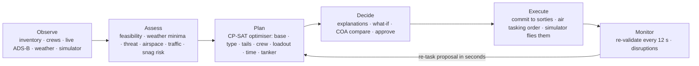

# Air Operations Picture: how it solves SIH26250

**Problem statement SIH26250: Air Power: Dynamic Air Operations & Resource Optimisation.**
Branch `phase2-decision-support`. Every number below comes from the repository's own tests and benchmark on
SIMULATED data ([BENCHMARK](BENCHMARK.md), [MODEL_CARD_SNAG_RISK](MODEL_CARD_SNAG_RISK.md)).

---

## 1. The problem in one paragraph

Planning and re-tasking air operations in a contested, fast-changing environment needs seven kinds of information at
once: **aircraft availability, crew status, weapon loads, airspace, weather, threats and mission priorities.** Today
they sit in separate systems. Without a common, real-time decision-support picture, planning is slow, changes ripple
through by phone and spreadsheet, and scarce air power is used poorly. No official dataset is provided.

So a solution must do four things:

1. **Fuse** the seven categories into one live picture.
2. **Plan**: turn mission requests into a feasible, priority-respecting allocation of bases, aircraft, crews and loads,
   fast.
3. **Re-task**: when the situation changes, repair the plan in seconds while changing as little as possible.
4. **Earn trust**: explain every recommendation, keep a person in charge, and prove it is faster and better than
   doing it by hand.

---

## 2. The solution at a glance

A web application for Air HQ, command HQs and base commanders. It runs one decision loop over a live picture of the
Indian Air Force's (synthetic) resources:



- **One picture.** A 3D map of India with official boundaries shows 75 IAF stations, 1,826 aircraft, 3,821 aircrew,
  fuel and stores, air defence and radar, live civil and military ADS-B, weather and threat zones. Drill-down panels
  cover each base, pilot and alert.
- **One planner.** For the next 24 hours it assigns every mission a base, aircraft type, specific tails, specific crew,
  a generic loadout, a launch time and (if needed) a tanker. It covers P1 first, then P2, P3, P4, then the chosen
  preset (balanced, maximum coverage, minimum risk, minimum fuel). The seeded day plans in about 3 s.
- **One monitor.** The committed plan is re-checked against the live (simulated) world every 12 s. Anything that
  breaks it (an unserviceable tail, a closed runway, a weather front, a new P1, a lost tanker) becomes a re-task
  proposal in seconds, which a person approves.
- **One audit trail.** Nothing reaches the sortie tables without an audited human approval.

---

## 3. Requirement by requirement

| # | What SIH26250 needs | How the system does it | Evidence |
|---|---|---|---|
| PS-1 | Fuse **all seven data categories** into one model and picture | See §3.1: every category is in the database, on the map and used by the planner | Data model §10; tests |
| PS-2 | A **real-time** picture | Live public feeds (ADS-B, METAR/TAF, forecasts, wind) plus a tick simulator: sorties launch, fly their routes, burn fuel, recover; aircraft go unserviceable and come back; crews rest. WebSocket push to every screen | 30 simulated hours at ×90 with invariant checks: 0 violations |
| PS-3 | **Decision support for planning** | Feasibility for every mission × base × type × time, then a CP-SAT optimiser, then tail and crew assignment, then an independent validator, then explanations | 0 validator violations in 35 benchmark plans |
| PS-4 | **Dynamic re-tasking** | Monitor every 12 s; repair escalates from swapping tails/crew, to re-solving only the affected missions, to a full re-plan with a stability bonus. Also divert advice, in-flight re-roling of an airborne package for an urgent pop-up, and knock-on repairs | Runway closure: proposal in 0.7–3.4 s, 81 % of the plan untouched. Pop-up P1: 0.2–0.5 s |
| PS-5 | **Optimal use of scarce air power** | Lexicographic objective (no P2 is ever bought with a P1); QRA reserve kept; fleet-hours balancing; the most reliable tails go to P1/P2; tankers, launch waves, split missions and AEW&C dependencies make more missions flyable | CP-SAT matches or beats a greedy planner in 7 of 7 runs; surge day 131 vs 129 of 154 missions |
| PS-6 | **Contested environment**: threats and airspace shape plans | Generic threat bands along the de facto LoC / LAC and exercise threat injects (route risk ≤ the mission's limit); border standoff router; restricted / danger / training airspace with capacity; civil-traffic avoidance; optional import of published airspace (OpenAIP) | Router threads the 22 km Siliguri corridor; prohibited-area test |
| PS-7 | **Weather-aware planning** | Hourly forecast per base (Open-Meteo, synthetic fallback, exercise overrides). Launch and recovery checked against minima per crew instrument rating; night needs night / NVG crew | Weather-minima test; a forecast drop re-crews a package with an instrument-rated pilot |
| PS-8 | **Faster planning, measurable** against a manual baseline | Benchmark harness across seeds, seasons and a surge day; a greedy baseline; a timed **manual planning baseline** tool judged by the same rules | Seeded day 2.7 s by machine; manual sessions are recorded by the tool (§7) |
| PS-9 | **Trustworthy, human in the loop** | Every package explains itself (and its rejected alternatives); uncovered missions give reasons and checked fixes; approve, reject, override; full audit; the same deterministic plan on a rerun | Determinism 7 of 7; audit tests |
| PS-10 | **No official dataset**: build a realistic one | Deterministic generator: real public base locations and order of battle; every operational number synthetic and labelled SIMULATED; 90 days of sortie and maintenance history | Post-generation checks; checksum |
| PS-11 | **Training and wargaming** | Exercise mode: scenarios with timed injects (runway closed, weather front, threat zone, grounding, pop-up, fuel delay, radar down, unknown track), KPI samples, after-action report | Scenario test; AAR CSV and print view |

### 3.1 The seven data categories

| Category | Held as | Used by the planner as |
|---|---|---|
| **Aircraft availability** | Status per tail (available, standby, QRA, maintenance, AOG, depot), hours to inspection, turnaround, maintenance ETA, airframe hours, maintenance log | Free / busy intervals, QRA reserve, hours left, **predicted defect risk per tail** (snag-risk model) |
| **Crew status** | Duty, medical, currency per type, qualifications (night, NVG, mountain, formation lead, AAR, …), instrument rating, rest, 7-day fatigue | Eligible-pilot pools by qualification and rating, 10 h rest after recovery, assignment of named crew |
| **Weapon loads** | Generic loadouts (category counts, e.g. AAM-BVR ×4) per aircraft family; stock per base and category | Loadout per mission and type; stock never over-drawn at any moment; reserved on commit, expended on ranges |
| **Airspace** | Training areas, ranges, restricted areas, temporary reservations, optional published airspace, live civil traffic | Restricted areas never crossed; zone capacity; civil-traffic cost; runway launch rate |
| **Weather** | METAR/TAF live; hourly base forecast 72 h | Flight category at launch and recovery vs crew rating; night; recovery-base diverts |
| **Threats** | Generic risk bands along the de facto LoC / LAC; exercise threat zones; neighbour bases; unknown tracks | Route risk ≤ mission limit; border standoff (25 km from Pakistan / China) |
| **Mission priorities** | Missions P1–P4 with window, area, aircraft, time on station, roles, quals, risk limit, dependencies, parts | Lexicographic objective; dependencies and part groups as constraints |

---

## 4. How it works

### 4.1 The decision engine (`backend/app/decide/`)

1. **Snapshot** (`snapshot.py`) is the planner's one view of the world: bases, runways, aircraft, crews, fuel, stock,
   weather, airspace, threats, the committed plan, the snag-risk model and civil traffic. What-if analysis plans on a
   copy and never writes.
2. **Feasibility** (`feasibility.py`) checks every mission × base × type: eligible role, loadout, aircraft count,
   launch rate (big packages take off in up to 3 waves), border-safe route, range and endurance (adding a tanker if
   that closes the gap), restricted airspace, threat risk, time window, runway, weather minima at both ends,
   qualified crew, weapons and fuel. It keeps the best few options and records why every other option failed.
3. **Optimiser** (`optimiser.py`, OR-Tools CP-SAT) chooses at most one option per mission:
   - **Constraints:** aircraft and crew capacity over time, QRA reserve, airspace capacity, weapons at any moment,
     fuel, launches per runway slot, AEW&C dependencies, and split-mission parts all or nothing.
   - **Objective:** maximise P1 coverage, then P2, P3, P4, then the preset's cost (transit, risk, fuel, weather,
     reserve, civil traffic, stability).
4. **Assignment** (`assign.py`) names the tails and crew. P1/P2 packages get the tails least likely to go
   unserviceable; otherwise fleet hours are balanced, and currency-lapsing pilots fly first.
5. **Validator** (`validate.py`) re-derives every rule independently. If it rejects something, that option is
   forbidden and the model is re-solved. A final fill pass recovers anything detailed crewing lost and may displace up
   to two lower-priority packages for a P1/P2.
6. **Explanations** (`explain.py`):
   - **Per package:** transit, weather, risk, night, qualifications, tanker, waves, fuel and weapons impact, snag
     risk, civil traffic, dependency, binding constraints, and the alternatives that lost and why.
   - **Per uncovered mission:** reasons nearest-base first, and *checked* fixes (move the window, add aircraft, raise
     priority, split into reliefs or across bases).
7. **Commit** (`store.py`) turns a plan into sorties: kept, swapped, moved, new, diverted, re-roled or dropped. It
   reserves weapons, repairs packages whose tails went unserviceable since planning, and writes the audit trail.
8. **Re-tasking** (`retask.py`, `monitor.py`) re-validates the committed plan every 12 s and proposes the cheapest
   repair.

### 4.2 Beyond plain allocation

- **Air-to-air refuelling:** a package that can't reach or hold gets a tanker (base, meeting point and window, crew,
  fuel), which becomes its own sortie.
- **AEW&C dependencies:** a barrier CAP flies only while its AEW&C orbit is on station. Losing the AEW&C sortie
  re-plans both.
- **Split missions:** a 6 h patrol no package can hold becomes reliefs with 15-minute handovers. A surge no base can
  field becomes parts from several bases on station together. Both are offered as checked fixes that a planner
  applies with one click.
- **Launch waves:** big packages take off over successive 15-minute slots and join up.
- **In-flight re-roling:** an urgent P1 the ground can't reach in time takes an airborne lower-priority package with
  the right load and fuel. The simulator then flies the new route from where the aircraft is.
- **Predictive maintenance:** a logistic snag-risk model is learned from the maintenance log only. On held-out
  sorties it scores AUC 0.74, close to the 0.76 ceiling of the simulator's own law and above 0.68 for a
  hours-since-maintenance rule. It is calibrated by tenths. It drives tail choice, explanations, expected-defect
  forecasts and a model card with a retrain button.
- **Civil-traffic deconfliction:** busy terminal areas and live ADS-B density make a route cost more. It is never a
  hard rule; explanations say where to coordinate with ATC.
- **Air tasking order:** a printable order for the theatre or per base, with a briefing card per package
  (callsigns, tails, crew, times in Zulu and IST, waypoints, loadout, tanker meeting point, notes) and CSV.
- **What-if and COA comparison:**
  - **What-if deltas:** ground a fleet, close a runway, weather front, threat zone, mission surge, fuel shortfall,
    base attack.
  - **COA comparison:** two or three presets side by side.
- **Forecasts:** 72 h per base (aircraft free, pilots free, fuel to reserve, weather).

### 4.3 Stack

| Layer | Technology |
|---|---|
| Backend | FastAPI, SQLAlchemy 2, PostgreSQL 17 + PostGIS 3.5, OR-Tools CP-SAT 9.15, NumPy |
| Frontend | React 18, TypeScript (strict), Vite, MapLibre GL 5 (3D terrain), TanStack Query, Zustand |
| Theme | Navy and neon blue, B612 fonts; violet marks simulated data |
| Live data | adsb.lol / adsb.fi / OpenSky, AviationWeather METAR/TAF, Open-Meteo, GFS/ECMWF wind |
| Deployment | `docker compose --profile full up -d --build` (database, API, web on :8080, wind); Windows and macOS scripts for development |

---

## 5. Measured results

From [BENCHMARK](BENCHMARK.md): 3 seeds × 2 seasons (October late morning, January fog-season dawn) plus a 2.5× surge
day, one solver worker, fixed seed.

| Measure | Result | Target |
|---|---|---|
| Missions covered, normal days | **89.2 %** (P1 91 %, P2 86 %, P3 88 %, P4 96 %) | |
| Validator violations | **0** in 35 plans | 0 |
| Time to plan, normal day (cold cache included) | **2.4–6.9 s**; seeded day 2.7 s | < 10 s |
| Same plan on a second run (one worker, fixed seed) | **7 of 7** | always |
| Optimiser vs greedy on the same options | better in 2, equal in 5, **never worse**; +3 missions | ≥ greedy |
| Surge day (154 missions) | **131 covered** (greedy 129) in 16 s | |
| Re-task proposal, runway closure | **0.7–3.4 s**, 81 % of the plan untouched | ≤ 15 s |
| Re-task proposal, pop-up P1 | **0.2–0.5 s**, 98 % untouched | ≤ 15 s |
| Snag-risk model, held-out AUC | **0.74** (ceiling 0.76, simple rule 0.68), top 10 % riskiest tails 3.4× the average | > rule |
| Simulator soak | 30 simulated hours, **0** invariant violations | 0 |
| Automated tests | **36** backend + **7** frontend unit + browser smoke test | all pass |

Uncovered missions are genuinely uncoverable in the horizon (out of range, no workable weather, threat above the
mission's limit, resources needed by higher priorities), and each one says so with a fix.

---

## 6. Trust, safety and compliance

- **Human in the loop:**
  - Recommendations are advisory; commits, re-task proposals, splits and overrides all need an audited approval.
  - Role-based access: Admin, Air HQ / Command HQ planners, base commanders (their own base), viewers.
- **Explainable:** every package lists why it was chosen and why the alternatives lost; every uncovered mission lists
  reasons and checked fixes.
- **Independent checks:**
  - The validator never trusts the optimiser.
  - The snag-risk model never sees the simulator's defect law; only the model-card tool compares against it.
  - Validator and optimiser share one definition of every limit.
- **Deterministic:** the same snapshot and seed give the same plan.
- **Synthetic data, clearly labelled:**
  - Base names and locations are public; everything inside a base is generated.
  - Every operational screen carries a SIMULATED badge; all people are fictional.
- **Border depiction:**
  - Official GoI boundaries on the map.
  - Planning uses the de facto LoC / LAC so no synthetic site or mission lands across it.
  - 25 km standoff from Pakistan and China.
- **No sensitive collation:**
  - Threats are generic bands, not real systems.
  - Loadouts are generic categories, not real stores.
  - Published airspace is optional and attributed.

---

## 7. Demo script (each under a minute)

1. **"Plan the next 24 hours: is every P1 covered?"** Planner → Generate. Read the KPI strip.
2. **"Why this base for CAP-WAC-006, and what lost?"** Open the package: "Why this package", alternatives.
3. **"What's uncovered and what would fix it?"** Open an uncovered mission: reasons, then checked fixes.
4. **"Nobody can hold a 6-hour CAP."** Its fix is "Split into 2 reliefs": Apply, re-plan, two packages with a handover.
5. **"A runway just closed."** Exercise inject → re-task proposal in seconds → Changes tab → Commit.
6. **"A P1 pop-up 20 minutes away."** If the ground can't make it, an airborne package is offered as re-roled in flight.
7. **"What if 20 Su-30MKI are grounded tomorrow?"** What-if, then compare with the baseline.
8. **"Which tails will go unserviceable?"** Base panel → Snag risk; the package explanation shows tail risk.
9. **"Give Halwara its orders."** Air tasking order → base VIHX → Print.
10. **"How much faster than by hand?"** Planner → Manual baseline: a planner tries it against the clock, then the
    optimiser on the same snapshot.

---

## 8. Running it

```bash
docker compose --profile full up -d --build    # any OS with Docker; first start ~10 min (boundaries + seed)
# http://localhost:8080 — demo users and password in .env.example (airhq = Air HQ planner, admin = directing staff)
```
Developers on Windows: `scripts\setup.ps1`, then `scripts\dev.ps1` (web :5173), `scripts\check.ps1` (all tests).
`python -m app.bench` regenerates the benchmark.

---

## 9. Limitations and what remains

| Item | Status |
|---|---|
| Manual planning sessions with real planners | The tool and the report section are ready. **The team needs to run sessions** so the benchmark can show human time beside machine time |
| Published airspace | The OpenAIP importer is built and tested. **Needs a free OpenAIP API key** or an export; synthetic zones are used until then |
| Generic threat bands and loadouts | **Organiser sign-off** on acceptability before the finale |
| Public base / squadron facts | Some curated rows still carry VERIFY flags; **check against the cited public sources** before the finale |
| Real data | Everything operational is synthetic by design; real integration would replace the generator with the service's systems behind the same snapshot |
| Very large surges | 150+ missions plan in about 16 s on one solver worker and re-task within 15 s. The running app already solves with 8 workers (`SOLVER_WORKERS` in `decide/config.py`); the benchmark uses 1 so that results are reproducible |

---

## Appendix: where to read more

- [PRD §17](PRD.md#17-phase-2-decision-support-sih26250-dynamic-air-operations-and-resource-optimisation): requirements
  FR-MSN, FR-PLN, FR-RTK, FR-XPL, FR-FCT, FR-WIF, FR-EXR.
- [ARCHITECTURE §18](ARCHITECTURE.md#18-decision-records-short): decision records D1–D47 (D28–D47 for decision
  support).
- [DATA_MODEL §10](DATA_MODEL.md#10-phase-2-tables-decision-support): Phase 2 tables and invariants I13–I22.
- [PHASE2_IMPLEMENTATION_PLAN](PHASE2_IMPLEMENTATION_PLAN.md): design, status and measured results.
- [BENCHMARK](BENCHMARK.md), [MODEL_CARD_SNAG_RISK](MODEL_CARD_SNAG_RISK.md).
